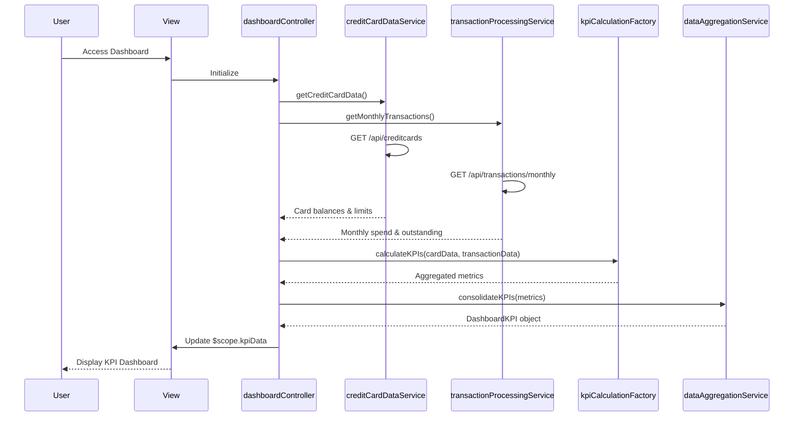

# Low-Level Design: QE-8516 - Dashboard and KPI Monitoring

## a. Architecture Mapping

- **Dashboard Controller** → AngularJS Controller (`dashboardController.js`)
- **Credit Card Data Service** → AngularJS Service (`creditCardDataService.js`)
- **Transaction Processing Service** → AngularJS Service (`transactionProcessingService.js`)
- **KPI Calculation Engine** → AngularJS Factory (`kpiCalculationFactory.js`)
- **Data Aggregation Layer** → AngularJS Service (`dataAggregationService.js`)
- **User Interface** → HTML5 View (`dashboard.html`) with Bootstrap styling

**Recommended Folder Structure:**
```
/app
  /modules
    /dashboard
      /controllers
      /services
      /factories
      /views
      /styles
```

## b. Component Specifications

| Name | Artifact Type | Responsibility | Key Dependencies |
|------|---------------|----------------|------------------|
| dashboardController | Controller | Orchestrates dashboard data flow, manages KPI display state | creditCardDataService, transactionProcessingService, kpiCalculationFactory, $scope, $timeout |
| creditCardDataService | Service | Fetches card balances and credit limits via REST API | $http, $q, apiConfig |
| transactionProcessingService | Service | Retrieves monthly spend and outstanding amounts via REST API | $http, $q, apiConfig |
| kpiCalculationFactory | Factory | Aggregates metrics (total credit limit, available credit, total outstanding) | None |
| dataAggregationService | Service | Consolidates KPI data for dashboard rendering | kpiCalculationFactory |
| dashboardView | HTML5 View | Renders responsive dashboard with Bootstrap grid layout | Bootstrap CSS, AngularJS directives |

## c. Data Model

```javascript
// Dashboard KPI Model
const DashboardKPI = {
  monthlySpend: Number,           // Current month's total spend
  totalCreditLimit: Number,       // Sum of all card limits
  availableCredit: Number,        // Total available credit across cards
  outstandingAmount: Number,      // Total outstanding balance
  lastUpdated: Date,              // Timestamp of last data refresh
  cards: Array                    // Array of CreditCard objects
};

// Credit Card Model
const CreditCard = {
  cardId: String,
  cardNumber: String,
  balance: Number,
  creditLimit: Number,
  availableCredit: Number
};
```

## d. Data Flow

User accesses dashboard view → dashboardController initializes and calls creditCardDataService and transactionProcessingService concurrently → Services make REST API calls to backend endpoints → Responses are passed to kpiCalculationFactory which computes aggregated metrics → dataAggregationService consolidates KPI data into DashboardKPI model → Controller updates $scope with KPI data → View renders responsive dashboard with real-time KPI display using Bootstrap cards and AngularJS data binding, with $timeout for periodic refresh every 30 seconds.

## e. Primary Sequence Diagram



## f. Implementation Notes

- Use AngularJS dependency injection for all services, factories, and controllers; register module as `angular.module('dashboard', [])`.
- Implement REST API calls using `$http` service with promise-based error handling; use `$q.all()` for concurrent data fetching.
- Apply ES6 arrow functions and const/let for cleaner code; use template literals for API endpoint construction.
- Utilize Bootstrap 3.x grid system (col-md-3 for KPI cards) for responsive layout; implement ng-repeat for dynamic card rendering.
- Implement auto-refresh using `$timeout` service with 30-second interval; cancel timeout on scope destruction to prevent memory leaks.

## g. Error Handling

HTTP interceptor captures API errors; controller displays user-friendly error messages via Bootstrap alerts; retry logic with exponential backoff for transient failures.

## h. Security Notes

Requires token-based auth via existing SSO; include auth token in HTTP headers for all API calls; validate user session before data retrieval.