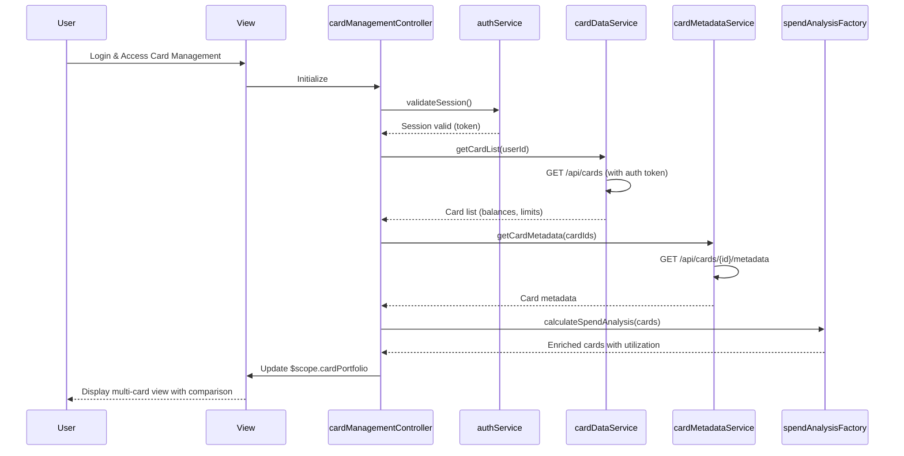

# Low-Level Design: QE-8517 - Multi-Card Management and Viewing

## a. Architecture Mapping

- **Card Management Controller** → AngularJS Controller (`cardManagementController.js`)
- **User Authentication Service** → AngularJS Service (`authService.js`)
- **Credit Card Data Repository** → AngularJS Service (`cardDataService.js`)
- **Card Metadata Service** → AngularJS Service (`cardMetadataService.js`)
- **Spend Analysis Module** → AngularJS Factory (`spendAnalysisFactory.js`)
- **User Interface** → HTML5 View (`card-management.html`) with Bootstrap styling

**Recommended Folder Structure:**
```
/app
  /modules
    /card-management
      /controllers
      /services
      /factories
      /views
      /directives
      /styles
```

## b. Component Specifications

| Name | Artifact Type | Responsibility | Key Dependencies |
|------|---------------|----------------|------------------|
| cardManagementController | Controller | Manages multi-card view state, handles card selection and comparison | authService, cardDataService, cardMetadataService, spendAnalysisFactory, $scope |
| authService | Service | Validates user authentication and manages session tokens | $http, $window, $q |
| cardDataService | Service | Retrieves card information (balances, limits) via REST API | $http, $q, apiConfig, authService |
| cardMetadataService | Service | Fetches card metadata (type, issuer, branding) via REST API | $http, $q, apiConfig |
| spendAnalysisFactory | Factory | Calculates card-wise spending patterns and utilization percentages | None |
| cardComparisonDirective | Directive | Renders card comparison table with sortable columns | spendAnalysisFactory |

## c. Data Model

```javascript
// Credit Card Model
const CreditCard = {
  cardId: String,
  cardNumber: String,              // Masked (e.g., **** **** **** 1234)
  cardType: String,                // Visa, Mastercard, Amex
  issuer: String,
  balance: Number,
  creditLimit: Number,
  availableCredit: Number,
  utilizationPercent: Number,
  monthlySpend: Number,
  metadata: Object                 // Card-specific details
};

// Card Portfolio Model
const CardPortfolio = {
  userId: String,
  cards: Array,                    // Array of CreditCard objects (max 10)
  totalCards: Number,
  lastSyncTime: Date
};
```

## d. Data Flow

User logs in → authService validates credentials and stores session token → cardManagementController requests card list for authenticated user → cardDataService makes GET /api/cards REST call with auth header → cardMetadataService enriches card data with metadata via GET /api/cards/{id}/metadata → spendAnalysisFactory calculates utilization % and spending patterns for each card → Controller updates $scope.cardPortfolio with CardPortfolio model → View renders multi-card grid using Bootstrap cards with ng-repeat, displaying individual card details with click-to-expand for detailed view and comparison functionality via cardComparisonDirective.

## e. Primary Sequence Diagram



## f. Implementation Notes

- Register module as `angular.module('cardManagement', [])` with DI for all artifacts; use controller-as syntax for cleaner scope management.
- Implement authService using localStorage for token persistence; include token in $http default headers via interceptor.
- Use $q.all() to fetch card metadata concurrently for all cards; implement caching in cardMetadataService to reduce API calls.
- Create reusable cardComparisonDirective with isolated scope; use Bootstrap table-responsive for comparison view.
- Apply ES6 features: arrow functions, destructuring, template literals for API endpoints; use Array.map() for data transformation.

## g. Error Handling

HTTP interceptor-based error handling with try/catch in controllers; display Bootstrap toast notifications for API failures; fallback to cached data if available.

## h. Security Notes

Requires token-based auth via existing SSO; validate session before each API call; mask sensitive card numbers in UI (show last 4 digits only).