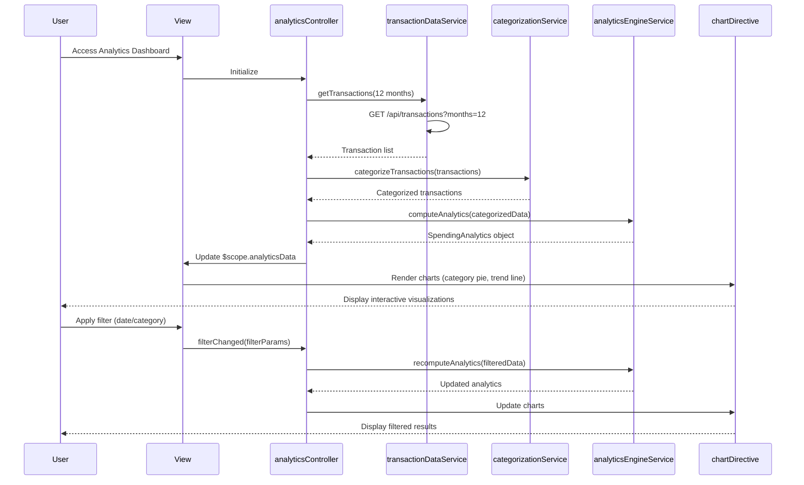

# Low-Level Design: QE-8518 - Spending Analytics and Insights

## a. Architecture Mapping

- **Analytics Controller** → AngularJS Controller (`analyticsController.js`)
- **Transaction Categorization Service** → AngularJS Service (`categorizationService.js`)
- **Data Analytics Engine** → AngularJS Service (`analyticsEngineService.js`)
- **Visualization Library** → External Library (Chart.js) + AngularJS Directive (`chartDirective.js`)
- **Transaction Data Repository** → AngularJS Service (`transactionDataService.js`)
- **User Interface** → HTML5 View (`analytics.html`) with Bootstrap layout

**Recommended Folder Structure:**
```
/app
  /modules
    /analytics
      /controllers
      /services
      /directives
      /views
      /styles
```

## b. Component Specifications

| Name | Artifact Type | Responsibility | Key Dependencies |
|------|---------------|----------------|------------------|
| analyticsController | Controller | Manages analytics view state, handles filter interactions and drill-down | transactionDataService, categorizationService, analyticsEngineService, $scope, $filter |
| transactionDataService | Service | Fetches historical transaction data (12+ months) via REST API | $http, $q, apiConfig |
| categorizationService | Service | Classifies transactions into 9 predefined categories | $http, $q |
| analyticsEngineService | Service | Computes monthly trends, aggregations, and spending patterns | None |
| chartDirective | Directive | Wraps Chart.js for rendering interactive category and trend charts | Chart.js library |
| filterPanel | Directive | Provides date range and category filter UI with Bootstrap form controls | $filter |

## c. Data Model

```javascript
// Transaction Model
const Transaction = {
  transactionId: String,
  cardId: String,
  amount: Number,
  category: String,               // Food & Dining, Fuel, Shopping, Travel, Entertainment, Utilities, Healthcare, Education, Miscellaneous
  merchant: String,
  transactionDate: Date,
  description: String
};

// Analytics Data Model
const SpendingAnalytics = {
  categoryBreakdown: Array,       // [{category: String, amount: Number, percentage: Number}]
  monthlyTrends: Array,           // [{month: String, totalSpend: Number, categorySpends: Object}]
  dateRange: Object,              // {startDate: Date, endDate: Date}
  totalSpend: Number,
  transactionCount: Number
};
```

## d. Data Flow

User accesses analytics view → analyticsController calls transactionDataService to fetch 12 months of transaction history via GET /api/transactions?months=12 → categorizationService classifies each transaction into one of 9 categories (Food & Dining, Fuel, Shopping, Travel, Entertainment, Utilities, Healthcare, Education, Miscellaneous) → analyticsEngineService computes category-wise aggregations and monthly trend data → Controller updates $scope.analyticsData with SpendingAnalytics model → chartDirective renders interactive Chart.js visualizations (pie chart for category breakdown, line chart for monthly trends) → User applies filters via filterPanel directive → Controller re-computes analytics and updates charts with filtered data, supporting drill-down into specific categories.

## e. Primary Sequence Diagram



## f. Implementation Notes

- Register module as `angular.module('analytics', [])` with DI; use Chart.js 2.x via angular-chart.js wrapper for AngularJS integration.
- Implement transactionDataService with response caching using $cacheFactory to avoid redundant API calls; use pagination for large datasets.
- Use ES6 Array methods (filter, map, reduce) in analyticsEngineService for efficient data aggregation; apply memoization for repeated calculations.
- Create chartDirective with isolated scope and two-way binding for chart data; implement responsive: true in Chart.js config for mobile support.
- Use Bootstrap grid (col-md-6 for side-by-side charts) and panel components for layout; implement ng-show/ng-hide for conditional rendering based on data availability.

## g. Error Handling

HTTP interceptor captures API errors; controller uses try/catch with user-friendly error messages via Bootstrap alert components; graceful degradation if categorization service fails.

## h. Security Notes

Standard input validation and secure API calls assumed; requires token-based auth for transaction data access; sanitize user inputs in filter panel to prevent XSS.