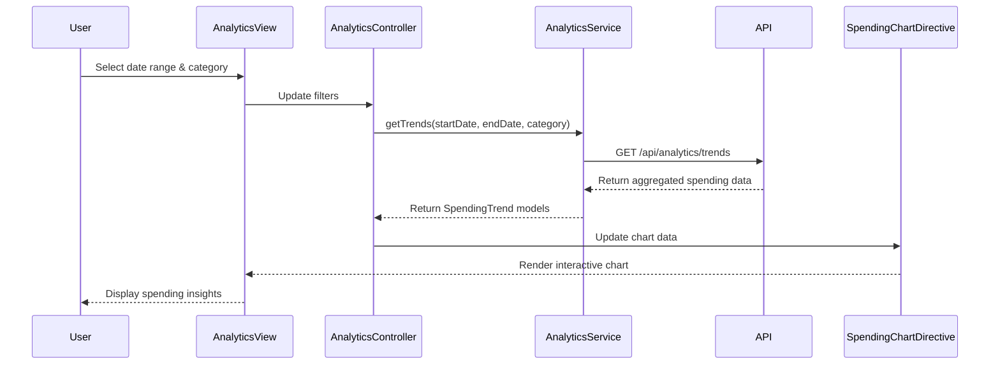

# Low-Level Design: Analytics and Spending Insights
**Epic ID:** QE-8519

## a. Architecture Mapping

- **AnalyticsModule** (ng-module) → Main module for analytics feature
- **AnalyticsController** → Manages analytics dashboard view state and user interactions
- **AnalyticsService** → Fetches spending data and trends from REST API
- **CategoryService** → Handles category classification and filtering logic
- **SpendingChartDirective** → Renders interactive monthly trend and category charts
- **TransactionFactory** → Manages transaction data models and transformations

**Folder Structure:**
```
/app
  /modules
    /analytics
      /controllers (AnalyticsController.js)
      /services (AnalyticsService.js, CategoryService.js)
      /directives (SpendingChartDirective.js)
      /factories (TransactionFactory.js)
      /views (analytics-dashboard.html)
      /styles (analytics.css)
```

## b. Component Specifications

| Component | Artifact Type | Responsibility | Key Dependencies |
|-----------|--------------|----------------|------------------|
| AnalyticsModule | Module | Registers analytics feature components and routing | ngRoute, chart.js |
| AnalyticsController | Controller | Manages view state, date range selection, category filters | AnalyticsService, CategoryService, $scope |
| AnalyticsService | Service | Fetches monthly trends and category spending via REST API | $http, $q, API_CONFIG |
| CategoryService | Service | Provides category list (9 categories), applies filters | TransactionFactory |
| SpendingChartDirective | Directive | Renders interactive line/bar charts for trends and categories | chart.js, $timeout |
| TransactionFactory | Factory | Models transaction objects with category, amount, date | None |

## c. Data Model

**Transaction Model:**
```javascript
{
  id: String,
  cardId: String,
  amount: Number,
  date: Date,
  category: String, // One of 9 categories
  merchant: String,
  description: String
}
```

**SpendingTrend Model:**
```javascript
{
  month: String, // YYYY-MM
  totalSpend: Number,
  categoryBreakdown: Object // { category: amount }
}
```

**Category Enum:**
```javascript
['Food & Dining', 'Fuel', 'Shopping', 'Travel', 'Entertainment', 'Utilities', 'Healthcare', 'Education', 'Miscellaneous']
```

## d. Data Flow

User selects date range or category filter → AnalyticsController captures input and calls AnalyticsService.getTrends() → Service sends GET request to `/api/analytics/trends?startDate=X&endDate=Y` → API returns aggregated spending data from Transaction Data Warehouse → CategoryService enriches response with category metadata → TransactionFactory transforms raw data into SpendingTrend models → Controller updates $scope.trendData → SpendingChartDirective watches scope changes and re-renders interactive charts using Chart.js → User interacts with chart (hover, click) to drill down into specific months or categories.

## e. Primary Sequence Diagram



## f. Implementation Notes

- Use AngularJS 1.x Dependency Injection to inject services into controllers via constructor parameters
- Leverage ES6 classes for services and factories with Babel transpilation for browser compatibility
- Integrate Chart.js library via directive with two-way data binding to scope for reactive updates
- Implement REST API calls using $http service with promise-based error handling ($q)
- Apply Bootstrap grid system for responsive chart layout across devices

## g. Error Handling

HTTP interceptor captures API errors (4xx/5xx), displays user-friendly notifications via toastr, and logs to console; service methods use try/catch with promise rejection.

## h. Security Notes

Standard input validation and secure API calls assumed; date range inputs sanitized to prevent injection attacks.