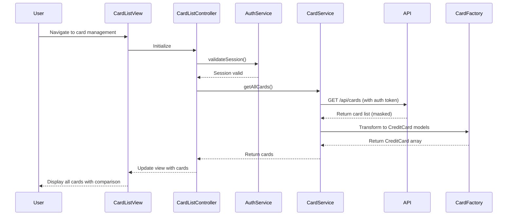

# Low-Level Design: Multi-Card Management and Tracking
**Epic ID:** QE-8520

## a. Architecture Mapping

- **CardManagementModule** (ng-module) → Main module for card management feature
- **CardListController** → Manages card list view and comparison logic
- **CardDetailController** → Handles individual card detail view
- **CardService** → Fetches card data and spending analysis from REST API
- **AuthService** → Manages user authentication and session validation
- **CardMaskFilter** → Custom filter to mask card numbers (show last 4 digits)
- **CardFactory** → Models credit card objects with limits and balances

**Folder Structure:**
```
/app
  /modules
    /card-management
      /controllers (CardListController.js, CardDetailController.js)
      /services (CardService.js, AuthService.js)
      /filters (CardMaskFilter.js)
      /factories (CardFactory.js)
      /views (card-list.html, card-detail.html)
      /styles (card-management.css)
```

## b. Component Specifications

| Component | Artifact Type | Responsibility | Key Dependencies |
|-----------|--------------|----------------|------------------|
| CardManagementModule | Module | Registers card management components and routing | ngRoute, AuthService |
| CardListController | Controller | Displays all user cards, handles comparison and sorting | CardService, $scope, $filter |
| CardDetailController | Controller | Shows detailed view for single card with spending breakdown | CardService, $routeParams |
| CardService | Service | Fetches card list, details, and card-wise spending via REST API | $http, AuthService, API_CONFIG |
| AuthService | Service | Validates user session and provides auth token for API calls | $http, $window (localStorage) |
| CardMaskFilter | Filter | Masks card number to show only last 4 digits | None |
| CardFactory | Factory | Models CreditCard objects with limit, balance, spending attributes | None |

## c. Data Model

**CreditCard Model:**
```javascript
{
  cardId: String,
  cardNumber: String, // Encrypted, masked on display
  cardType: String, // Visa, MasterCard, Amex
  creditLimit: Number,
  availableCredit: Number,
  outstandingBalance: Number,
  cardWiseSpend: Number,
  expiryDate: String, // MM/YY
  cardHolderName: String
}
```

**CardComparison Model:**
```javascript
{
  cards: Array<CreditCard>,
  totalCreditLimit: Number,
  totalAvailableCredit: Number,
  totalOutstanding: Number
}
```

## d. Data Flow

User navigates to card management page → CardListController calls AuthService.validateSession() → If valid, controller invokes CardService.getAllCards() → Service sends GET request to `/api/cards` with auth token in header → API queries Credit Card Master Data Repository and Transaction Service → API returns array of card objects with masked card numbers → CardFactory transforms response into CreditCard models → Controller updates $scope.cards → View renders card list using ng-repeat with CardMaskFilter applied → User clicks card for details → CardDetailController fetches card-specific spending via CardService.getCardDetails(cardId) → Detailed view displays card metrics and spending analysis.

## e. Primary Sequence Diagram



## f. Implementation Notes

- Use AngularJS DI to inject CardService and AuthService into controllers
- Store auth token in localStorage via $window service; attach token to $http headers using interceptor
- Implement CardMaskFilter as custom AngularJS filter to display last 4 digits (e.g., **** **** **** 1234)
- Use ES6 classes for services with arrow functions for promise chaining
- Apply Bootstrap card components for responsive card display grid

## g. Error Handling

HTTP interceptor handles 401 (redirect to login), 403 (access denied notification), and 5xx errors (generic error message); service methods use promise rejection with user-facing alerts.

## h. Security Notes

Requires token-based auth via existing SSO; card numbers stored encrypted and masked on display; all API calls use HTTPS with auth token in Authorization header.