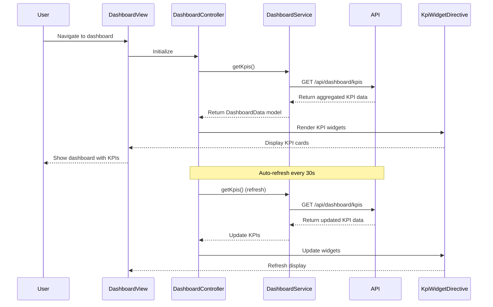

# Low-Level Design: Dashboard and KPI Management
**Epic ID:** QE-8521

## a. Architecture Mapping

- **DashboardModule** (ng-module) → Main module for dashboard feature
- **DashboardController** → Manages dashboard view state and KPI refresh logic
- **DashboardService** → Fetches aggregated KPI data from REST API
- **KpiWidgetDirective** → Reusable directive for rendering individual KPI cards
- **RefreshService** → Handles real-time data refresh with configurable intervals
- **KpiFactory** → Models KPI objects with value, label, and trend attributes

**Folder Structure:**
```
/app
  /modules
    /dashboard
      /controllers (DashboardController.js)
      /services (DashboardService.js, RefreshService.js)
      /directives (KpiWidgetDirective.js)
      /factories (KpiFactory.js)
      /views (dashboard.html)
      /styles (dashboard.css)
```

## b. Component Specifications

| Component | Artifact Type | Responsibility | Key Dependencies |
|-----------|--------------|----------------|------------------|
| DashboardModule | Module | Registers dashboard components and routing | ngRoute, $interval |
| DashboardController | Controller | Manages KPI data fetching, refresh triggers, and view state | DashboardService, RefreshService, $scope |
| DashboardService | Service | Fetches aggregated KPIs (monthly spend, credit limit, available credit, outstanding) via REST API | $http, $q, API_CONFIG |
| RefreshService | Service | Manages auto-refresh interval for real-time KPI updates | $interval, $rootScope |
| KpiWidgetDirective | Directive | Renders individual KPI card with value, label, icon, and trend indicator | KpiFactory |
| KpiFactory | Factory | Models KPI objects with value, label, trend (up/down), and formatting logic | None |

## c. Data Model

**KPI Model:**
```javascript
{
  label: String, // e.g., "Monthly Spend"
  value: Number,
  formattedValue: String, // e.g., "$1,234.56"
  trend: String, // 'up', 'down', 'neutral'
  trendPercentage: Number,
  icon: String // CSS class for icon
}
```

**DashboardData Model:**
```javascript
{
  monthlySpend: KPI,
  totalCreditLimit: KPI,
  availableCredit: KPI,
  outstandingAmount: KPI,
  lastUpdated: Date
}
```

## d. Data Flow

User navigates to dashboard → DashboardController initializes and calls DashboardService.getKpis() → Service sends GET request to `/api/dashboard/kpis` → API aggregates data from Credit Card Data Service (credit limits, balances) and Transaction Processing Service (monthly spend, outstanding amounts) → API returns consolidated KPI object → KpiFactory transforms raw values into KPI models with formatting and trend calculation → Controller updates $scope.dashboardData → KpiWidgetDirective renders each KPI card with animated counters → RefreshService triggers auto-refresh every 30 seconds via $interval → On refresh, service re-fetches KPIs and updates view without full page reload.

## e. Primary Sequence Diagram



## f. Implementation Notes

- Use AngularJS DI to inject DashboardService and RefreshService into DashboardController
- Implement KpiWidgetDirective with isolated scope for reusability across multiple KPI types
- Use $interval service for auto-refresh with cleanup on $scope.$on('$destroy') to prevent memory leaks
- Apply ES6 template literals for formatted KPI values (e.g., currency formatting)
- Use Bootstrap grid (col-md-3) for responsive 4-column KPI card layout

## g. Error Handling

HTTP interceptor captures API errors and displays toast notifications; service methods use promise chaining with .catch() for graceful degradation; failed refresh attempts log to console without blocking UI.

## h. Security Notes

Standard input validation and secure API calls assumed; auth token required for API access via existing SSO integration.