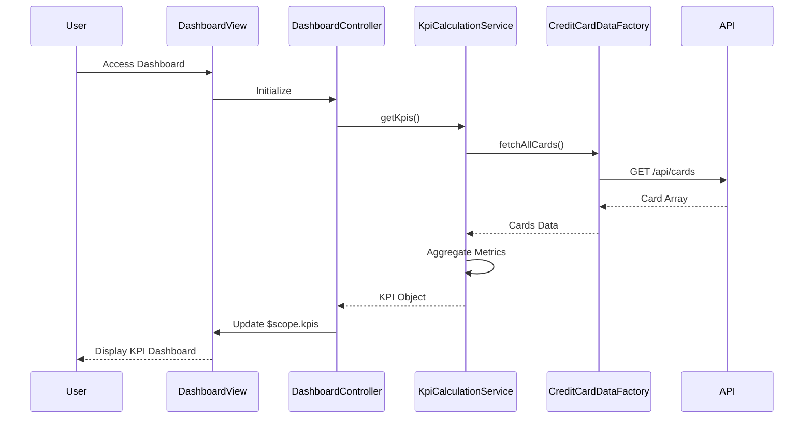

# Low-Level Design: Credit Card Dashboard and KPIs
**Epic ID:** QE-8522

## a. Architecture Mapping

- **Dashboard Module** → AngularJS Module (`app.dashboard`)
- **Dashboard Controller** → AngularJS Controller (`DashboardController`)
- **KPI Calculation Service** → AngularJS Service (`KpiCalculationService`)
- **Credit Card Data Service** → AngularJS Factory (`CreditCardDataFactory`)
- **Authentication Interceptor** → AngularJS HTTP Interceptor (`AuthInterceptor`)

**Folder Structure:**
```
/app
  /modules
    /dashboard
      dashboard.module.js
      dashboard.controller.js
      dashboard.html
  /services
    kpi-calculation.service.js
    credit-card-data.factory.js
  /interceptors
    auth.interceptor.js
  /models
    kpi.model.js
```

## b. Component Specifications

| Name | Artifact Type | Responsibility | Key Dependencies |
|------|---------------|----------------|------------------|
| DashboardModule | AngularJS Module | Registers dashboard components and routing | ui.router, ngAnimate |
| DashboardController | Controller | Manages dashboard UI state and KPI display | KpiCalculationService, CreditCardDataFactory, $scope |
| KpiCalculationService | Service | Aggregates and calculates KPI metrics across cards | CreditCardDataFactory, $q |
| CreditCardDataFactory | Factory | Fetches credit card details and balances via REST API | $http, $q, AuthInterceptor |
| AuthInterceptor | HTTP Interceptor | Attaches authentication tokens to API requests | $window, $q |
| KpiModel | ES6 Class | Represents KPI data structure with validation | None |

## c. Data Model

**KpiModel (ES6 Class):**
```javascript
{
  monthlySpend: Number,
  totalCreditLimit: Number,
  availableCredit: Number,
  outstandingAmount: Number,
  lastUpdated: Date,
  userId: String
}
```

**CreditCardModel:**
```javascript
{
  cardId: String,
  cardNumber: String (masked),
  balance: Number,
  creditLimit: Number,
  monthlySpend: Number
}
```

## d. Data Flow

User authenticates and navigates to dashboard → DashboardController initializes and calls KpiCalculationService → KpiCalculationService invokes CreditCardDataFactory to fetch all user cards via REST API (`GET /api/cards`) → AuthInterceptor attaches JWT token → API returns card array → KpiCalculationService aggregates metrics (sum of balances, limits, calculates available credit) → Calculated KPIs are cached in service and returned to controller → DashboardController binds KPI data to $scope → Dashboard view renders KPI widgets with Bootstrap responsive grid → Auto-refresh timer triggers periodic updates every 30 seconds.

## e. Primary Sequence Diagram



## f. Implementation Notes

- Use AngularJS 1.x with ES6 modules transpiled via Babel; leverage arrow functions and classes for cleaner code.
- Implement dependency injection via $inject annotation for minification safety.
- Use $http service with promise chaining; cache KPI data in service singleton for 30-second TTL to meet <2s load requirement.
- Bootstrap 3/4 responsive grid (col-xs/sm/md/lg) ensures mobile/tablet/desktop compatibility.
- Implement auto-refresh using $interval service; cancel on $scope.$on('$destroy') to prevent memory leaks.

## g. Error Handling

HTTP interceptor catches API errors; displays user-friendly notifications via toastr or Bootstrap alerts; logs errors to console.

## h. Security Notes

Requires token-based auth via existing SSO; AuthInterceptor attaches JWT to all API requests; secure card data transmission over HTTPS.