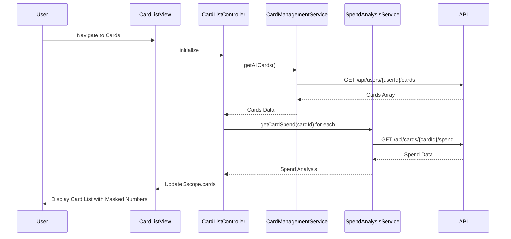

# Low-Level Design: Multiple Credit Card Management
**Epic ID:** QE-8523

## a. Architecture Mapping

- **Card Management Module** → AngularJS Module (`app.cardManagement`)
- **Card List Controller** → AngularJS Controller (`CardListController`)
- **Card Detail Controller** → AngularJS Controller (`CardDetailController`)
- **Card Management Service** → AngularJS Service (`CardManagementService`)
- **Spend Analysis Service** → AngularJS Service (`SpendAnalysisService`)
- **Card Filter** → AngularJS Filter (`cardMaskFilter`)

**Folder Structure:**
```
/app
  /modules
    /card-management
      card-management.module.js
      card-list.controller.js
      card-detail.controller.js
      card-list.html
      card-detail.html
  /services
    card-management.service.js
    spend-analysis.service.js
  /filters
    card-mask.filter.js
  /models
    credit-card.model.js
```

## b. Component Specifications

| Name | Artifact Type | Responsibility | Key Dependencies |
|------|---------------|----------------|------------------|
| CardManagementModule | AngularJS Module | Registers card management components and routes | ui.router, ngAnimate |
| CardListController | Controller | Manages card list display, filtering, and selection | CardManagementService, SpendAnalysisService, $scope |
| CardDetailController | Controller | Displays individual card details and spend analysis | CardManagementService, SpendAnalysisService, $stateParams |
| CardManagementService | Service | Fetches and manages credit card data via REST API | $http, $q, CreditCardModel |
| SpendAnalysisService | Service | Calculates per-card spending metrics and trends | $http, $q |
| cardMaskFilter | Filter | Masks card numbers showing only last 4 digits | None |
| CreditCardModel | ES6 Class | Represents credit card entity with validation | None |

## c. Data Model

**CreditCardModel (ES6 Class):**
```javascript
{
  cardId: String,
  userId: String,
  cardNumber: String,
  cardType: String,
  creditLimit: Number,
  outstandingBalance: Number,
  availableCredit: Number,
  expiryDate: String,
  isActive: Boolean
}
```

**CardSpendAnalysis:**
```javascript
{
  cardId: String,
  monthlySpend: Number,
  yearlySpend: Number,
  lastTransactionDate: Date,
  transactionCount: Number
}
```

## d. Data Flow

User navigates to card management interface → CardListController initializes and calls CardManagementService.getAllCards() → Service fetches user's cards via REST API (`GET /api/users/{userId}/cards`) → API returns array of up to 20 cards → Controller stores cards in $scope.cards → For each card, SpendAnalysisService.getCardSpend(cardId) is called asynchronously → Spend data is merged with card data → cardMaskFilter is applied in view to mask card numbers (show last 4 digits only) → User can filter/sort cards using ng-repeat filters → On card selection, state transitions to card detail view with cardId parameter → CardDetailController loads full card details and spend breakdown.

## e. Primary Sequence Diagram



## f. Implementation Notes

- Use ui.router for state management; define states for card list and card detail views.
- Implement pagination or virtual scrolling if card count exceeds 20 to maintain performance.
- Use $q.all() to batch spend analysis API calls for multiple cards; set timeout to meet 1-second retrieval requirement.
- Apply cardMaskFilter using AngularJS filter in view: `{{ card.cardNumber | cardMask }}` to show `****1234`.
- Store card data in service cache with 5-minute TTL; invalidate on card updates.

## g. Error Handling

HTTP interceptor-based error handling with user notifications; retry logic for failed API calls using exponential backoff.

## h. Security Notes

Card numbers encrypted at rest and in transit; display masked via filter; JWT-based authentication for all card API endpoints.