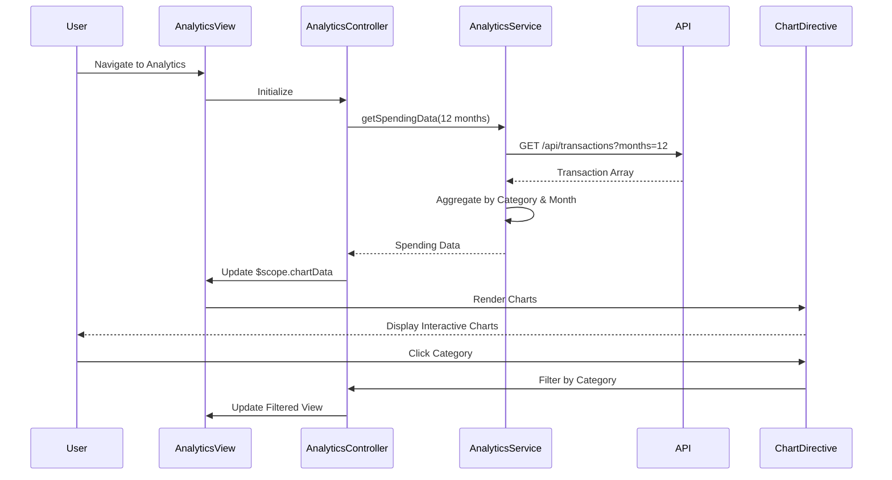

# Low-Level Design: Spending Analytics and Insights
**Epic ID:** QE-8524

## a. Architecture Mapping

- **Analytics Module** → AngularJS Module (`app.analytics`)
- **Analytics Controller** → AngularJS Controller (`AnalyticsController`)
- **Analytics Service** → AngularJS Service (`AnalyticsService`)
- **Chart Directive** → AngularJS Directive (`spendingChart`)
- **Category Filter** → AngularJS Filter (`categoryFilter`)

**Folder Structure:**
```
/app
  /modules
    /analytics
      analytics.module.js
      analytics.controller.js
      analytics.html
  /services
    analytics.service.js
  /directives
    spending-chart.directive.js
  /models
    spending-data.model.js
```

## b. Component Specifications

| Name | Artifact Type | Responsibility | Key Dependencies |
|------|---------------|----------------|------------------|
| AnalyticsModule | AngularJS Module | Registers analytics components and chart libraries | ui.router, chart.js, angular-chart.js |
| AnalyticsController | Controller | Manages analytics view state and user interactions | AnalyticsService, $scope, $filter |
| AnalyticsService | Service | Fetches transaction data and computes aggregations | $http, $q, SpendingDataModel |
| spendingChart | Directive | Renders interactive charts using Chart.js | chart.js, $timeout |
| categoryFilter | Filter | Filters transactions by category selection | None |
| SpendingDataModel | ES6 Class | Represents spending data with category and time dimensions | None |

## c. Data Model

**SpendingDataModel (ES6 Class):**
```javascript
{
  userId: String,
  transactions: Array<Transaction>,
  categoryBreakdown: Object,
  monthlyTrends: Array<MonthlySpend>
}
```

**Transaction:**
```javascript
{
  transactionId: String,
  cardId: String,
  amount: Number,
  category: String,
  date: Date,
  description: String
}
```

**CategoryBreakdown:**
```javascript
{
  "Food & Dining": Number,
  "Fuel": Number,
  "Shopping": Number,
  "Travel": Number,
  "Entertainment": Number,
  "Utilities": Number,
  "Healthcare": Number,
  "Education": Number,
  "Miscellaneous": Number
}
```

## d. Data Flow

User navigates to analytics dashboard → AnalyticsController calls AnalyticsService.getSpendingData(timeRange) → Service fetches categorized transactions via REST API (`GET /api/transactions?userId={userId}&months=12`) → API returns transaction array with pre-assigned categories → AnalyticsService aggregates data by category and month using reduce operations → Aggregated data is formatted for Chart.js (labels, datasets) → Controller updates $scope.chartData and $scope.categoryBreakdown → spendingChart directive watches chartData and renders interactive pie chart for categories and line chart for monthly trends → User interacts with charts (hover, click) to drill down → categoryFilter applied on user selection to show filtered transactions.

## e. Primary Sequence Diagram



## f. Implementation Notes

- Use angular-chart.js wrapper for Chart.js integration; configure responsive charts with maintainAspectRatio: true.
- Implement data aggregation in service using ES6 Array.reduce() for category summation and monthly grouping.
- Cache aggregated data in service for 10-minute TTL; use $http cache: true for API calls to meet 3-second render requirement.
- Directive uses isolated scope with two-way binding for chartData; watches data changes using $scope.$watch with deep comparison.
- Leverage Chart.js onClick and onHover events for interactive drill-down; emit custom events to controller for filtering.

## g. Error Handling

Try/catch blocks in service methods with fallback to empty datasets; user notified via toast on API failures.

## h. Security Notes

Standard input validation and secure API calls assumed; transaction data filtered by authenticated userId to prevent unauthorized access.