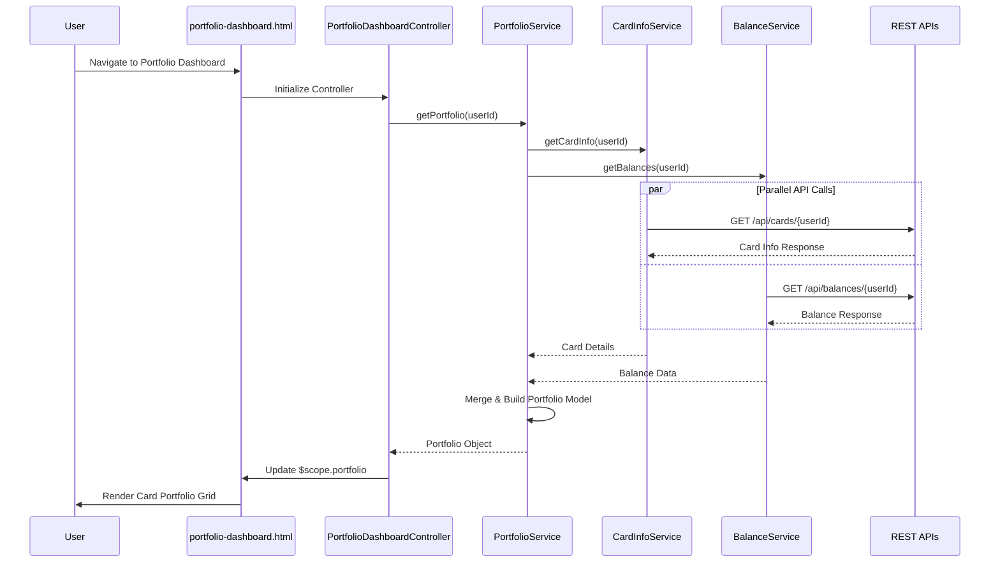

# Low-Level Design: QE-8525 - Credit Card Portfolio Management

## a. Architecture Mapping

- **Portfolio Dashboard UI** → AngularJS View (`portfolio-dashboard.html`) + Controller (`PortfolioDashboardController`)
- **Portfolio Management Service** → AngularJS Service (`PortfolioService`) for orchestrating card data retrieval
- **Credit Card Data Source Integration** → AngularJS Factory (`CardDataFactory`) for API communication
- **Card Information API Client** → AngularJS Service (`CardInfoService`) for card details and metadata
- **Balance Service Client** → AngularJS Service (`BalanceService`) for balance and outstanding amounts

**Recommended Folder Structure:**
```
app/
├── modules/
│   └── portfolio/
│       ├── portfolio.module.js
│       ├── controllers/
│       │   └── portfolio-dashboard.controller.js
│       ├── services/
│       │   ├── portfolio.service.js
│       │   ├── card-info.service.js
│       │   └── balance.service.js
│       ├── factories/
│       │   └── card-data.factory.js
│       └── views/
│           └── portfolio-dashboard.html
├── shared/
│   └── services/
│       └── http-interceptor.service.js
└── assets/
    └── css/
        └── portfolio.css
```

---

## b. Component Specifications

| Component Name | Artifact Type | Responsibility | Key Dependencies |
|----------------|---------------|----------------|------------------|
| `portfolio.module` | Module | Defines portfolio feature module and routing | `ngRoute`, `ui.bootstrap` |
| `PortfolioDashboardController` | Controller | Manages portfolio view state, handles user interactions, coordinates service calls | `PortfolioService`, `$scope`, `$q` |
| `PortfolioService` | Service | Orchestrates parallel API calls to retrieve consolidated card data | `CardInfoService`, `BalanceService`, `$q` |
| `CardInfoService` | Service | Fetches card details (card number, type, credit limit) from Card Information API | `$http`, `CardDataFactory` |
| `BalanceService` | Service | Retrieves available credit and outstanding balances from Balance API | `$http`, `CardDataFactory` |
| `CardDataFactory` | Factory | Provides reusable API endpoint configuration and HTTP wrapper methods | `$http`, `API_CONFIG` |
| `portfolio-dashboard.html` | View | Renders responsive card portfolio grid with Bootstrap layout | `PortfolioDashboardController` |

---

## c. Data Model

```javascript
// Card Model
const Card = {
  cardId: String,
  cardNumber: String,        // masked, e.g., "**** **** **** 1234"
  cardType: String,          // e.g., "Visa", "Mastercard"
  cardholderName: String,
  creditLimit: Number,       // in currency units
  availableCredit: Number,
  outstandingBalance: Number,
  status: String             // e.g., "Active", "Blocked"
};

// Portfolio Model
const Portfolio = {
  userId: String,
  cards: Array<Card>,
  totalCreditLimit: Number,
  totalAvailableCredit: Number,
  totalOutstanding: Number,
  lastUpdated: Date
};
```

---

## d. Data Flow

User navigates to portfolio dashboard → View loads and `PortfolioDashboardController` initializes → Controller invokes `PortfolioService.getPortfolio()` → Service makes parallel `$q.all()` calls to `CardInfoService` and `BalanceService` → Both services call REST APIs via `CardDataFactory` using `$http` → API responses are merged into `Portfolio` model → Controller updates `$scope.portfolio` → View renders card grid using `ng-repeat` with Bootstrap responsive classes → User sees consolidated portfolio with real-time data within 2-second load time.

---

## e. Primary Sequence Diagram



---

## f. Implementation Notes

- Use AngularJS Dependency Injection to inject services into controller; follow `$inject` annotation pattern for minification safety
- Leverage `$q.all()` for parallel API calls to meet 2-second load requirement; handle partial failures gracefully
- Apply Bootstrap grid system (`col-xs-12`, `col-sm-6`, `col-md-4`) for responsive card layout across devices
- Use `$http` interceptors for centralized authentication token injection and error handling
- Implement ES6 arrow functions and `const`/`let` in services; use AngularJS 1.5+ component architecture where applicable

---

## g. Error Handling

HTTP interceptor-based approach with `$httpProvider.interceptors` for global error capture; display user-friendly notifications via Bootstrap alerts on API failures.

---

## h. Security Notes

Requires token-based authentication via existing SSO; card numbers must be masked in transit and display; secure API calls over HTTPS only.

---

**End of LLD for QE-8525**