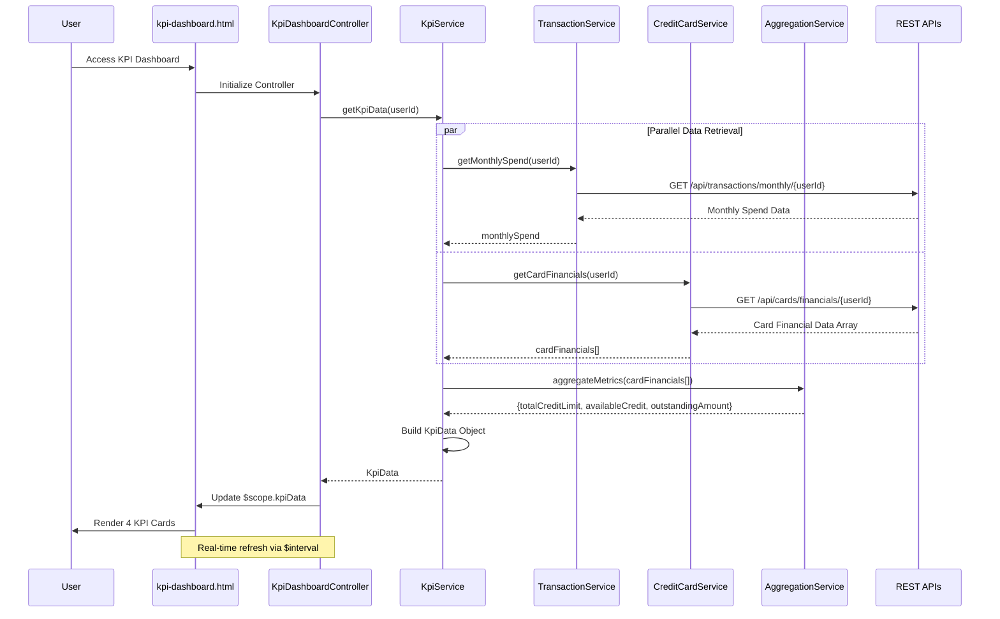

# Low-Level Design: QE-8526 - Financial KPI Dashboard

## a. Architecture Mapping

- **User Dashboard UI** → AngularJS View (`kpi-dashboard.html`) + Controller (`KpiDashboardController`)
- **KPI Service** → AngularJS Service (`KpiService`) for orchestrating KPI data retrieval and aggregation
- **Transaction Processing System Integration** → AngularJS Service (`TransactionService`) for monthly spend data
- **Credit Card Service Integration** → AngularJS Service (`CreditCardService`) for limits and balances
- **Aggregation Engine** → AngularJS Service (`AggregationService`) for multi-card metric computation

**Recommended Folder Structure:**
```
app/
├── modules/
│   └── kpi/
│       ├── kpi.module.js
│       ├── controllers/
│       │   └── kpi-dashboard.controller.js
│       ├── services/
│       │   ├── kpi.service.js
│       │   ├── transaction.service.js
│       │   ├── credit-card.service.js
│       │   └── aggregation.service.js
│       ├── directives/
│       │   └── kpi-card.directive.js
│       └── views/
│           └── kpi-dashboard.html
├── shared/
│   └── services/
│       └── real-time-update.service.js
└── assets/
    └── css/
        └── kpi.css
```

---

## b. Component Specifications

| Component Name | Artifact Type | Responsibility | Key Dependencies |
|----------------|---------------|----------------|------------------|
| `kpi.module` | Module | Defines KPI dashboard feature module and routing | `ngRoute`, `ui.bootstrap` |
| `KpiDashboardController` | Controller | Manages KPI dashboard state, triggers data refresh, handles real-time updates | `KpiService`, `$scope`, `$interval` |
| `KpiService` | Service | Orchestrates KPI data retrieval from multiple sources and coordinates aggregation | `TransactionService`, `CreditCardService`, `AggregationService`, `$q` |
| `TransactionService` | Service | Fetches current month transaction data for Monthly Spend calculation | `$http`, `API_CONFIG` |
| `CreditCardService` | Service | Retrieves credit limits, available credit, and outstanding amounts for all cards | `$http`, `API_CONFIG` |
| `AggregationService` | Service | Computes aggregated KPIs (Total Credit Limit, Available Credit, Outstanding Amount) across multiple cards | None (pure computation) |
| `kpi-card.directive` | Directive | Reusable component for rendering individual KPI metric cards with formatting | None |
| `kpi-dashboard.html` | View | Renders four KPI cards in responsive Bootstrap grid layout | `KpiDashboardController`, `kpiCard` directive |

---

## c. Data Model

```javascript
// KPI Model
const KpiData = {
  monthlySpend: Number,           // Total expenditure for current month
  totalCreditLimit: Number,       // Aggregated credit limit across all cards
  availableCredit: Number,        // Total remaining spending capacity
  outstandingAmount: Number,      // Total dues across all cards
  lastRefreshed: Date
};

// Transaction Summary Model
const TransactionSummary = {
  userId: String,
  month: String,                  // e.g., "2026-11"
  totalSpend: Number,
  transactionCount: Number
};

// Card Financial Data Model
const CardFinancialData = {
  cardId: String,
  creditLimit: Number,
  availableCredit: Number,
  outstandingBalance: Number
};
```

---

## d. Data Flow

User accesses KPI dashboard → `KpiDashboardController` initializes and calls `KpiService.getKpiData()` → Service makes parallel calls to `TransactionService.getMonthlySpend()` and `CreditCardService.getCardFinancials()` → Both services fetch data via REST APIs → `AggregationService.aggregateMetrics()` computes Total Credit Limit, Available Credit, and Outstanding Amount from card data array → `KpiService` assembles complete `KpiData` object → Controller updates `$scope.kpiData` → View renders four KPI cards using `kpi-card` directive with real-time refresh via `$interval` → User sees updated metrics in responsive layout.

---

## e. Primary Sequence Diagram



---

## f. Implementation Notes

- Use `$interval` service for periodic KPI refresh (configurable interval, e.g., 30 seconds) to achieve near real-time updates
- Implement `AggregationService` as pure JavaScript class with static methods for testability and reusability
- Apply Bootstrap grid (`col-xs-12`, `col-sm-6`, `col-lg-3`) for responsive 4-column KPI card layout
- Use `$q.all()` for parallel API calls to minimize latency; cache results briefly to reduce API load
- Create reusable `kpi-card` directive with isolated scope for metric name, value, icon, and formatting

---

## g. Error Handling

Interceptor-based error handling with try/catch in service methods; display fallback values ("--") and error notification banner on API failures.

---

## h. Security Notes

Requires token-based auth via existing SSO; validate user authorization for financial data access; secure API calls over HTTPS.

---

**End of LLD for QE-8526**