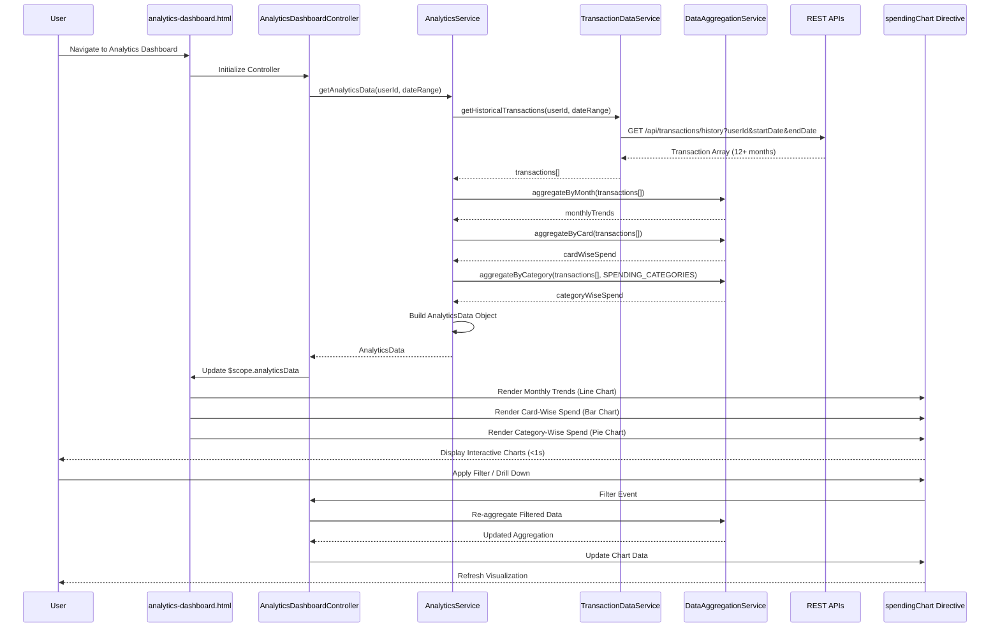

# Low-Level Design: QE-8527 - Spending Analytics and Insights

## a. Architecture Mapping

- **User Interface Layer** → AngularJS View (`analytics-dashboard.html`) + Controller (`AnalyticsDashboardController`)
- **Analytics Service** → AngularJS Service (`AnalyticsService`) for orchestrating analytics data retrieval
- **Transaction Data Service** → AngularJS Service (`TransactionDataService`) for historical transaction retrieval
- **Data Aggregation Engine** → AngularJS Service (`DataAggregationService`) for category/card/time-based aggregation
- **Visualization Component** → AngularJS Directive (`spendingChart`) for rendering interactive charts using Chart.js or D3.js
- **Historical Data Store Integration** → AngularJS Factory (`HistoricalDataFactory`) for API communication

**Recommended Folder Structure:**
```
app/
├── modules/
│   └── analytics/
│       ├── analytics.module.js
│       ├── controllers/
│       │   └── analytics-dashboard.controller.js
│       ├── services/
│       │   ├── analytics.service.js
│       │   ├── transaction-data.service.js
│       │   └── data-aggregation.service.js
│       ├── directives/
│       │   └── spending-chart.directive.js
│       ├── factories/
│       │   └── historical-data.factory.js
│       └── views/
│           └── analytics-dashboard.html
├── shared/
│   └── constants/
│       └── spending-categories.constant.js
└── assets/
    ├── css/
    │   └── analytics.css
    └── libs/
        └── chart.js
```

---

## b. Component Specifications

| Component Name | Artifact Type | Responsibility | Key Dependencies |
|----------------|---------------|----------------|------------------|
| `analytics.module` | Module | Defines analytics feature module, routing, and third-party chart library integration | `ngRoute`, `chart.js`, `ui.bootstrap` |
| `AnalyticsDashboardController` | Controller | Manages analytics view state, handles filter interactions, coordinates chart data updates | `AnalyticsService`, `$scope`, `$filter` |
| `AnalyticsService` | Service | Orchestrates transaction data retrieval and aggregation for multiple visualization dimensions | `TransactionDataService`, `DataAggregationService`, `$q` |
| `TransactionDataService` | Service | Fetches historical transaction data from Transaction Data API (minimum 12 months) | `$http`, `HistoricalDataFactory` |
| `DataAggregationService` | Service | Performs client-side aggregation by category (9 categories), card, and time period (monthly) | `SPENDING_CATEGORIES` constant |
| `HistoricalDataFactory` | Factory | Provides API endpoint configuration and caching for historical transaction data | `$http`, `$cacheFactory`, `API_CONFIG` |
| `spendingChart` | Directive | Renders interactive charts (line, bar, pie) with drill-down and filtering capabilities using Chart.js | `$timeout` |
| `SPENDING_CATEGORIES` | Constant | Defines 9 spending categories: Food & Dining, Fuel, Shopping, Travel, Entertainment, Utilities, Healthcare, Education, Miscellaneous | None |
| `analytics-dashboard.html` | View | Renders three chart sections (monthly trends, card-wise, category-wise) with filter controls in responsive layout | `AnalyticsDashboardController`, `spendingChart` directive |

---

## c. Data Model

```javascript
// Transaction Model
const Transaction = {
  transactionId: String,
  cardId: String,
  amount: Number,
  category: String,              // One of 9 predefined categories
  transactionDate: Date,
  merchantName: String,
  description: String
};

// Aggregated Spend Model
const AggregatedSpend = {
  dimension: String,             // "monthly", "card", "category"
  data: Array<{
    label: String,               // e.g., "2026-11", "Card *1234", "Food & Dining"
    value: Number,               // Spend amount
    percentage: Number           // % of total (for category view)
  }>
};

// Analytics Data Model
const AnalyticsData = {
  userId: String,
  dateRange: { startDate: Date, endDate: Date },
  monthlyTrends: AggregatedSpend,
  cardWiseSpend: AggregatedSpend,
  categoryWiseSpend: AggregatedSpend,
  totalTransactions: Number,
  lastUpdated: Date
};

// Spending Categories Constant
const SPENDING_CATEGORIES = [
  "Food & Dining", "Fuel", "Shopping", "Travel", 
  "Entertainment", "Utilities", "Healthcare", "Education", "Miscellaneous"
];
```

---

## d. Data Flow

User navigates to analytics dashboard → `AnalyticsDashboardController` initializes and calls `AnalyticsService.getAnalyticsData(userId, dateRange)` → Service invokes `TransactionDataService.getHistoricalTransactions()` which fetches data from Historical Data Store via REST API → Raw transaction array is passed to `DataAggregationService` → Aggregation service processes transactions in three dimensions: monthly trends (group by month), card-wise spend (group by cardId), and category-wise spend (group by category using SPENDING_CATEGORIES constant) → Aggregated data is returned as `AnalyticsData` object → Controller updates `$scope.analyticsData` → View renders three `spendingChart` directives (line chart for trends, bar chart for card comparison, pie chart for categories) → Charts render within 1 second using Chart.js → User interacts with filters and drill-down controls, triggering controller methods that update chart data dynamically.

---

## e. Primary Sequence Diagram



---

## f. Implementation Notes

- Use Chart.js library integrated via `angular-chart.js` wrapper for declarative chart rendering with AngularJS data binding
- Implement `DataAggregationService` with ES6 array methods (`reduce`, `map`, `filter`) for efficient client-side aggregation
- Apply `$cacheFactory` in `HistoricalDataFactory` to cache transaction data and avoid redundant API calls during filter operations
- Use AngularJS `$filter` service for date formatting and currency display in chart labels and tooltips
- Ensure chart rendering completes within 1 second by limiting initial dataset to 12 months and implementing lazy loading for older data

---

## g. Error Handling

Interceptor-based approach with try/catch in aggregation methods; display empty state with user-friendly message on API failures or missing data.

---

## h. Security Notes

Requires token-based auth via existing SSO; validate user authorization for transaction history access; mask sensitive transaction details in API responses.

---

**End of LLD for QE-8527**