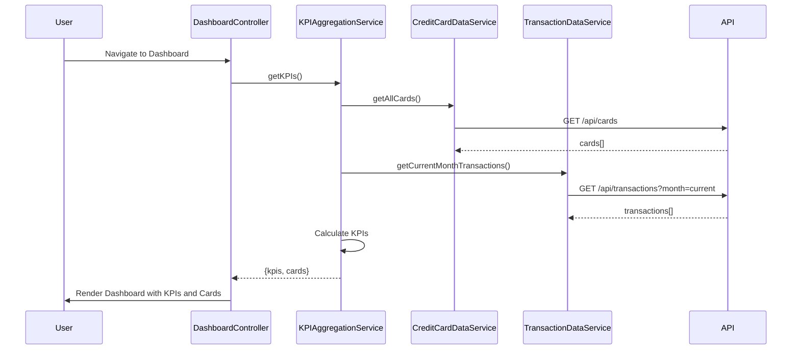

# Low-Level Design: QE-8528 - Dashboard KPIs and Credit Card Overview

## a. Architecture Mapping

- **DashboardModule** (angular.module): Main module for dashboard functionality
- **DashboardController**: Orchestrates KPI display and card overview rendering
- **KPIAggregationService**: Calculates and aggregates KPI metrics across cards
- **CreditCardDataService**: Fetches card information and balances via REST API
- **TransactionDataService**: Retrieves transaction data for monthly spend calculation
- **DashboardDirective**: Renders individual KPI widgets and card tiles

**Folder Structure:**
```
/app
  /modules
    /dashboard
      dashboard.module.js
      dashboard.controller.js
      dashboard.html
      /services
        kpi-aggregation.service.js
        credit-card-data.service.js
        transaction-data.service.js
      /directives
        kpi-widget.directive.js
        card-tile.directive.js
```

## b. Component Specifications

| Component Name | Artifact Type | Responsibility | Key Dependencies |
|----------------|---------------|----------------|------------------|
| DashboardModule | Module | Registers all dashboard components and configures routing | angular, ngRoute |
| DashboardController | Controller | Manages dashboard state, triggers KPI aggregation, handles card display | KPIAggregationService, $scope |
| KPIAggregationService | Service | Aggregates KPIs (monthly spend, total limit, available credit, outstanding) | CreditCardDataService, TransactionDataService, $q |
| CreditCardDataService | Factory | Fetches all user credit cards via GET /api/cards | $http |
| TransactionDataService | Factory | Retrieves current month transactions via GET /api/transactions?month=current | $http |
| KPIWidgetDirective | Directive | Renders individual KPI metric with label and value | None |
| CardTileDirective | Directive | Displays individual card summary (name, limit, outstanding, available) | None |

## c. Data Model

**CreditCard Object:**
```javascript
{
  cardId: String,
  cardName: String,
  cardNumber: String (masked),
  creditLimit: Number,
  outstandingAmount: Number,
  availableCredit: Number,
  cardType: String,
  expiryDate: String
}
```

**KPIMetrics Object:**
```javascript
{
  monthlySpend: Number,
  totalCreditLimit: Number,
  totalAvailableCredit: Number,
  totalOutstanding: Number
}
```

**Transaction Object (for monthly spend):**
```javascript
{
  transactionId: String,
  amount: Number,
  transactionDate: Date,
  cardId: String
}
```

## d. Data Flow

User navigates to dashboard → DashboardController initializes and calls KPIAggregationService.getKPIs() → Service invokes CreditCardDataService.getAllCards() and TransactionDataService.getCurrentMonthTransactions() in parallel using $q.all() → REST APIs return card data and transaction data → KPIAggregationService calculates totals (sum credit limits, sum outstanding, compute available credit, sum transaction amounts for monthly spend) → Aggregated KPIMetrics and card array returned to controller → Controller updates $scope.kpis and $scope.cards → View renders KPI widgets via kpi-widget directive and card tiles via card-tile directive in responsive Bootstrap grid → User sees complete dashboard within 2 seconds.

## e. Primary Sequence Diagram



## f. Implementation Notes

- Use AngularJS Dependency Injection to inject services into controller and ensure testability
- Leverage $q.all() for parallel API calls to CreditCardDataService and TransactionDataService to meet 2-second load requirement
- Implement Bootstrap grid (col-md-3 for KPIs, col-md-4 for card tiles) for responsive layout across mobile/tablet/desktop
- Use $http interceptor for centralized API error handling and loading state management
- Apply ES6 arrow functions and const/let in services for cleaner code

## g. Error Handling

HTTP interceptor captures API errors, displays user-friendly notification via toaster service, and logs errors to console.

## h. Security Notes

Standard input validation and secure API calls assumed; token-based authentication via existing SSO expected for /api/cards and /api/transactions endpoints.