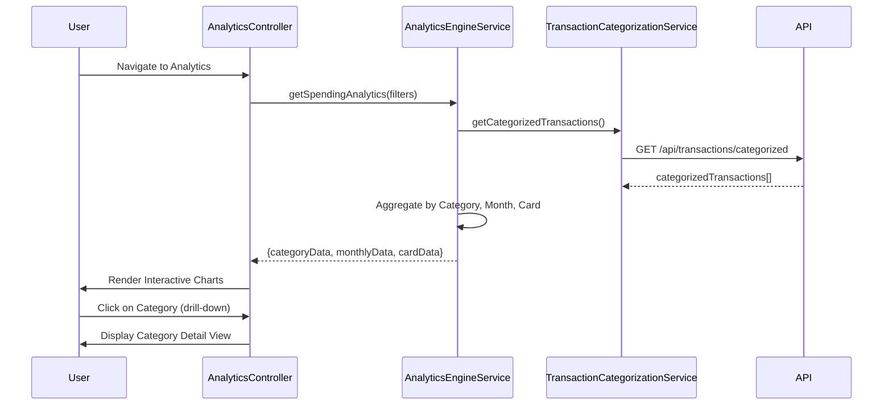

# Low-Level Design: QE-8529 - Spending Analytics and Insights

## a. Architecture Mapping

- **AnalyticsModule** (angular.module): Main module for analytics functionality
- **AnalyticsController**: Manages analytics view state and chart interactions
- **AnalyticsEngineService**: Processes and aggregates spending data for visualizations
- **TransactionCategorizationService**: Retrieves categorized transaction data via REST API
- **TransactionService**: Fetches raw transaction data
- **CreditCardService**: Provides card information for card-wise analysis
- **ChartDirective**: Renders interactive charts using Chart.js or D3.js wrapper

**Folder Structure:**
```
/app
  /modules
    /analytics
      analytics.module.js
      analytics.controller.js
      analytics.html
      /services
        analytics-engine.service.js
        transaction-categorization.service.js
        transaction.service.js
        credit-card.service.js
      /directives
        chart.directive.js
```

## b. Component Specifications

| Component Name | Artifact Type | Responsibility | Key Dependencies |
|----------------|---------------|----------------|------------------|
| AnalyticsModule | Module | Registers analytics components and configures routing | angular, ngRoute, chart.js |
| AnalyticsController | Controller | Manages analytics filters (time range, card selection), triggers data refresh | AnalyticsEngineService, $scope, $filter |
| AnalyticsEngineService | Service | Aggregates spending by category, month, and card; computes trends | TransactionCategorizationService, TransactionService, CreditCardService, $q |
| TransactionCategorizationService | Factory | Fetches categorized transactions via GET /api/transactions/categorized | $http |
| TransactionService | Factory | Retrieves all transactions via GET /api/transactions | $http |
| CreditCardService | Factory | Fetches user cards via GET /api/cards | $http |
| ChartDirective | Directive | Renders interactive pie/bar/line charts with drill-down using Chart.js | chart.js library |

## c. Data Model

**CategorizedTransaction Object:**
```javascript
{
  transactionId: String,
  amount: Number,
  category: String, // One of: Food & Dining, Fuel, Shopping, Travel, Entertainment, Utilities, Healthcare, Education, Miscellaneous
  transactionDate: Date,
  cardId: String
}
```

**CategorySpend Object:**
```javascript
{
  category: String,
  totalSpend: Number,
  transactionCount: Number
}
```

**MonthlyTrend Object:**
```javascript
{
  month: String, // YYYY-MM
  totalSpend: Number
}
```

**CardWiseSpend Object:**
```javascript
{
  cardId: String,
  cardName: String,
  totalSpend: Number
}
```

## d. Data Flow

User navigates to analytics view → AnalyticsController initializes and calls AnalyticsEngineService.getSpendingAnalytics(filters) → Service fetches data from TransactionCategorizationService, TransactionService, and CreditCardService via parallel API calls → REST APIs return categorized transactions, raw transactions, and card details → AnalyticsEngineService aggregates data: groups transactions by category (9 categories) for pie chart, groups by month for line chart trend, groups by cardId for bar chart → Processed analytics objects (CategorySpend[], MonthlyTrend[], CardWiseSpend[]) returned to controller → Controller updates $scope.categoryData, $scope.monthlyData, $scope.cardData → ChartDirective renders three interactive charts with drill-down enabled → User interacts with charts to explore spending patterns.

## e. Primary Sequence Diagram



## f. Implementation Notes

- Use AngularJS DI to inject AnalyticsEngineService and ensure separation of concerns between data processing and presentation
- Leverage Chart.js with Angular wrapper directive for interactive visualizations; configure onClick handlers for drill-down
- Apply Array.reduce() and ES6 Map for efficient aggregation of transactions by category, month, and card
- Use $q.all() for parallel API calls to meet 2-second rendering requirement
- Implement real-time refresh via $interval or manual refresh button triggering AnalyticsEngineService.getSpendingAnalytics()

## g. Error Handling

HTTP interceptor captures API failures; user notified via alert directive; partial data rendered if some API calls succeed.

## h. Security Notes

Requires token-based auth via existing SSO for /api/transactions/categorized and /api/transactions endpoints.