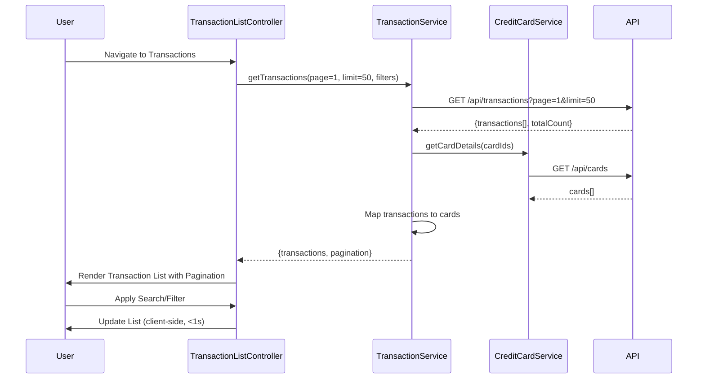

# Low-Level Design: QE-8530 - Transaction Management and Monitoring

## a. Architecture Mapping

- **TransactionModule** (angular.module): Main module for transaction management
- **TransactionListController**: Manages transaction list display, pagination, search, and filters
- **TransactionDetailController**: Displays individual transaction details
- **TransactionService**: Fetches transaction data with pagination and filtering via REST API
- **CreditCardService**: Maps transactions to card details
- **SearchFilterService**: Implements client-side search and filter logic
- **PaginationDirective**: Renders pagination controls

**Folder Structure:**
```
/app
  /modules
    /transactions
      transaction.module.js
      transaction-list.controller.js
      transaction-detail.controller.js
      transaction-list.html
      transaction-detail.html
      /services
        transaction.service.js
        credit-card.service.js
        search-filter.service.js
      /directives
        pagination.directive.js
```

## b. Component Specifications

| Component Name | Artifact Type | Responsibility | Key Dependencies |
|----------------|---------------|----------------|------------------|
| TransactionModule | Module | Registers transaction components and configures routing | angular, ngRoute |
| TransactionListController | Controller | Manages transaction list, pagination state, search/filter inputs | TransactionService, SearchFilterService, $scope |
| TransactionDetailController | Controller | Displays detailed view of a single transaction | TransactionService, $routeParams, $scope |
| TransactionService | Factory | Fetches paginated transactions via GET /api/transactions?page=X&limit=Y&search=Z | $http |
| CreditCardService | Factory | Retrieves card details for transaction-to-card mapping via GET /api/cards | $http |
| SearchFilterService | Service | Applies client-side search and filtering on transaction list | $filter |
| PaginationDirective | Directive | Renders pagination controls and emits page change events | None |

## c. Data Model

**Transaction Object:**
```javascript
{
  transactionId: String,
  cardId: String,
  cardName: String,
  amount: Number,
  transactionDate: Date,
  merchantName: String,
  category: String,
  status: String, // e.g., Posted, Pending
  description: String
}
```

**PaginationState Object:**
```javascript
{
  currentPage: Number,
  pageSize: Number,
  totalRecords: Number,
  totalPages: Number
}
```

**SearchFilter Object:**
```javascript
{
  searchTerm: String,
  cardId: String,
  dateFrom: Date,
  dateTo: Date,
  category: String
}
```

## d. Data Flow

User navigates to transaction list → TransactionListController initializes with default pagination (page=1, limit=50) → Controller calls TransactionService.getTransactions(page, limit, filters) → Service invokes GET /api/transactions with query params → API returns paginated transaction array and total count → TransactionService maps transactions to cards using CreditCardService → Controller updates $scope.transactions and $scope.pagination → View renders transaction table with pagination controls → User enters search term or applies filter → SearchFilterService filters $scope.transactions client-side (sub-1-second) → User clicks pagination button → Controller updates page number and re-fetches via TransactionService → User clicks transaction row → Navigate to transaction detail view with TransactionDetailController displaying full transaction object.

## e. Primary Sequence Diagram



## f. Implementation Notes

- Use AngularJS DI to inject TransactionService and SearchFilterService into TransactionListController
- Implement server-side pagination via API query params (page, limit) to handle large transaction volumes efficiently
- Apply AngularJS $filter for client-side search/filter to achieve sub-1-second response; debounce search input using ng-model-options="{debounce: 300}"
- Use ui-router or ngRoute with $routeParams to pass transactionId to TransactionDetailController
- Leverage Bootstrap table-responsive class for mobile-friendly transaction list display

## g. Error Handling

HTTP interceptor handles API errors; user notified via toast notification; retry mechanism for failed pagination requests.

## h. Security Notes

Requires token-based auth via existing SSO for /api/transactions endpoint; input validation on search and filter parameters to prevent injection attacks.