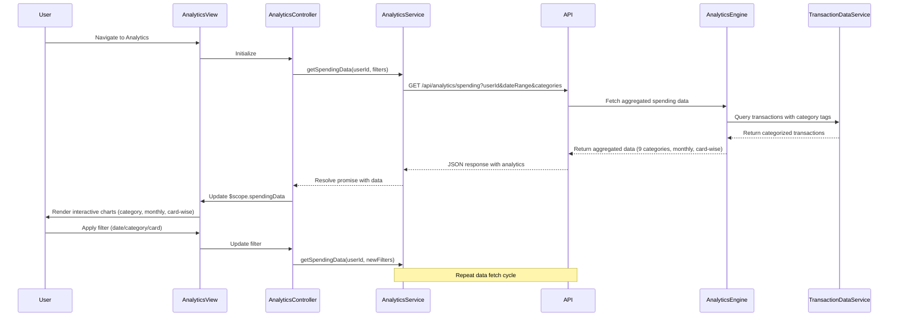

# Low-Level Design: QE-8531 - Spending Analytics and Insights

## a. Architecture Mapping

- **Analytics View Module** → AngularJS Module (`app.analytics`)
- **Analytics Controller** → AngularJS Controller (`AnalyticsController`) - manages view state and user interactions
- **Analytics Service** → AngularJS Service (`AnalyticsService`) - handles API calls to analytics endpoints
- **Chart Directive** → AngularJS Directive (`spendingChart`) - renders interactive visualizations
- **Category Filter Factory** → AngularJS Factory (`CategoryFilterFactory`) - manages category and time period filters

**Recommended Folder Structure:**
```
/app
  /analytics
    analytics.module.js
    analytics.controller.js
    analytics.service.js
    /directives
      spending-chart.directive.js
    /factories
      category-filter.factory.js
    /views
      analytics.html
```

## b. Component Specifications

| Component Name | Artifact Type | Responsibility | Key Dependencies |
|---|---|---|---|
| AnalyticsModule | Module | Bootstrap analytics feature module | angular, ui.router, chart.js |
| AnalyticsController | Controller | Manage analytics view state, handle user filter interactions, coordinate data refresh | AnalyticsService, CategoryFilterFactory, $scope |
| AnalyticsService | Service | Fetch spending data from REST API, cache aggregated results, handle API errors | $http, $q, API_CONFIG |
| SpendingChartDirective | Directive | Render interactive charts for category/monthly/card-wise spending | chart.js, d3 (optional) |
| CategoryFilterFactory | Factory | Maintain filter state (categories, date range, cards), provide filter methods | - |
| TransactionDataModel | Model/Factory | Structure for transaction aggregation data (category, amount, month, card) | - |

## c. Data Model

**SpendingAnalytics (JS Object)**
```javascript
{
  userId: String,
  timeRange: { startDate: Date, endDate: Date },
  categorySpending: [
    { category: String, amount: Number, percentage: Number }
  ], // 9 categories: Food & Dining, Fuel, Shopping, Travel, Entertainment, Utilities, Healthcare, Education, Miscellaneous
  monthlyTrends: [
    { month: String, totalSpend: Number, categoryBreakdown: Object }
  ],
  cardWiseSpending: [
    { cardId: String, cardName: String, totalSpend: Number, categoryBreakdown: Object }
  ]
}
```

**FilterCriteria (JS Object)**
```javascript
{
  selectedCategories: Array<String>, // subset of 9 categories
  dateRange: { from: Date, to: Date },
  selectedCards: Array<String>
}
```

## d. Data Flow

User navigates to analytics view, triggering AnalyticsController initialization. Controller invokes AnalyticsService.getSpendingData() with current filter criteria from CategoryFilterFactory. Service makes GET request to `/api/analytics/spending` with query parameters (userId, dateRange, categories, cards). API Gateway routes to Analytics Service backend, which queries Transaction Data Service via Analytics Engine for aggregated data across nine categories, monthly trends, and card-wise breakdowns. Backend returns JSON response with spending analytics. AnalyticsService caches data and resolves promise to Controller. Controller updates $scope model, triggering SpendingChartDirective to render interactive charts using chart.js. User interactions (filter changes, chart drill-downs) update CategoryFilterFactory state and re-trigger data fetch cycle.

## e. Primary Sequence Diagram



## f. Implementation Notes

- Use AngularJS 1.x dependency injection for all services/factories; register components via module.controller/service/directive methods
- Leverage ES6 classes for Controllers and Services; use arrow functions for promise chains to maintain `this` context
- Integrate chart.js via angular-chart.js wrapper for declarative chart directives; bind chart data to $scope for reactive updates
- Implement HTTP interceptor for adding auth tokens and handling 401/500 errors globally
- Use $q service for promise-based async flow; cache analytics data in AnalyticsService using simple object cache with TTL

## g. Error Handling

HTTP interceptor captures API errors; user-facing notifications via toastr or custom alert service; try/catch in service methods with fallback to cached data.

## h. Security Notes

Requires token-based auth via existing SSO; userId validated server-side; standard input validation and secure API calls assumed.