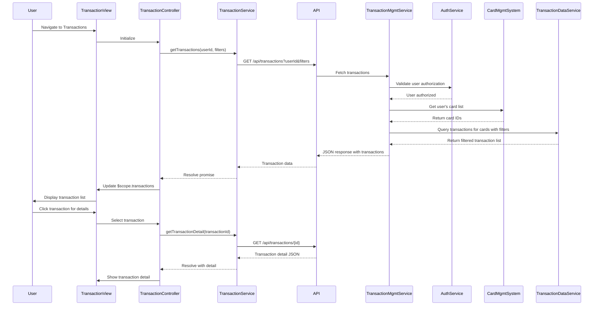

# Low-Level Design: QE-8532 - Credit Card Transaction Management

## a. Architecture Mapping

- **Transaction View Module** → AngularJS Module (`app.transactions`)
- **Transaction Controller** → AngularJS Controller (`TransactionController`) - manages transaction list and detail views
- **Transaction Service** → AngularJS Service (`TransactionService`) - handles REST API calls for transaction data
- **Transaction Filter Factory** → AngularJS Factory (`TransactionFilterFactory`) - manages search and filter state
- **Transaction Detail Directive** → AngularJS Directive (`transactionDetail`) - displays individual transaction details

**Recommended Folder Structure:**
```
/app
  /transactions
    transactions.module.js
    transaction.controller.js
    transaction.service.js
    /factories
      transaction-filter.factory.js
    /directives
      transaction-detail.directive.js
    /views
      transaction-list.html
      transaction-detail.html
```

## b. Component Specifications

| Component Name | Artifact Type | Responsibility | Key Dependencies |
|---|---|---|---|
| TransactionsModule | Module | Bootstrap transaction management feature | angular, ui.router |
| TransactionController | Controller | Manage transaction list/detail views, handle search/filter actions, pagination | TransactionService, TransactionFilterFactory, $scope, $state |
| TransactionService | Service | Fetch transactions from REST API, retrieve transaction details, handle card ownership validation | $http, $q, API_CONFIG |
| TransactionFilterFactory | Factory | Maintain filter/search state (card, date range, search term), provide filter methods | - |
| TransactionDetailDirective | Directive | Render detailed transaction view with all attributes | - |
| TransactionModel | Model/Factory | Structure for transaction data (id, cardId, amount, date, merchant, category) | - |

## c. Data Model

**Transaction (JS Object)**
```javascript
{
  transactionId: String,
  cardId: String,
  cardName: String,
  amount: Number,
  currency: String,
  transactionDate: Date,
  merchantName: String,
  category: String,
  description: String,
  status: String // 'posted', 'pending'
}
```

**TransactionFilter (JS Object)**
```javascript
{
  selectedCards: Array<String>,
  dateRange: { from: Date, to: Date },
  searchTerm: String,
  category: String
}
```

**TransactionListResponse (JS Object)**
```javascript
{
  transactions: Array<Transaction>,
  totalCount: Number,
  pageSize: Number,
  currentPage: Number
}
```

## d. Data Flow

User authenticates and navigates to transaction view. TransactionController initializes and calls TransactionService.getTransactions() with filter criteria from TransactionFilterFactory. Service makes GET request to `/api/transactions?userId&cards&dateRange&search` via API Gateway. Backend Transaction Management Service validates user authorization via User Authentication Service, retrieves user's card list from Credit Card Management System, then queries Transaction Data Service for matching transactions. Transaction Data Service applies filters and returns paginated transaction list. Service returns JSON response to TransactionService, which resolves promise to Controller. Controller updates $scope.transactions, triggering view rendering. User can search/filter (updates TransactionFilterFactory and re-fetches) or click transaction for details (TransactionService.getTransactionDetail() fetches full transaction data, TransactionDetailDirective renders detail view).

## e. Primary Sequence Diagram



## f. Implementation Notes

- Use AngularJS $http service with promise-based API calls; implement pagination via query parameters (page, pageSize)
- Leverage ui.router for state management (list view vs. detail view); pass transactionId via state params
- Implement debounced search using $timeout to avoid excessive API calls on keystroke
- Use ng-repeat with track by transactionId for efficient list rendering; apply filters client-side for cached data
- Store filter state in TransactionFilterFactory as singleton to persist across view transitions

## g. Error Handling

HTTP interceptor-based error handling with user notifications via alert service; try/catch in service methods with graceful degradation.

## h. Security Notes

Requires token-based auth via existing SSO; server-side validation of card ownership per user; standard input validation and secure API calls assumed.