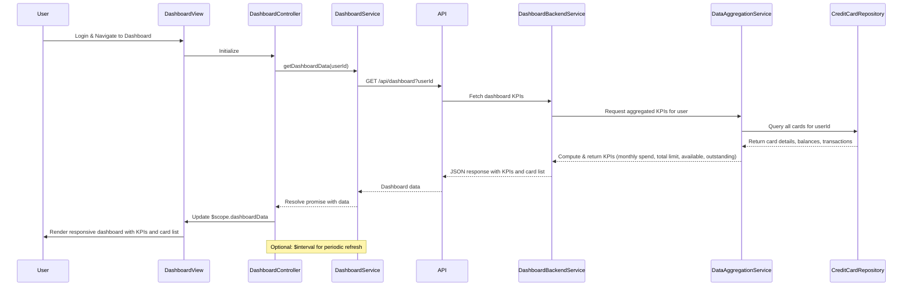

# Low-Level Design: QE-8533 - Credit Card Dashboard and KPI Management

## a. Architecture Mapping

- **Dashboard Module** → AngularJS Module (`app.dashboard`)
- **Dashboard Controller** → AngularJS Controller (`DashboardController`) - manages dashboard state and KPI display
- **Dashboard Service** → AngularJS Service (`DashboardService`) - fetches aggregated KPI data from REST API
- **KPI Card Directive** → AngularJS Directive (`kpiCard`) - renders individual KPI widgets
- **Credit Card List Directive** → AngularJS Directive (`creditCardList`) - displays all user credit cards with summary info

**Recommended Folder Structure:**
```
/app
  /dashboard
    dashboard.module.js
    dashboard.controller.js
    dashboard.service.js
    /directives
      kpi-card.directive.js
      credit-card-list.directive.js
    /views
      dashboard.html
```

## b. Component Specifications

| Component Name | Artifact Type | Responsibility | Key Dependencies |
|---|---|---|---|
| DashboardModule | Module | Bootstrap dashboard feature module | angular, ui.router |
| DashboardController | Controller | Manage dashboard view state, trigger KPI data refresh, handle real-time updates | DashboardService, $scope, $interval |
| DashboardService | Service | Fetch KPI data from REST API, cache aggregated metrics, provide refresh method | $http, $q, API_CONFIG |
| KpiCardDirective | Directive | Render individual KPI widget (monthly spend, credit limit, available credit, outstanding) | - |
| CreditCardListDirective | Directive | Display all user credit cards with card-level summary (name, limit, balance, available) | - |
| DashboardDataModel | Model/Factory | Structure for dashboard KPI data (monthly spend, total limit, available credit, outstanding) | - |

## c. Data Model

**DashboardKPI (JS Object)**
```javascript
{
  userId: String,
  monthlySpend: Number,
  totalCreditLimit: Number,
  availableCredit: Number,
  outstandingAmount: Number,
  lastUpdated: Date
}
```

**CreditCard (JS Object)**
```javascript
{
  cardId: String,
  cardName: String,
  cardNumber: String, // masked, last 4 digits
  creditLimit: Number,
  currentBalance: Number,
  availableCredit: Number,
  outstandingAmount: Number
}
```

**DashboardData (JS Object)**
```javascript
{
  kpis: DashboardKPI,
  cards: Array<CreditCard>
}
```

## d. Data Flow

User authenticates via User Authentication Service and lands on dashboard. DashboardController initializes and calls DashboardService.getDashboardData(userId). Service makes GET request to `/api/dashboard?userId` via API Gateway. Backend Dashboard Service requests aggregated KPI data from Data Aggregation Service, which queries Credit Card Data Repository for all cards associated with userId. Repository returns card details, balances, and transaction summaries. Data Aggregation Service computes monthly spend (sum of current month transactions), total credit limit (sum across cards), available credit (sum of available credit per card), and outstanding amounts (sum of balances). Aggregated KPIs and card list returned to Dashboard Service, which formats response and sends via API Gateway to DashboardService. Service caches data and resolves promise to Controller. Controller updates $scope.dashboardData, triggering KpiCardDirective and CreditCardListDirective to render responsive dashboard. Optional: $interval triggers periodic refresh for real-time updates.

## e. Primary Sequence Diagram



## f. Implementation Notes

- Use AngularJS dependency injection for all components; bootstrap DashboardModule as main entry point
- Implement responsive layout using Bootstrap grid system (col-xs/sm/md/lg) for mobile/tablet/desktop support
- Use $interval service for optional real-time refresh (e.g., every 60 seconds); cancel interval on $scope.$destroy to prevent memory leaks
- Cache dashboard data in DashboardService with TTL; serve from cache if request within TTL window to meet sub-2-second load requirement
- Use ES6 template literals in directives for cleaner HTML generation; leverage ng-if for conditional rendering

## g. Error Handling

HTTP interceptor captures API errors; display user-friendly error message via toastr; try/catch in service with fallback to last cached data if available.

## h. Security Notes

Requires token-based auth via existing SSO; userId extracted from auth token server-side; standard input validation and secure API calls assumed.