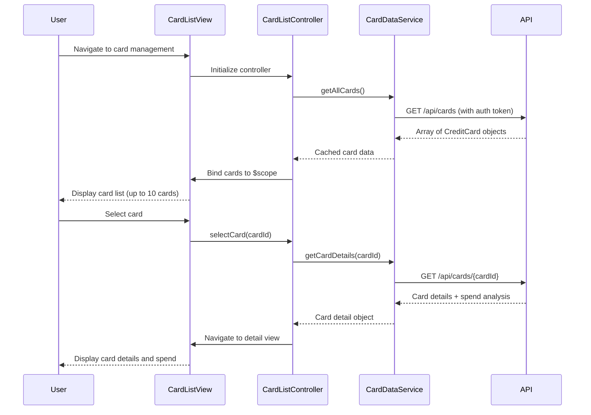

# Low-Level Design: Multi-Card Management and Viewing
**Epic ID:** QE-8534  
**Stack:** AngularJS 1.x, JavaScript ES6, HTML5, CSS3, Bootstrap, REST APIs, MVC Architecture

---

## a. Architecture Mapping

- **Card Management Module** → AngularJS Module (`app.cardManagement`)
- **Card List Controller** → AngularJS Controller (`CardListController`)
- **Card Detail Controller** → AngularJS Controller (`CardDetailController`)
- **Card Data Service** → AngularJS Service (`CardDataService`)
- **Authentication Interceptor** → AngularJS Factory (`AuthInterceptor`)
- **Card Display Directive** → AngularJS Directive (`cardTile`)

**Folder Structure:**
```
/app
  /modules
    /card-management
      /controllers
      /services
      /directives
      /views
  /shared
    /interceptors
```

---

## b. Component Specifications

| Name | Artifact Type | Responsibility | Key Dependencies |
|------|---------------|----------------|------------------|
| CardListController | Controller | Manages card list view, handles card selection and switching | CardDataService, $scope, $state |
| CardDetailController | Controller | Displays individual card details and card-wise spend analysis | CardDataService, $stateParams, $scope |
| CardDataService | Service | Fetches card data from REST API, caches card list (500ms SLA) | $http, $q, $cacheFactory |
| AuthInterceptor | Factory | Injects authentication tokens into API requests | $q, AuthService |
| cardTile | Directive | Renders individual card tile with card details | None |

---

## c. Data Model

**CreditCard Object:**
```javascript
{
  cardId: String,
  cardNumber: String,        // masked, e.g., "**** **** **** 1234"
  cardHolderName: String,
  cardType: String,          // e.g., "Visa", "MasterCard"
  creditLimit: Number,
  availableCredit: Number,
  outstandingAmount: Number,
  monthlySpend: Number,
  expiryDate: String,        // format: "MM/YY"
  isActive: Boolean
}
```

---

## d. Data Flow

User navigates to the card management view → CardListController initializes and calls CardDataService.getAllCards() → Service sends GET request to `/api/cards` with auth token via AuthInterceptor → API returns array of CreditCard objects → Service caches response and resolves promise → Controller binds card array to $scope → View renders card list using cardTile directive and Bootstrap grid → User selects a card → Controller transitions to card detail state → CardDetailController fetches card-specific data including spend analysis → View displays detailed card information and spending breakdown.

---

## e. Primary Sequence Diagram



---

## f. Implementation Notes

- Use AngularJS $cacheFactory for card list caching to meet 500ms latency requirement; cache TTL = 5 minutes.
- Implement card masking in CardDataService using ES6 string template literals and regex for PCI compliance.
- Use ui-router for state management (card.list, card.detail states) with resolve blocks for data pre-fetching.
- Apply Bootstrap responsive grid (col-xs-12, col-sm-6, col-md-4) for card tiles to support mobile/tablet/desktop layouts.
- Leverage AngularJS DI for all services and controllers; use ES6 classes with $inject annotation for minification safety.

---

## g. Error Handling

HTTP interceptor captures API errors (4xx/5xx), displays Bootstrap alert notifications, and logs errors to console; service layer wraps promises with $q.reject for controller-level handling.

---

## h. Security Notes

Requires token-based auth via existing SSO; AuthInterceptor injects bearer token in Authorization header for all API calls.