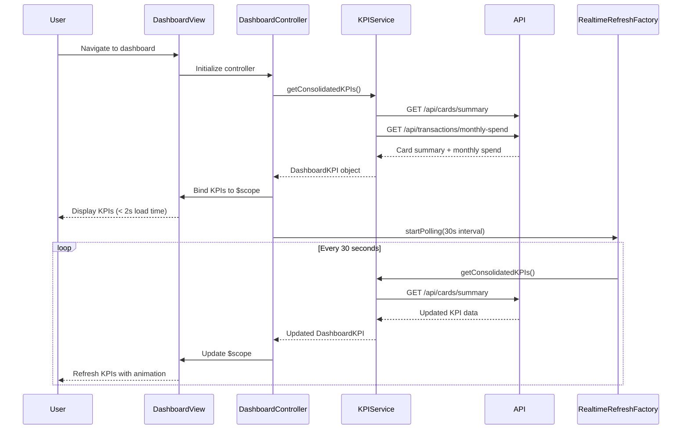

# Low-Level Design: Dashboard and KPI Management
**Epic ID:** QE-8535  
**Stack:** AngularJS 1.x, JavaScript ES6, HTML5, CSS3, Bootstrap, REST APIs, MVC Architecture

---

## a. Architecture Mapping

- **Dashboard Module** → AngularJS Module (`app.dashboard`)
- **Dashboard Controller** → AngularJS Controller (`DashboardController`)
- **KPI Service** → AngularJS Service (`KPIService`)
- **Real-time Refresh Factory** → AngularJS Factory (`RealtimeRefreshFactory`)
- **KPI Widget Directive** → AngularJS Directive (`kpiWidget`)

**Folder Structure:**
```
/app
  /modules
    /dashboard
      /controllers
      /services
      /directives
      /views
  /shared
    /factories
```

---

## b. Component Specifications

| Name | Artifact Type | Responsibility | Key Dependencies |
|------|---------------|----------------|------------------|
| DashboardController | Controller | Orchestrates dashboard view, manages KPI display and refresh | KPIService, RealtimeRefreshFactory, $scope, $interval |
| KPIService | Service | Aggregates KPI data from Credit Card Data Service and Transaction Processing System | $http, $q |
| RealtimeRefreshFactory | Factory | Manages polling mechanism for real-time KPI updates (configurable interval) | $interval, $rootScope |
| kpiWidget | Directive | Renders individual KPI metric with responsive layout and animation | None |

---

## c. Data Model

**DashboardKPI Object:**
```javascript
{
  monthlySpend: Number,
  totalCreditLimit: Number,
  availableCredit: Number,
  outstandingAmount: Number,
  utilizationPercentage: Number,  // calculated: (outstandingAmount / totalCreditLimit) * 100
  lastUpdated: Date
}
```

---

## d. Data Flow

User navigates to dashboard → DashboardController initializes and calls KPIService.getConsolidatedKPIs() → Service sends parallel GET requests to `/api/cards/summary` and `/api/transactions/monthly-spend` → API returns aggregated card data and monthly spend → Service consolidates metrics into DashboardKPI object → Controller binds KPI to $scope and starts RealtimeRefreshFactory polling (30-second interval) → View renders KPIs using kpiWidget directives with Bootstrap responsive grid → On each polling cycle, KPIService fetches updated data → Controller updates $scope → View reflects real-time changes with CSS transitions.

---

## e. Primary Sequence Diagram



---

## f. Implementation Notes

- Use $q.all() in KPIService to parallelize API calls for card summary and monthly spend, reducing total load time to meet 2-second SLA.
- Implement responsive KPI layout using Bootstrap grid (col-xs-12, col-sm-6, col-md-3) for mobile-first design.
- Use CSS3 transitions in kpiWidget directive for smooth KPI value updates during real-time refresh.
- Leverage AngularJS $interval service in RealtimeRefreshFactory for polling; cancel interval on $scope.$destroy to prevent memory leaks.
- Apply AngularJS one-time binding (::) for static labels to optimize digest cycle performance.

---

## g. Error Handling

HTTP interceptor catches API failures, displays user-friendly Bootstrap alert, and retries failed requests once before showing error; RealtimeRefreshFactory pauses polling on consecutive failures.

---

## h. Security Notes

Requires token-based auth via existing SSO; all API calls include bearer token in Authorization header.