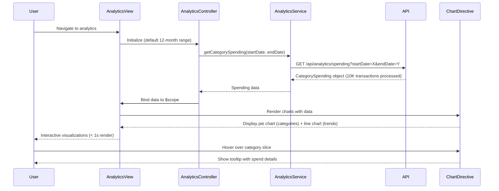

# Low-Level Design: Spending Analytics and Insights
**Epic ID:** QE-8536  
**Stack:** AngularJS 1.x, JavaScript ES6, HTML5, CSS3, Bootstrap, REST APIs, MVC Architecture

---

## a. Architecture Mapping

- **Analytics Module** → AngularJS Module (`app.analytics`)
- **Analytics Controller** → AngularJS Controller (`AnalyticsController`)
- **Analytics Service** → AngularJS Service (`AnalyticsService`)
- **Chart Directive** → AngularJS Directive (`spendingChart`)
- **Category Filter** → AngularJS Filter (`categoryName`)

**Folder Structure:**
```
/app
  /modules
    /analytics
      /controllers
      /services
      /directives
      /filters
      /views
  /shared
    /chart-lib
```

---

## b. Component Specifications

| Name | Artifact Type | Responsibility | Key Dependencies |
|------|---------------|----------------|------------------|
| AnalyticsController | Controller | Manages analytics view, handles date range selection and category filtering | AnalyticsService, $scope, $filter |
| AnalyticsService | Service | Fetches transaction data, calculates category-wise breakdown and monthly trends (12-month history, 10K transactions) | $http, $q |
| spendingChart | Directive | Renders interactive charts (pie for categories, line for trends) using Chart.js or D3.js | Chart.js/D3.js |
| categoryName | Filter | Maps category codes to display names (e.g., "FD" → "Food & Dining") | None |

---

## c. Data Model

**CategorySpending Object:**
```javascript
{
  categories: [
    {
      categoryCode: String,    // e.g., "FD", "FUEL", "SHOP"
      categoryName: String,    // e.g., "Food & Dining"
      totalSpend: Number,
      transactionCount: Number,
      percentage: Number       // of total spend
    }
  ],
  monthlyTrends: [
    {
      month: String,           // format: "YYYY-MM"
      totalSpend: Number,
      categoryBreakdown: Object // { "FD": 1200, "FUEL": 800, ... }
    }
  ],
  totalTransactions: Number,
  dateRange: { startDate: Date, endDate: Date }
}
```

**Predefined Categories:** Food & Dining, Fuel, Shopping, Travel, Entertainment, Utilities, Healthcare, Education, Miscellaneous

---

## d. Data Flow

User navigates to analytics view → AnalyticsController initializes with default 12-month date range and calls AnalyticsService.getCategorySpending() → Service sends GET request to `/api/analytics/spending?startDate=X&endDate=Y` → API processes up to 10,000 transactions, applies category classification, calculates aggregations → API returns CategorySpending object → Service resolves promise → Controller binds data to $scope → View renders category-wise pie chart and monthly trend line chart using spendingChart directive (< 1s rendering) → User interacts with chart (hover, click) → Directive updates tooltip and highlights using Chart.js event handlers.

---

## e. Primary Sequence Diagram



---

## f. Implementation Notes

- Use Chart.js for lightweight, responsive chart rendering; load library via CDN or npm and wrap in AngularJS directive with isolated scope.
- Implement pagination or virtual scrolling if transaction list view is added; for charts, aggregate data server-side to meet 1-second rendering SLA.
- Use ES6 Array methods (map, reduce, filter) in AnalyticsService for client-side data transformation and aggregation.
- Apply AngularJS $filter service for category name mapping and currency formatting in views.
- Leverage AngularJS $watch on date range picker to trigger automatic chart updates when user changes date range.

---

## g. Error Handling

HTTP interceptor handles API errors with try/catch in service layer; displays Bootstrap alert notification to user on failure and logs error details to console.

---

## h. Security Notes

Standard input validation and secure API calls assumed; token-based auth via existing SSO for API access.