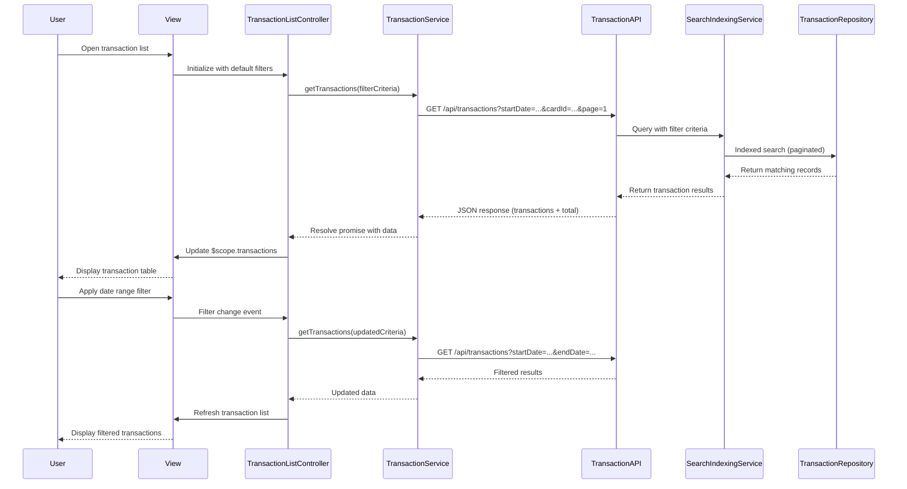

# Low-Level Design: Transaction Management and Monitoring
**Epic ID:** QE-8537

## a. Architecture Mapping

- **transactionModule** (AngularJS Module) → Root module for transaction management functionality
- **TransactionListController** (Controller) → Manages transaction listing, filtering, and pagination UI logic
- **TransactionService** (Service) → Handles REST API calls for fetching, filtering, and searching transactions
- **TransactionFilterDirective** (Directive) → Reusable filter component for date range, card, and category selection
- **CardDataFactory** (Factory) → Provides credit card metadata for linking transactions to cards
- **DateUtilService** (Service) → Handles date validation and formatting operations

**Recommended Folder Structure:**
```
app/
├── modules/
│   └── transactions/
│       ├── controllers/
│       │   └── transaction-list.controller.js
│       ├── services/
│       │   ├── transaction.service.js
│       │   └── date-util.service.js
│       ├── directives/
│       │   └── transaction-filter.directive.js
│       ├── factories/
│       │   └── card-data.factory.js
│       ├── views/
│       │   └── transaction-list.html
│       └── transaction.module.js
```

## b. Component Specifications

| Name | Artifact Type | Responsibility | Key Dependencies |
|------|---------------|----------------|------------------|
| transactionModule | Module | Registers all transaction management components and configures routing | angular, ngRoute |
| TransactionListController | Controller | Manages UI state, filter parameters, pagination controls, and transaction display | TransactionService, CardDataFactory, DateUtilService, $scope |
| TransactionService | Service | Executes REST API calls to fetch, filter, and search transactions; handles pagination | $http, $q |
| TransactionFilterDirective | Directive | Renders filter controls (date range picker, card dropdown, category dropdown) and emits filter changes | DateUtilService, CardDataFactory |
| CardDataFactory | Factory | Caches and provides credit card metadata (card IDs, names, types) for transaction enrichment | $http |
| DateUtilService | Service | Validates date ranges, formats dates for API calls, and provides date range presets | moment.js or native Date |

## c. Data Model

**Transaction Object:**
```javascript
{
  transactionId: String,
  cardId: String,
  merchantName: String,
  amount: Number,
  currency: String,
  transactionDate: Date,
  category: String,
  description: String,
  status: String
}
```

**Filter Criteria Object:**
```javascript
{
  startDate: Date,
  endDate: Date,
  cardId: String,
  category: String,
  pageNumber: Number,
  pageSize: Number
}
```

**Card Metadata Object:**
```javascript
{
  cardId: String,
  cardName: String,
  cardType: String,
  lastFourDigits: String
}
```

## d. Data Flow

User opens transaction list view → TransactionListController initializes with default filter (last 30 days, all cards, all categories) → Controller calls TransactionService.getTransactions(filterCriteria) → Service sends GET request to /api/transactions with query parameters → Transaction API validates date range via Date/Time Service, queries Search Indexing Service, retrieves paginated results from Transaction Data Repository, enriches with card details from Credit Card Data Service → API returns JSON array of transactions with total count → Service resolves promise with transaction data → Controller updates $scope.transactions and pagination metadata → View renders transaction table with merchant name, amount, date, category → User applies filters via TransactionFilterDirective → Directive emits filter change event → Controller updates filterCriteria and re-calls TransactionService → Updated transactions displayed.

## e. Primary Sequence Diagram



## f. Implementation Notes

- Use AngularJS dependency injection to inject TransactionService, CardDataFactory, and DateUtilService into TransactionListController
- Implement TransactionService using $http with promise-based pattern; handle pagination via query parameters (page, pageSize)
- TransactionFilterDirective uses isolate scope with two-way binding for filter criteria and callback for filter change events
- Apply Bootstrap grid system and responsive tables for mobile/tablet compatibility; use ng-repeat with track by transactionId for performance
- REST API endpoints: GET /api/transactions (with query params: startDate, endDate, cardId, category, page, pageSize) returns {transactions: [], total: Number}

## g. Error Handling

HTTP interceptor captures API errors (4xx/5xx), displays user-friendly toast notifications via a NotificationService, and logs errors to console; try/catch in controllers for synchronous operations.

## h. Security Notes

Requires token-based authentication via existing SSO; transaction data encrypted in transit (HTTPS) and at rest; audit trail logged server-side for all transaction view operations.