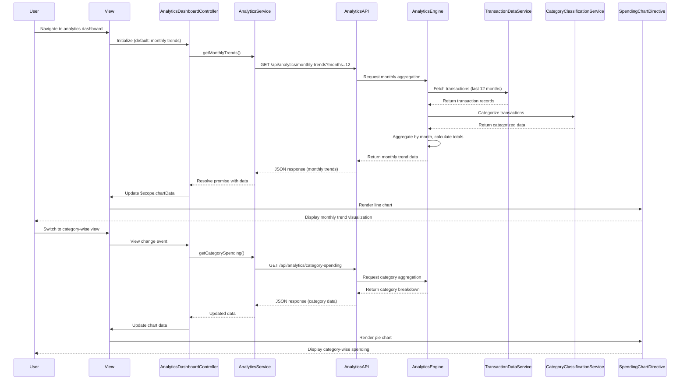

# Low-Level Design: Spending Analytics and Insights
**Epic ID:** QE-8538

## a. Architecture Mapping

- **analyticsModule** (AngularJS Module) → Root module for spending analytics functionality
- **AnalyticsDashboardController** (Controller) → Manages analytics view selection, data retrieval, and chart rendering logic
- **AnalyticsService** (Service) → Handles REST API calls to fetch aggregated spending data (monthly trends, card-wise, category-wise)
- **SpendingChartDirective** (Directive) → Reusable directive for rendering interactive charts using Chart.js or D3.js
- **CategoryService** (Service) → Provides category definitions and mappings for the nine predefined spending categories
- **AnalyticsDataFactory** (Factory) → Caches and transforms raw analytics data for visualization consumption

**Recommended Folder Structure:**
```
app/
├── modules/
│   └── analytics/
│       ├── controllers/
│       │   └── analytics-dashboard.controller.js
│       ├── services/
│       │   ├── analytics.service.js
│       │   └── category.service.js
│       ├── directives/
│       │   └── spending-chart.directive.js
│       ├── factories/
│       │   └── analytics-data.factory.js
│       ├── views/
│       │   └── analytics-dashboard.html
│       └── analytics.module.js
```

## b. Component Specifications

| Name | Artifact Type | Responsibility | Key Dependencies |
|------|---------------|----------------|------------------|
| analyticsModule | Module | Registers all analytics components and configures routing for analytics views | angular, ngRoute |
| AnalyticsDashboardController | Controller | Manages view state (monthly/card-wise/category-wise), triggers data fetch, and coordinates chart rendering | AnalyticsService, AnalyticsDataFactory, CategoryService, $scope |
| AnalyticsService | Service | Executes REST API calls to fetch monthly trends, card-wise spending, and category-wise breakdowns | $http, $q |
| SpendingChartDirective | Directive | Renders interactive charts (line for trends, bar for card-wise, pie for category-wise) using Chart.js | Chart.js library |
| CategoryService | Service | Provides list of nine predefined categories and color mappings for visualization consistency | None |
| AnalyticsDataFactory | Factory | Transforms API response data into chart-ready format (labels, datasets, colors) | CategoryService |

## c. Data Model

**Monthly Trend Data:**
```javascript
{
  month: String,
  year: Number,
  totalSpend: Number,
  transactionCount: Number
}
```

**Card-wise Spending Data:**
```javascript
{
  cardId: String,
  cardName: String,
  totalSpend: Number,
  percentage: Number
}
```

**Category-wise Spending Data:**
```javascript
{
  category: String,
  totalSpend: Number,
  percentage: Number,
  transactionCount: Number
}
```

**Category Definitions:**
```javascript
[
  'Food & Dining',
  'Fuel',
  'Shopping',
  'Travel',
  'Entertainment',
  'Utilities',
  'Healthcare',
  'Education',
  'Miscellaneous'
]
```

## d. Data Flow

User navigates to analytics dashboard → AnalyticsDashboardController initializes with default view (monthly trends, last 12 months) → Controller calls AnalyticsService.getMonthlyTrends() → Service sends GET request to /api/analytics/monthly-trends → Analytics API receives request, Analytics Engine queries Transaction Data Service for transaction data, Category Classification Service categorizes transactions, Analytics Engine aggregates by month and calculates totals → API returns JSON array of monthly spend data → Service resolves promise → Controller passes data to AnalyticsDataFactory for transformation → Factory formats data for Chart.js (labels: month names, datasets: spend amounts) → Controller updates $scope.chartData → SpendingChartDirective watches chartData, renders line chart → User views interactive monthly trend visualization → User switches to category-wise view → Controller calls AnalyticsService.getCategorySpending() → Similar flow returns category breakdown → Directive renders pie chart with nine category slices.

## e. Primary Sequence Diagram



## f. Implementation Notes

- Use AngularJS DI to inject AnalyticsService, AnalyticsDataFactory, and CategoryService into AnalyticsDashboardController
- Implement AnalyticsService with three methods: getMonthlyTrends(), getCardWiseSpending(), getCategorySpending() using $http promises
- SpendingChartDirective uses isolate scope with chartData and chartType attributes; integrates Chart.js for rendering (line, bar, pie charts)
- Apply responsive chart sizing using Chart.js responsive options; ensure charts render smoothly on mobile/tablet via CSS media queries
- REST API endpoints: GET /api/analytics/monthly-trends, GET /api/analytics/card-spending, GET /api/analytics/category-spending (all return aggregated arrays)

## g. Error Handling

HTTP interceptor-based error handling with user-friendly notifications for API failures; graceful fallback displays "No data available" message when analytics queries return empty results.

## h. Security Notes

Requires token-based auth via existing SSO; analytics data aggregated server-side to prevent exposure of individual transaction details; standard input validation on date range parameters.