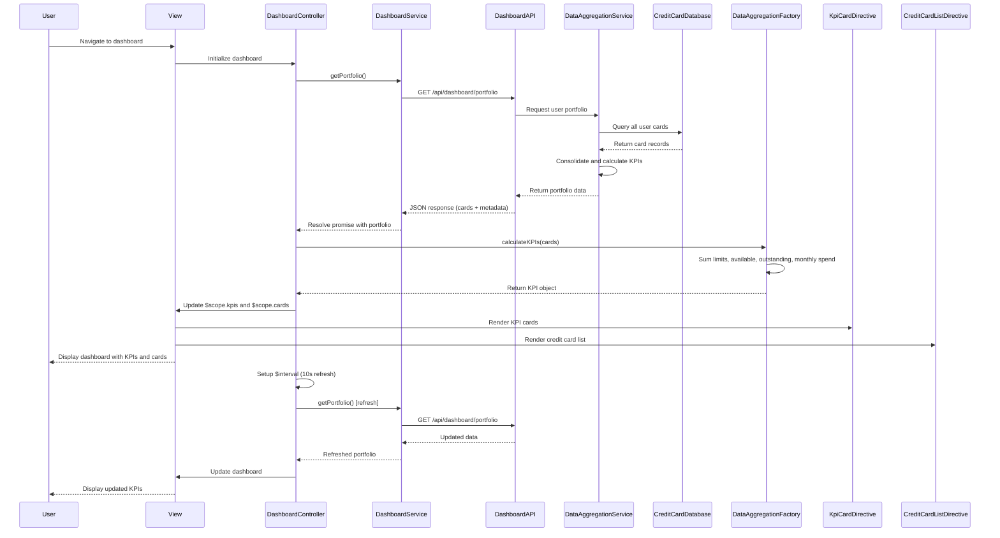

# Low-Level Design: Dashboard KPIs and Credit Card Overview
**Epic ID:** QE-8539

## a. Architecture Mapping

- **dashboardModule** (AngularJS Module) → Root module for dashboard functionality
- **DashboardController** (Controller) → Manages dashboard initialization, KPI data retrieval, and UI state
- **DashboardService** (Service) → Handles REST API calls to fetch consolidated credit card portfolio data and KPIs
- **CreditCardListDirective** (Directive) → Reusable component for displaying multiple credit cards with details
- **KpiCardDirective** (Directive) → Reusable component for rendering individual KPI metrics (monthly spend, credit limit, available credit, outstanding)
- **DataAggregationFactory** (Factory) → Client-side aggregation and calculation of derived KPIs from raw card data

**Recommended Folder Structure:**
```
app/
├── modules/
│   └── dashboard/
│       ├── controllers/
│       │   └── dashboard.controller.js
│       ├── services/
│       │   └── dashboard.service.js
│       ├── directives/
│       │   ├── credit-card-list.directive.js
│       │   └── kpi-card.directive.js
│       ├── factories/
│       │   └── data-aggregation.factory.js
│       ├── views/
│       │   └── dashboard.html
│       └── dashboard.module.js
```

## b. Component Specifications

| Name | Artifact Type | Responsibility | Key Dependencies |
|------|---------------|----------------|------------------|
| dashboardModule | Module | Registers all dashboard components and configures routing for dashboard view | angular, ngRoute |
| DashboardController | Controller | Initializes dashboard, fetches portfolio data, calculates KPIs, and manages refresh logic | DashboardService, DataAggregationFactory, $scope, $interval |
| DashboardService | Service | Executes REST API call to fetch user's credit card portfolio (all cards with balances, limits, transactions) | $http, $q |
| CreditCardListDirective | Directive | Renders list of credit cards with card name, last four digits, available credit, and outstanding amount | None |
| KpiCardDirective | Directive | Displays individual KPI metric with label, value, and optional trend indicator | None |
| DataAggregationFactory | Factory | Aggregates data across multiple cards to calculate total credit limit, total available credit, total outstanding, and monthly spend | None |

## c. Data Model

**Credit Card Object:**
```javascript
{
  cardId: String,
  cardName: String,
  cardType: String,
  lastFourDigits: String,
  creditLimit: Number,
  currentBalance: Number,
  availableCredit: Number,
  outstandingAmount: Number,
  monthlySpend: Number
}
```

**Dashboard KPI Object:**
```javascript
{
  totalCreditLimit: Number,
  totalAvailableCredit: Number,
  totalOutstanding: Number,
  monthlySpend: Number,
  creditUtilization: Number
}
```

**Portfolio Response:**
```javascript
{
  userId: String,
  cards: [CreditCard],
  lastUpdated: Date
}
```

## d. Data Flow

User authenticates and navigates to dashboard → DashboardController initializes → Controller calls DashboardService.getPortfolio() → Service sends GET request to /api/dashboard/portfolio → Dashboard API authenticates user via Authentication Service, calls Data Aggregation Service → Data Aggregation Service queries Credit Card Database for all user's cards → Database returns card details (limits, balances, outstanding amounts, monthly spend) → Data Aggregation Service consolidates data → Dashboard API returns JSON portfolio object with array of cards → Service resolves promise → Controller receives portfolio data → Controller passes cards array to DataAggregationFactory.calculateKPIs() → Factory iterates through cards, sums credit limits, available credit, outstanding amounts, and monthly spend → Factory returns KPI object → Controller updates $scope.kpis and $scope.cards → View renders KPI cards via KpiCardDirective and credit card list via CreditCardListDirective → User views consolidated dashboard → Controller sets up $interval for near real-time refresh (every 10 seconds) → Refresh cycle repeats data fetch and KPI calculation.

## e. Primary Sequence Diagram



## f. Implementation Notes

- Use AngularJS DI to inject DashboardService and DataAggregationFactory into DashboardController
- Implement DashboardService.getPortfolio() using $http with promise pattern; handle caching with $cacheFactory for 10-second intervals
- KpiCardDirective and CreditCardListDirective use isolate scope with one-way binding for data attributes (kpi, card)
- Apply Bootstrap grid system (col-md-3 for KPI cards, col-md-12 for card list) and responsive utilities for mobile/tablet layout
- REST API endpoint: GET /api/dashboard/portfolio returns {userId, cards: [], lastUpdated} with 2-second response time target

## g. Error Handling

HTTP interceptor captures API errors and displays toast notifications; $interval-based refresh includes try/catch to prevent refresh loop failures from breaking the UI.

## h. Security Notes

Requires token-based auth via existing SSO; credit card data masked (last four digits only) in UI; all API calls over HTTPS with encrypted data at rest and in transit.