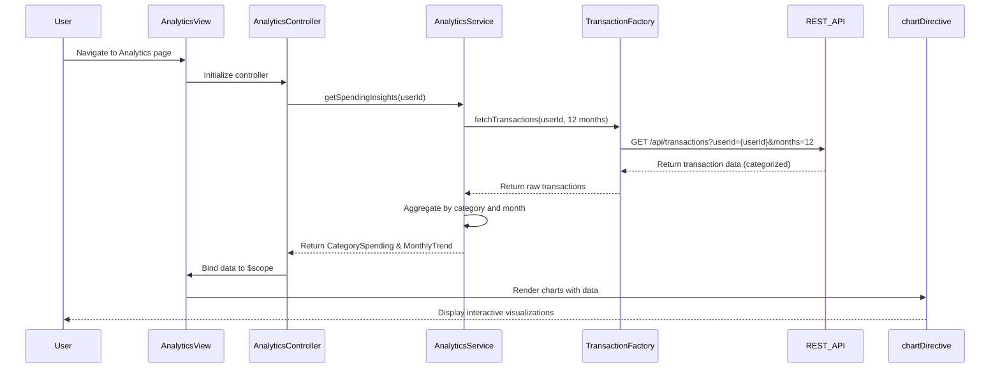

# Low-Level Design: Analytics and Spending Insights
**Epic ID:** QE-8540  
**Application Stack:** AngularJS 1.x, JavaScript ES6, HTML5, CSS3, Bootstrap, REST APIs, MVC Architecture

---

## a. Architecture Mapping

- **User Interface** → AngularJS Module (`analyticsModule`) + Controller (`AnalyticsController`) + HTML5/CSS3 Views
- **Analytics Visualization Engine** → AngularJS Service (`AnalyticsService`) for data processing and aggregation
- **Chart Rendering Component** → AngularJS Directive (`chartDirective`) wrapping a charting library (e.g., Chart.js)
- **Transaction Data Service** → AngularJS Factory (`TransactionFactory`) for REST API calls
- **Categorization Engine** → Backend REST API (consumed via `TransactionFactory`)
- **Data Aggregation Service** → Backend REST API (consumed via `AnalyticsService`)

**Recommended Folder Structure:**
```
/app
  /modules
    /analytics
      /controllers
        analytics.controller.js
      /services
        analytics.service.js
      /directives
        chart.directive.js
      /factories
        transaction.factory.js
      /views
        analytics.html
      analytics.module.js
```

---

## b. Component Specifications

| Component Name | Artifact Type | Responsibility | Key Dependencies |
|----------------|---------------|----------------|------------------|
| `analyticsModule` | Module | Registers all analytics-related components and defines routing | `ngRoute`, `chartDirective` |
| `AnalyticsController` | Controller | Manages UI state, user interactions, and binds data to view | `AnalyticsService`, `$scope` |
| `AnalyticsService` | Service | Aggregates transaction data, calculates category-wise spending and trends | `TransactionFactory`, `$q` |
| `TransactionFactory` | Factory | Fetches raw transaction data from REST API | `$http`, API endpoint |
| `chartDirective` | Directive | Renders interactive charts (category-wise, monthly trends) using Chart.js | Chart.js library, `$timeout` |

---

## c. Data Model

**Transaction Model:**
```javascript
{
  transactionId: String,
  cardId: String,
  amount: Number,
  category: String, // Food & Dining, Fuel, Shopping, Travel, Entertainment, Utilities, Healthcare, Education, Miscellaneous
  date: Date,
  description: String
}
```

**CategorySpending Model:**
```javascript
{
  category: String,
  totalAmount: Number,
  transactionCount: Number,
  percentage: Number
}
```

**MonthlyTrend Model:**
```javascript
{
  month: String, // YYYY-MM
  totalSpend: Number,
  categoryBreakdown: Array<CategorySpending>
}
```

---

## d. Data Flow

User navigates to the Analytics view, triggering `AnalyticsController` to invoke `AnalyticsService.getSpendingInsights()`. The service calls `TransactionFactory.fetchTransactions()` to retrieve raw transaction data via REST API (`GET /api/transactions?userId={userId}&months=12`). The backend Categorization Engine pre-categorizes transactions. `AnalyticsService` aggregates data by category and month, then returns processed `CategorySpending` and `MonthlyTrend` objects to the controller. The controller binds this data to `$scope`, and `chartDirective` renders interactive charts. User interactions (e.g., selecting a category) update the view via two-way data binding without additional API calls.

---

## e. Primary Sequence Diagram



---

## f. Implementation Notes

- Use AngularJS Dependency Injection to inject `AnalyticsService` and `TransactionFactory` into `AnalyticsController`.
- Leverage ES6 arrow functions and `const`/`let` for cleaner service and factory code.
- Wrap Chart.js in a custom AngularJS directive to ensure proper digest cycle integration and DOM manipulation.
- Use `$http` interceptors for global error handling and loading indicators during API calls.
- Cache aggregated data in `AnalyticsService` using a simple in-memory object to avoid redundant calculations on view re-renders.

---

## g. Error Handling

Client-side errors (API failures, data parsing issues) are handled via `$http` interceptor, displaying user-friendly notifications using Bootstrap alerts.

---

## h. Security Notes

Standard input validation and secure API calls assumed; token-based authentication via existing SSO for API requests.

---