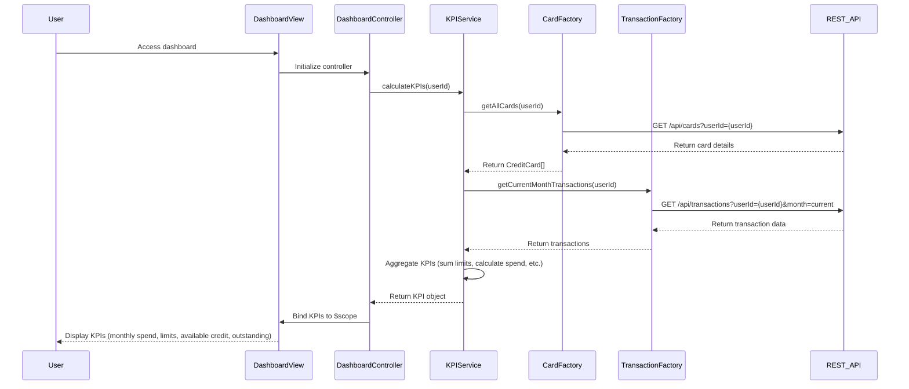

# Low-Level Design: Dashboard and KPI Management
**Epic ID:** QE-8541  
**Application Stack:** AngularJS 1.x, JavaScript ES6, HTML5, CSS3, Bootstrap, REST APIs, MVC Architecture

---

## a. Architecture Mapping

- **User Device / Dashboard UI** → AngularJS Module (`dashboardModule`) + Controller (`DashboardController`) + HTML5/CSS3 Views
- **KPI Calculation Engine** → AngularJS Service (`KPIService`) for aggregating and calculating KPIs
- **Credit Card Data Source** → AngularJS Factory (`CardFactory`) for REST API calls to fetch card details
- **Transaction Data Service** → AngularJS Factory (`TransactionFactory`) for REST API calls to fetch transaction data

**Recommended Folder Structure:**
```
/app
  /modules
    /dashboard
      /controllers
        dashboard.controller.js
      /services
        kpi.service.js
      /factories
        card.factory.js
        transaction.factory.js
      /views
        dashboard.html
      dashboard.module.js
```

---

## b. Component Specifications

| Component Name | Artifact Type | Responsibility | Key Dependencies |
|----------------|---------------|----------------|------------------|
| `dashboardModule` | Module | Registers dashboard components and routing | `ngRoute` |
| `DashboardController` | Controller | Manages dashboard UI state and binds KPI data to view | `KPIService`, `$scope`, `$interval` |
| `KPIService` | Service | Calculates and aggregates KPIs (monthly spend, credit limit, available credit, outstanding) | `CardFactory`, `TransactionFactory`, `$q` |
| `CardFactory` | Factory | Fetches credit card details from REST API | `$http`, API endpoint |
| `TransactionFactory` | Factory | Fetches transaction data for current month from REST API | `$http`, API endpoint |

---

## c. Data Model

**CreditCard Model:**
```javascript
{
  cardId: String,
  cardType: String,
  creditLimit: Number,
  currentBalance: Number,
  availableCredit: Number,
  outstandingAmount: Number
}
```

**KPI Model:**
```javascript
{
  monthlySpend: Number,
  totalCreditLimit: Number,
  availableCredit: Number,
  outstandingAmount: Number
}
```

---

## d. Data Flow

User accesses the dashboard, triggering `DashboardController` to invoke `KPIService.calculateKPIs()`. The service calls `CardFactory.getAllCards()` to fetch all credit card details via REST API (`GET /api/cards?userId={userId}`) and `TransactionFactory.getCurrentMonthTransactions()` to fetch current month transactions via REST API (`GET /api/transactions?userId={userId}&month=current`). `KPIService` aggregates data: sums credit limits, calculates total available credit, sums outstanding amounts, and calculates monthly spend from transactions. The service returns a `KPI` object to the controller, which binds it to `$scope`. The view displays KPIs using Bootstrap cards with responsive layout. An optional `$interval` service refreshes KPIs every 60 seconds for real-time updates.

---

## e. Primary Sequence Diagram



---

## f. Implementation Notes

- Use AngularJS Dependency Injection to inject `KPIService`, `CardFactory`, and `TransactionFactory` into `DashboardController`.
- Leverage ES6 `Promise.all()` or `$q.all()` to fetch card and transaction data concurrently for faster load times.
- Use Bootstrap grid system (e.g., `col-md-3`, `col-sm-6`, `col-xs-12`) for responsive KPI card layout.
- Implement `$interval` in controller for optional real-time KPI refresh (configurable interval, default 60 seconds).
- Cache KPI data in `KPIService` to avoid redundant API calls during the same session unless explicitly refreshed.

---

## g. Error Handling

API errors are intercepted via `$http` interceptor, displaying user-friendly error messages using Bootstrap alerts and logging errors to console.

---

## h. Security Notes

Requires token-based auth via existing SSO; card details are fetched securely with masked card numbers (last 4 digits only).

---