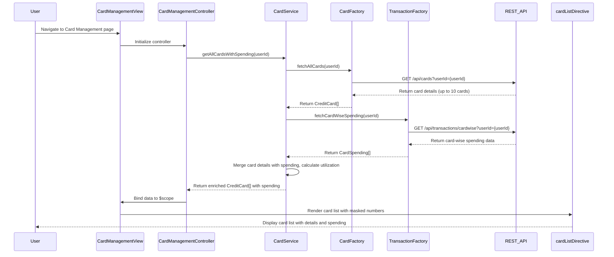

# Low-Level Design: Multiple Credit Card Management
**Epic ID:** QE-8542  
**Application Stack:** AngularJS 1.x, JavaScript ES6, HTML5, CSS3, Bootstrap, REST APIs, MVC Architecture

---

## a. Architecture Mapping

- **User Interface** → AngularJS Module (`cardManagementModule`) + Controller (`CardManagementController`) + HTML5/CSS3 Views
- **Card Management Service** → AngularJS Service (`CardService`) for business logic and data aggregation
- **Credit Card Data Repository** → AngularJS Factory (`CardFactory`) for REST API calls to fetch card data
- **Transaction Service** → AngularJS Factory (`TransactionFactory`) for REST API calls to fetch card-wise spending data
- **Display Layer** → AngularJS Directive (`cardListDirective`) for rendering card list with masking

**Recommended Folder Structure:**
```
/app
  /modules
    /cardManagement
      /controllers
        cardManagement.controller.js
      /services
        card.service.js
      /factories
        card.factory.js
        transaction.factory.js
      /directives
        cardList.directive.js
      /views
        cardManagement.html
        cardDetail.html
      cardManagement.module.js
```

---

## b. Component Specifications

| Component Name | Artifact Type | Responsibility | Key Dependencies |
|----------------|---------------|----------------|------------------|
| `cardManagementModule` | Module | Registers card management components and routing | `ngRoute` |
| `CardManagementController` | Controller | Manages UI state, user interactions, and binds card data to view | `CardService`, `$scope`, `$routeParams` |
| `CardService` | Service | Aggregates card data, calculates card-wise spending, and provides comparison logic | `CardFactory`, `TransactionFactory`, `$q` |
| `CardFactory` | Factory | Fetches credit card details from REST API | `$http`, API endpoint |
| `TransactionFactory` | Factory | Fetches card-wise transaction data from REST API | `$http`, API endpoint |
| `cardListDirective` | Directive | Renders list of cards with masked card numbers and usage patterns | `CardService` |

---

## c. Data Model

**CreditCard Model:**
```javascript
{
  cardId: String,
  cardType: String, // Visa, MasterCard, Amex, etc.
  cardNumberMasked: String, // e.g., "**** **** **** 1234"
  creditLimit: Number,
  currentBalance: Number,
  availableCredit: Number,
  outstandingAmount: Number
}
```

**CardSpending Model:**
```javascript
{
  cardId: String,
  monthlySpend: Number,
  transactionCount: Number,
  topCategory: String
}
```

**CardComparison Model:**
```javascript
{
  cardId: String,
  utilizationRate: Number, // (currentBalance / creditLimit) * 100
  spendRate: Number // monthlySpend relative to credit limit
}
```

---

## d. Data Flow

User navigates to the Card Management view, triggering `CardManagementController` to invoke `CardService.getAllCardsWithSpending()`. The service calls `CardFactory.fetchAllCards()` to retrieve all credit cards via REST API (`GET /api/cards?userId={userId}`) and `TransactionFactory.fetchCardWiseSpending()` to retrieve card-wise spending data via REST API (`GET /api/transactions/cardwise?userId={userId}`). `CardService` merges card details with spending data, calculates utilization rates, and returns an array of enriched `CreditCard` objects with associated `CardSpending` data. The controller binds this data to `$scope`, and `cardListDirective` renders the card list with masked card numbers. User can click on a card to view detailed card information, triggering a route change to `cardDetail.html` with `cardId` as a route parameter.

---

## e. Primary Sequence Diagram



---

## f. Implementation Notes

- Use AngularJS Dependency Injection to inject `CardService`, `CardFactory`, and `TransactionFactory` into `CardManagementController`.
- Leverage ES6 `Promise.all()` or `$q.all()` to fetch card details and spending data concurrently for sub-1-second retrieval.
- Implement card number masking in `CardFactory` or `CardService` using a utility function (e.g., `maskCardNumber(cardNumber)` returns `**** **** **** 1234`).
- Use `ng-repeat` in `cardListDirective` to iterate over cards and display them in a Bootstrap grid layout (responsive cards).
- Implement card comparison logic in `CardService` by calculating utilization rate and spend rate, exposing a `compareCards()` method for future use.

---

## g. Error Handling

API errors are handled via `$http` interceptor, displaying user-friendly error messages using Bootstrap modals or alerts.

---

## h. Security Notes

Card information masking follows PCI-DSS patterns (last 4 digits only); token-based authentication via existing SSO for API requests.

---