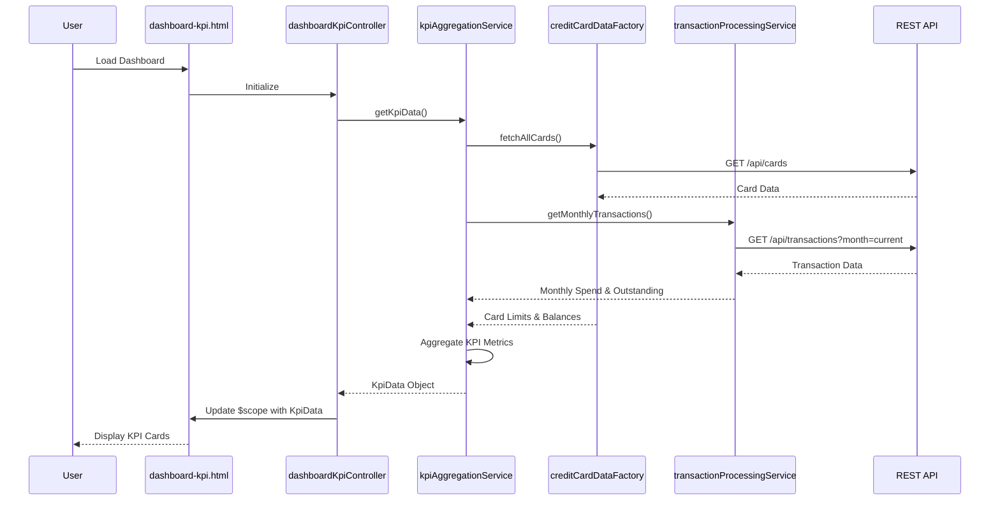

# Low-Level Design: Dashboard KPIs and Financial Overview
**Epic ID:** QE-8543  
**Application Stack:** AngularJS 1.x, JavaScript ES6, HTML5, CSS3, Bootstrap, REST APIs, MVC Architecture

---

## a. Architecture Mapping

- **Dashboard Controller** → AngularJS Controller (`dashboardKpiController.js`) - Orchestrates KPI data retrieval and view binding
- **KPI Aggregation Service** → AngularJS Service (`kpiAggregationService.js`) - Aggregates financial metrics from multiple sources
- **Credit Card Data Service** → AngularJS Factory (`creditCardDataFactory.js`) - Fetches card balances and limits via REST API
- **Transaction Processing Service** → AngularJS Service (`transactionProcessingService.js`) - Calculates monthly spend and outstanding amounts
- **Dashboard UI** → AngularJS Template (`dashboard-kpi.html`) with Bootstrap grid layout

**Recommended Folder Structure:**
```
/app
  /modules
    /dashboard
      /controllers (dashboardKpiController.js)
      /services (kpiAggregationService.js, transactionProcessingService.js)
      /factories (creditCardDataFactory.js)
      /views (dashboard-kpi.html)
      /styles (dashboard-kpi.css)
```

---

## b. Component Specifications

| Component Name | Artifact Type | Responsibility | Key Dependencies |
|----------------|---------------|----------------|------------------|
| dashboardKpiController | Controller | Manages dashboard state, fetches KPI data, handles real-time refresh | kpiAggregationService, $scope, $interval |
| kpiAggregationService | Service | Aggregates monthly spend, credit limit, available credit, outstanding amount | creditCardDataFactory, transactionProcessingService |
| creditCardDataFactory | Factory | REST API calls to retrieve card balances and limits | $http, $q |
| transactionProcessingService | Service | Calculates monthly spend and outstanding amounts from transaction data | $http, $filter |
| dashboard-kpi.html | Template | Renders KPI cards with Bootstrap responsive grid | dashboardKpiController, Bootstrap CSS |

---

## c. Data Model

**KpiData (JavaScript Object)**
```javascript
{
  monthlySpend: Number,          // Total spend for current month
  totalCreditLimit: Number,      // Sum of all card limits
  availableCredit: Number,       // Total available credit across cards
  outstandingAmount: Number,     // Total outstanding balance
  lastUpdated: Date              // Timestamp of last data refresh
}
```

**CreditCard (JavaScript Object)**
```javascript
{
  cardId: String,
  cardNumber: String,
  balance: Number,
  creditLimit: Number,
  availableCredit: Number
}
```

---

## d. Data Flow

User loads the dashboard → `dashboard-kpi.html` initializes → `dashboardKpiController` invokes `kpiAggregationService.getKpiData()` → Service calls `creditCardDataFactory.fetchAllCards()` and `transactionProcessingService.getMonthlyTransactions()` via REST APIs → Aggregation logic computes KPI metrics → Controller binds `KpiData` object to `$scope` → View renders KPI cards using Bootstrap grid with two-way data binding → `$interval` triggers periodic refresh every 30 seconds to update metrics in real-time.

---

## e. Primary Sequence Diagram



---

## f. Implementation Notes

- Use AngularJS Dependency Injection to inject services/factories into controller via constructor parameters
- Implement REST API calls using `$http` service with promise-based error handling (`$q`)
- Apply `$interval` service for 30-second polling to refresh KPI data; cancel interval on `$scope.$on('$destroy')`
- Use Bootstrap grid classes (col-md-3) for responsive KPI card layout across desktop/mobile
- Cache API responses in service layer for 30 seconds using simple in-memory object to reduce redundant calls

---

## g. Error Handling

HTTP interceptor captures API errors; display user-friendly notification via Bootstrap alert component with retry option.

---

## h. Security Notes

Requires token-based auth via existing SSO; API calls include Authorization header with JWT token.

---