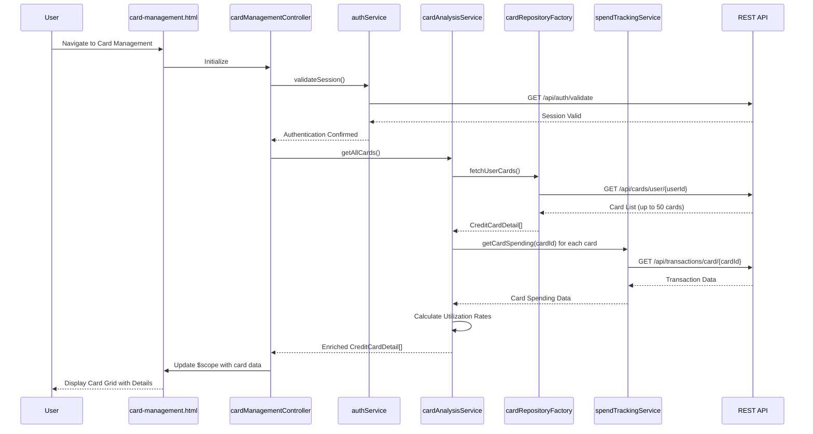

# Low-Level Design: Credit Card Management and Monitoring
**Epic ID:** QE-8544  
**Application Stack:** AngularJS 1.x, JavaScript ES6, HTML5, CSS3, Bootstrap, REST APIs, MVC Architecture

---

## a. Architecture Mapping

- **Card Management Controller** → AngularJS Controller (`cardManagementController.js`) - Manages multi-card display and user interactions
- **Card Analysis Service** → AngularJS Service (`cardAnalysisService.js`) - Performs card-wise spend analysis and comparison logic
- **User Authentication Service** → AngularJS Service (`authService.js`) - Validates card ownership and manages session tokens
- **Credit Card Data Repository** → AngularJS Factory (`cardRepositoryFactory.js`) - CRUD operations for card data via REST API
- **Spend Tracking Module** → AngularJS Service (`spendTrackingService.js`) - Tracks and analyzes card-specific spending patterns
- **Card Management UI** → AngularJS Template (`card-management.html`) with Bootstrap card components

**Recommended Folder Structure:**
```
/app
  /modules
    /card-management
      /controllers (cardManagementController.js)
      /services (cardAnalysisService.js, authService.js, spendTrackingService.js)
      /factories (cardRepositoryFactory.js)
      /views (card-management.html, card-details.html)
      /styles (card-management.css)
```

---

## b. Component Specifications

| Component Name | Artifact Type | Responsibility | Key Dependencies |
|----------------|---------------|----------------|------------------|
| cardManagementController | Controller | Orchestrates card list display, filtering, comparison, and detail navigation | cardAnalysisService, authService, $scope |
| cardAnalysisService | Service | Analyzes card-wise spending, calculates utilization ratios, performs card comparison | cardRepositoryFactory, spendTrackingService |
| authService | Service | Validates user session, ensures card ownership, manages JWT tokens | $http, $window |
| cardRepositoryFactory | Factory | REST API calls for fetching, updating, and synchronizing card data | $http, $q |
| spendTrackingService | Service | Retrieves and processes card-specific transaction history for spend analysis | $http, $filter |
| card-management.html | Template | Renders card list with Bootstrap cards, supports sorting and filtering | cardManagementController, Bootstrap CSS |

---

## c. Data Model

**CreditCardDetail (JavaScript Object)**
```javascript
{
  cardId: String,
  cardNumber: String,
  cardType: String,              // Visa, MasterCard, etc.
  balance: Number,
  creditLimit: Number,
  availableCredit: Number,
  utilizationRate: Number,       // Percentage (balance/limit * 100)
  monthlySpend: Number,
  lastSyncTimestamp: Date
}
```

**CardComparison (JavaScript Object)**
```javascript
{
  cardId: String,
  cardNumber: String,
  utilizationRate: Number,
  monthlySpend: Number,
  availableCredit: Number
}
```

---

## d. Data Flow

User navigates to card management page → `card-management.html` loads → `cardManagementController` calls `authService.validateSession()` to verify user authentication → Controller invokes `cardAnalysisService.getAllCards()` → Service calls `cardRepositoryFactory.fetchUserCards()` via REST API → Factory returns array of `CreditCardDetail` objects → Service enriches data by calling `spendTrackingService.getCardSpending(cardId)` for each card → Controller binds card array to `$scope` → View renders Bootstrap card grid with sorting/filtering controls → User interactions (sort, filter, compare) trigger controller methods that update `$scope` and re-render view.

---

## e. Primary Sequence Diagram



---

## f. Implementation Notes

- Use AngularJS `ng-repeat` with `track by cardId` for efficient rendering of up to 50 cards
- Implement delta-sync pattern: store last sync timestamp, fetch only updated cards via API query parameter `?since=<timestamp>`
- Apply AngularJS filters (`orderBy`, custom filters) for client-side sorting and filtering to minimize API calls
- Use `$q.all()` to parallelize spend tracking API calls for multiple cards, improving 5-second sync NFR compliance
- Store JWT token in `authService` singleton; inject token into `$http` default headers via interceptor

---

## g. Error Handling

HTTP interceptor with retry logic for transient failures; display Bootstrap toast notifications for persistent errors.

---

## h. Security Notes

Token-based authentication via existing SSO; validate card ownership server-side on every API call using userId from JWT.

---