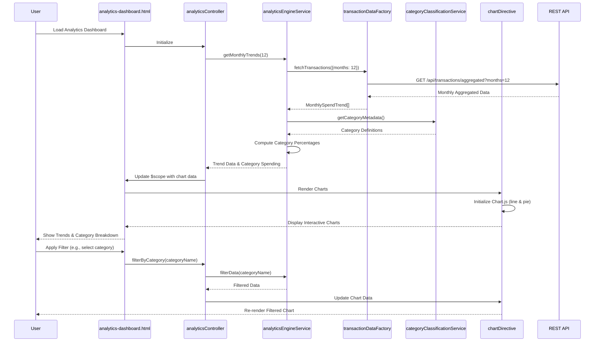

# Low-Level Design: Spending Analytics and Insights
**Epic ID:** QE-8545  
**Application Stack:** AngularJS 1.x, JavaScript ES6, HTML5, CSS3, Bootstrap, REST APIs, MVC Architecture

---

## a. Architecture Mapping

- **Analytics Controller** → AngularJS Controller (`analyticsController.js`) - Manages analytics view state and user interactions
- **Analytics Engine** → AngularJS Service (`analyticsEngineService.js`) - Processes and aggregates spending data for visualization
- **Transaction Data Service** → AngularJS Factory (`transactionDataFactory.js`) - Fetches categorized transaction data via REST API
- **Category Classification Module** → AngularJS Service (`categoryClassificationService.js`) - Maps transactions to nine spending categories
- **Data Visualization Library** → AngularJS Directive (`chartDirective.js`) wrapping Chart.js or D3.js for interactive charts
- **Analytics Dashboard UI** → AngularJS Template (`analytics-dashboard.html`) with Bootstrap layout

**Recommended Folder Structure:**
```
/app
  /modules
    /analytics
      /controllers (analyticsController.js)
      /services (analyticsEngineService.js, categoryClassificationService.js)
      /factories (transactionDataFactory.js)
      /directives (chartDirective.js)
      /views (analytics-dashboard.html)
      /styles (analytics.css)
```

---

## b. Component Specifications

| Component Name | Artifact Type | Responsibility | Key Dependencies |
|----------------|---------------|----------------|------------------|
| analyticsController | Controller | Manages analytics dashboard state, handles filter/drill-down interactions | analyticsEngineService, $scope, $filter |
| analyticsEngineService | Service | Aggregates monthly trends, computes category-wise spending, prepares chart data | transactionDataFactory, categoryClassificationService |
| transactionDataFactory | Factory | REST API calls to fetch transaction data for specified date ranges | $http, $q |
| categoryClassificationService | Service | Classifies transactions into nine categories, provides category metadata | None (static mapping logic) |
| chartDirective | Directive | Renders interactive charts (line for trends, pie for categories) using Chart.js | Chart.js library, $timeout |
| analytics-dashboard.html | Template | Displays trend charts, category breakdown, filter controls | analyticsController, chartDirective, Bootstrap |

---

## c. Data Model

**MonthlySpendTrend (JavaScript Object)**
```javascript
{
  month: String,                 // Format: "YYYY-MM"
  totalSpend: Number,
  categoryBreakdown: Object      // { "Food & Dining": 500, "Fuel": 200, ... }
}
```

**CategorySpending (JavaScript Object)**
```javascript
{
  categoryName: String,          // One of nine categories
  amount: Number,
  percentage: Number,            // Percentage of total spend
  transactionCount: Number
}
```

**Transaction (JavaScript Object)**
```javascript
{
  transactionId: String,
  amount: Number,
  category: String,
  date: Date,
  description: String
}
```

---

## d. Data Flow

User navigates to analytics dashboard → `analytics-dashboard.html` loads → `analyticsController` calls `analyticsEngineService.getMonthlyTrends(12)` to fetch 12 months of data → Service invokes `transactionDataFactory.fetchTransactions({months: 12})` via REST API → Factory returns pre-aggregated monthly summaries → Service processes data using `categoryClassificationService.getCategoryMetadata()` to enrich category information → Controller binds trend and category data to `$scope` → `chartDirective` renders line chart for monthly trends and pie chart for category breakdown using Chart.js → User applies filters (date range, category) → Controller updates data model and directives re-render charts with filtered data.

---

## e. Primary Sequence Diagram



---

## f. Implementation Notes

- Use AngularJS directive with isolated scope to encapsulate Chart.js integration; pass chart data via directive attributes
- Fetch pre-aggregated monthly data from API to meet 3-second rendering NFR; avoid client-side aggregation of raw transactions
- Implement client-side caching of 12-month data in `analyticsEngineService` using simple object store; invalidate on date range change
- Use AngularJS `$filter` service for interactive filtering (category, date range) without re-fetching data from API
- Apply ES6 array methods (map, reduce, filter) in `analyticsEngineService` for efficient data transformation

---

## g. Error Handling

HTTP interceptor captures API failures; display error message in analytics view with retry button using Bootstrap alert.

---

## h. Security Notes

Standard input validation and secure API calls assumed; category classification logic is client-side and does not expose sensitive data.

---