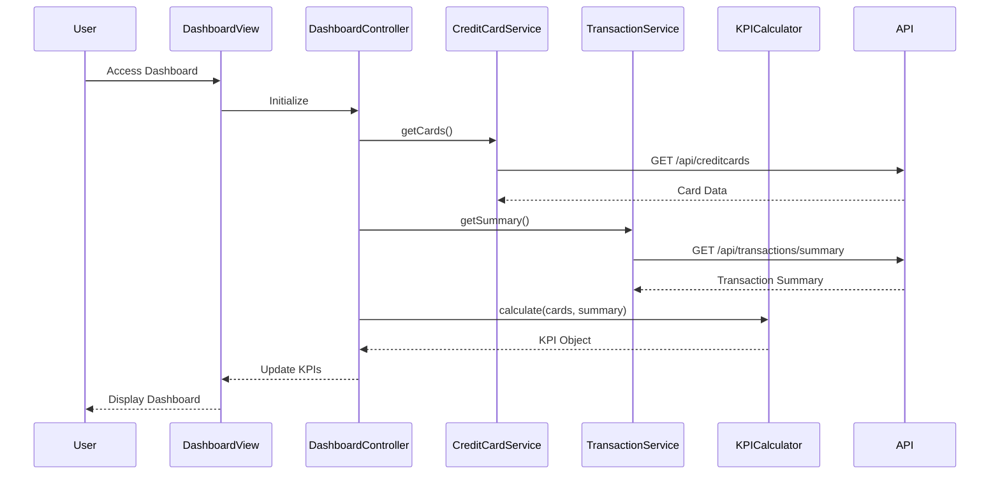

# Low-Level Design: Dashboard KPIs and Credit Card Overview
**Epic ID:** QE-8546  
**Stack:** AngularJS 1.x, JavaScript ES6, HTML5, CSS3, Bootstrap, REST APIs, MVC

---

## a. Architecture Mapping

- **Dashboard Module** → AngularJS Module (`creditCard.dashboard`)
- **Dashboard Controller** → AngularJS Controller (`DashboardController`)
- **Credit Card Data Service** → AngularJS Service (`CreditCardService`)
- **Transaction Processing** → AngularJS Service (`TransactionService`)
- **KPI Calculation Engine** → AngularJS Factory (`KPICalculator`)
- **User Authentication** → AngularJS Service (`AuthService`)

**Folder Structure:**
```
/app
  /modules
    /dashboard
      dashboard.module.js
      dashboard.controller.js
      dashboard.view.html
  /services
    creditcard.service.js
    transaction.service.js
    auth.service.js
  /factories
    kpi-calculator.factory.js
  /assets
    /css
    /js
```

---

## b. Component Specifications

| Component Name | Artifact Type | Responsibility | Key Dependencies |
|----------------|---------------|----------------|------------------|
| `creditCard.dashboard` | Module | Defines dashboard module and routes | `ngRoute`, `AuthService` |
| `DashboardController` | Controller | Orchestrates KPI display and data refresh | `CreditCardService`, `TransactionService`, `KPICalculator`, `$scope`, `$interval` |
| `CreditCardService` | Service | Fetches credit card data via REST API | `$http`, `API_CONFIG` |
| `TransactionService` | Service | Retrieves transaction summaries via REST API | `$http`, `API_CONFIG` |
| `KPICalculator` | Factory | Computes monthly spend, credit utilization, available credit | None |
| `AuthService` | Service | Manages user authentication and session | `$http`, `$window` |

---

## c. Data Model

**CreditCard Object:**
```javascript
{
  cardId: String,
  cardNumber: String,
  cardType: String,
  creditLimit: Number,
  outstandingAmount: Number,
  availableCredit: Number
}
```

**KPI Object:**
```javascript
{
  monthlySpend: Number,
  totalCreditLimit: Number,
  totalAvailableCredit: Number,
  totalOutstanding: Number,
  creditUtilization: Number
}
```

---

## d. Data Flow

User authenticates via `AuthService` → `DashboardController` initializes and calls `CreditCardService.getCards()` and `TransactionService.getSummary()` → Both services make REST API calls → `KPICalculator` aggregates card data and computes monthly spend, total credit limit, available credit, outstanding amounts, and utilization percentage → Computed KPIs are bound to `$scope` and rendered in the dashboard view → `$interval` triggers periodic refresh (every 60 seconds) to update KPIs in real-time.

---

## e. Primary Sequence Diagram



---

## f. Implementation Notes

- Use AngularJS Dependency Injection to inject services and factories into `DashboardController`.
- Implement ES6 classes for services; use `$http` promises with `.then()` and `.catch()` for API calls.
- Use `$interval` service for real-time data refresh (configurable interval, default 60s).
- Apply Bootstrap grid system for responsive layout (col-xs, col-sm, col-md, col-lg).
- Store API endpoints in a constant module (`API_CONFIG`) for maintainability.

---

## g. Error Handling

HTTP interceptor captures API errors; user-facing notifications displayed via Bootstrap alerts with retry option.

---

## h. Security Notes

Requires token-based auth via existing SSO; token passed in Authorization header for all API calls.