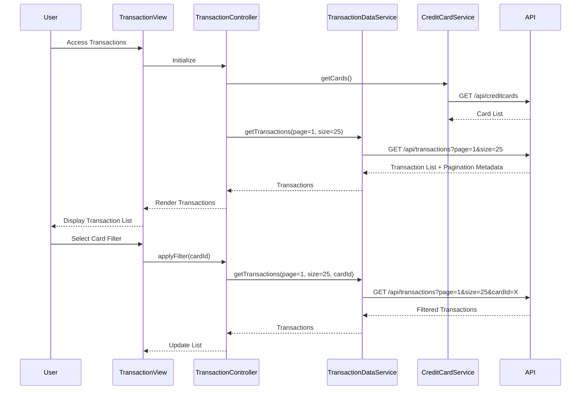

# Low-Level Design: Transaction Management and Monitoring
**Epic ID:** QE-8547  
**Stack:** AngularJS 1.x, JavaScript ES6, HTML5, CSS3, Bootstrap, REST APIs, MVC

---

## a. Architecture Mapping

- **Transaction Module** → AngularJS Module (`creditCard.transactions`)
- **Transaction Controller** → AngularJS Controller (`TransactionController`)
- **Transaction Data Service** → AngularJS Service (`TransactionDataService`)
- **Credit Card Service** → AngularJS Service (`CreditCardService`)
- **Date Time Service** → AngularJS Service (`DateTimeService`)
- **Pagination Handler** → AngularJS Directive (`pagination`)

**Folder Structure:**
```
/app
  /modules
    /transactions
      transactions.module.js
      transactions.controller.js
      transactions.view.html
  /services
    transaction-data.service.js
    creditcard.service.js
    datetime.service.js
  /directives
    pagination.directive.js
  /assets
    /css
    /js
```

---

## b. Component Specifications

| Component Name | Artifact Type | Responsibility | Key Dependencies |
|----------------|---------------|----------------|------------------|
| `creditCard.transactions` | Module | Defines transaction module and routes | `ngRoute`, `AuthService` |
| `TransactionController` | Controller | Manages transaction list, filters, pagination | `TransactionDataService`, `CreditCardService`, `DateTimeService`, `$scope` |
| `TransactionDataService` | Service | Fetches transaction records via REST API | `$http`, `API_CONFIG` |
| `CreditCardService` | Service | Provides card list for filtering | `$http`, `API_CONFIG` |
| `DateTimeService` | Service | Formats timestamps and handles date operations | `moment.js` or native Date |
| `pagination` | Directive | Renders pagination controls and handles page navigation | `$scope`, `$attrs` |

---

## c. Data Model

**Transaction Object:**
```javascript
{
  transactionId: String,
  cardId: String,
  amount: Number,
  merchantName: String,
  category: String,
  timestamp: Date,
  status: String
}
```

**Pagination Object:**
```javascript
{
  currentPage: Number,
  pageSize: Number,
  totalRecords: Number,
  totalPages: Number
}
```

---

## d. Data Flow

User navigates to transaction view → `TransactionController` calls `TransactionDataService.getTransactions(page, pageSize, filters)` → Service makes REST API call with query parameters → API returns paginated transaction list → `DateTimeService` formats timestamps → Transactions bound to `$scope.transactions` and rendered in chronological order → User applies card filter via dropdown → Controller updates filter and re-fetches data → Pagination directive handles page navigation and triggers data refresh.

---

## e. Primary Sequence Diagram



---

## f. Implementation Notes

- Use AngularJS `ng-repeat` with `track by transactionId` for efficient list rendering.
- Implement pagination directive with isolated scope; emit events for page change.
- Use `$http` with query parameter serialization for filter and pagination support.
- Apply Bootstrap table classes for responsive transaction list display.
- Cache card list in `CreditCardService` to avoid redundant API calls.

---

## g. Error Handling

HTTP interceptor with try/catch in service layer; display user-friendly error messages via Bootstrap modals.

---

## h. Security Notes

Standard input validation and secure API calls assumed; token-based authentication required.