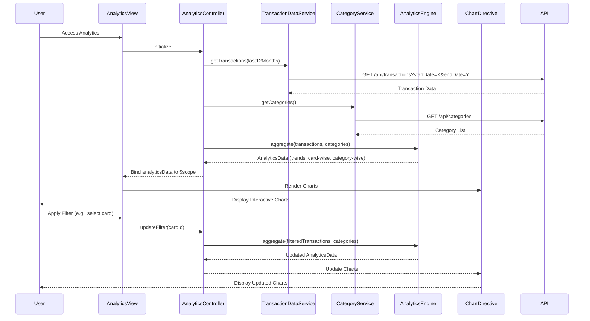

# Low-Level Design: Spending Analytics and Insights
**Epic ID:** QE-8548  
**Stack:** AngularJS 1.x, JavaScript ES6, HTML5, CSS3, Bootstrap, REST APIs, MVC

---

## a. Architecture Mapping

- **Analytics Module** → AngularJS Module (`creditCard.analytics`)
- **Analytics Controller** → AngularJS Controller (`AnalyticsController`)
- **Transaction Data Service** → AngularJS Service (`TransactionDataService`)
- **Transaction Categorization Service** → AngularJS Service (`CategoryService`)
- **Analytics Engine** → AngularJS Factory (`AnalyticsEngine`)
- **Visualization Library** → External Library (Chart.js or D3.js wrapped in AngularJS Directive)

**Folder Structure:**
```
/app
  /modules
    /analytics
      analytics.module.js
      analytics.controller.js
      analytics.view.html
  /services
    transaction-data.service.js
    category.service.js
  /factories
    analytics-engine.factory.js
  /directives
    chart.directive.js
  /assets
    /css
    /js
```

---

## b. Component Specifications

| Component Name | Artifact Type | Responsibility | Key Dependencies |
|----------------|---------------|----------------|------------------|
| `creditCard.analytics` | Module | Defines analytics module and routes | `ngRoute`, `AuthService` |
| `AnalyticsController` | Controller | Orchestrates data fetching, aggregation, and chart rendering | `TransactionDataService`, `CategoryService`, `AnalyticsEngine`, `$scope` |
| `TransactionDataService` | Service | Fetches historical transaction data via REST API | `$http`, `API_CONFIG` |
| `CategoryService` | Service | Provides category mappings and metadata | `$http`, `API_CONFIG` |
| `AnalyticsEngine` | Factory | Aggregates data by month, card, and category; computes trends | None |
| `chart` | Directive | Renders interactive charts using Chart.js or D3.js | `Chart.js` or `D3.js` |

---

## c. Data Model

**Transaction Object:**
```javascript
{
  transactionId: String,
  cardId: String,
  amount: Number,
  category: String,
  timestamp: Date
}
```

**AnalyticsData Object:**
```javascript
{
  monthlyTrends: Array<{month: String, amount: Number}>,
  cardWiseSpend: Array<{cardId: String, amount: Number}>,
  categoryWiseSpend: Array<{category: String, amount: Number}>
}
```

**Category List:**
```javascript
['Food & Dining', 'Fuel', 'Shopping', 'Travel', 'Entertainment', 'Utilities', 'Healthcare', 'Education', 'Miscellaneous']
```

---

## d. Data Flow

User accesses analytics view → `AnalyticsController` calls `TransactionDataService.getTransactions(last12Months)` and `CategoryService.getCategories()` → Services fetch data via REST APIs → `AnalyticsEngine` processes transactions to compute monthly trends, card-wise spend, and category-wise breakdown → Aggregated data is bound to `$scope.analyticsData` → Chart directive watches scope changes and renders interactive visualizations (line chart for trends, pie chart for category distribution, bar chart for card-wise spend) → User interacts with filters (date range, card selection) triggering re-aggregation and chart update.

---

## e. Primary Sequence Diagram



---

## f. Implementation Notes

- Use AngularJS `$watch` in chart directive to detect data changes and re-render charts.
- Implement `AnalyticsEngine` as a pure factory with ES6 methods for aggregation (reduce, map, filter).
- Use Chart.js for lightweight, responsive charts; wrap in AngularJS directive for two-way binding.
- Apply Bootstrap grid for multi-chart layout (monthly trends full-width, card/category charts side-by-side).
- Cache category list in `CategoryService` to minimize API calls.

---

## g. Error Handling

HTTP interceptor for API errors; user notified via Bootstrap alerts with option to retry data fetch.

---

## h. Security Notes

Standard input validation and secure API calls assumed; token-based authentication required for transaction data access.