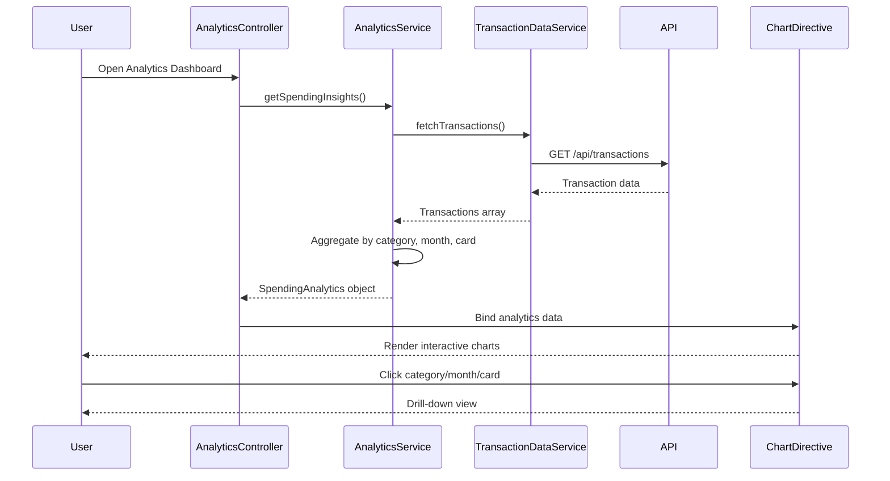

# Low-Level Design: QE-8549 - Spending Analytics and Insights

## a. Architecture Mapping

- **AnalyticsModule** (AngularJS Module) - Root module for analytics feature
- **AnalyticsController** (Controller) - Manages analytics dashboard UI state and user interactions
- **AnalyticsService** (Service) - Handles analytics calculations and data aggregation
- **TransactionDataService** (Service) - Retrieves transaction data from backend REST API
- **CategoryClassificationService** (Factory) - Categorizes transactions into spending categories
- **ChartDirective** (Directive) - Renders interactive charts using Chart.js

**Folder Structure:**
```
/app
  /modules
    /analytics
      analytics.module.js
      analytics.controller.js
      analytics.service.js
      analytics.html
  /services
    transaction-data.service.js
    category-classification.service.js
  /directives
    chart.directive.js
```

## b. Component Specifications

| Name | Artifact Type | Responsibility | Key Dependencies |
|------|---------------|----------------|------------------|
| AnalyticsModule | Module | Registers analytics feature components and routes | angular, angular-route, chart.js |
| AnalyticsController | Controller | Manages dashboard state, fetches analytics data, handles user interactions | AnalyticsService, $scope |
| AnalyticsService | Service | Aggregates spending data by category, month, and card; calculates trends | TransactionDataService, CategoryClassificationService |
| TransactionDataService | Service | Fetches transaction data from REST API endpoint /api/transactions | $http, $q |
| CategoryClassificationService | Factory | Maps transactions to 9 spending categories (Food, Fuel, Shopping, Travel, Entertainment, Utilities, Healthcare, Education, Misc) | None |
| ChartDirective | Directive | Renders pie, line, and bar charts with interactive drill-down | chart.js library |

## c. Data Model

**SpendingAnalytics (JS Object):**
- `categoryBreakdown`: Array of {category: String, amount: Number, percentage: Number}
- `monthlyTrends`: Array of {month: String, totalSpend: Number}
- `cardWiseSpend`: Array of {cardId: String, cardName: String, totalSpend: Number}

**Transaction (JS Object):**
- `id`: String
- `date`: Date
- `amount`: Number
- `merchant`: String
- `category`: String (Food & Dining, Fuel, Shopping, Travel, Entertainment, Utilities, Healthcare, Education, Miscellaneous)
- `cardId`: String

## d. Data Flow

User opens analytics dashboard → AnalyticsController initializes → Calls AnalyticsService.getSpendingInsights() → Service invokes TransactionDataService to fetch transactions via GET /api/transactions → CategoryClassificationService categorizes each transaction → AnalyticsService aggregates data into categoryBreakdown, monthlyTrends, and cardWiseSpend → Returns analytics object to controller → Controller binds data to $scope → ChartDirective renders interactive visualizations (pie chart for categories, line chart for trends, bar chart for cards) → User interacts with charts to drill down.

## e. Primary Sequence Diagram



## f. Implementation Notes

- Use AngularJS DI to inject services into controllers; follow ES6 class syntax for controllers and services
- Leverage Chart.js for rendering; wrap in custom directive for AngularJS integration and two-way data binding
- REST API calls via $http with promise-based error handling; cache transaction data in service for performance
- Apply filters in controller for date range selection; use Angular's $filter for client-side data manipulation
- Implement lazy loading for historical data beyond 12 months to optimize initial load time

## g. Error Handling

HTTP interceptor captures API errors; display user-friendly notifications via toast/modal; retry logic for transient failures.

## h. Security Notes

Standard input validation and secure API calls assumed; token-based auth via existing SSO.