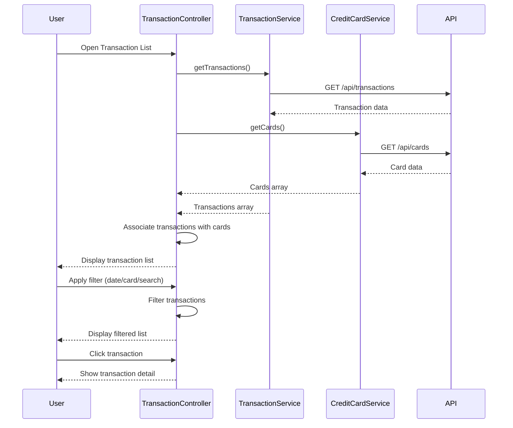

# Low-Level Design: QE-8550 - Transaction Management and Monitoring

## a. Architecture Mapping

- **TransactionModule** (AngularJS Module) - Root module for transaction management feature
- **TransactionController** (Controller) - Manages transaction list and detail views
- **TransactionService** (Service) - Retrieves and filters transaction data
- **CreditCardService** (Service) - Fetches credit card details to associate with transactions
- **TransactionFilterDirective** (Directive) - Provides filtering and search UI controls

**Folder Structure:**
```
/app
  /modules
    /transactions
      transaction.module.js
      transaction.controller.js
      transaction.service.js
      transaction-list.html
      transaction-detail.html
  /services
    credit-card.service.js
  /directives
    transaction-filter.directive.js
```

## b. Component Specifications

| Name | Artifact Type | Responsibility | Key Dependencies |
|------|---------------|----------------|------------------|
| TransactionModule | Module | Registers transaction feature components and routes | angular, angular-route |
| TransactionController | Controller | Manages transaction list/detail views, handles pagination and filtering | TransactionService, CreditCardService, $scope, $routeParams |
| TransactionService | Service | Fetches transactions from REST API, applies client-side filters | $http, $q |
| CreditCardService | Service | Retrieves credit card details from REST API endpoint /api/cards | $http, $q |
| TransactionFilterDirective | Directive | Renders filter controls (date range, card selector, search box) and emits filter events | None |

## c. Data Model

**Transaction (JS Object):**
- `id`: String
- `date`: Date
- `merchant`: String
- `amount`: Number
- `category`: String
- `cardId`: String
- `cardName`: String
- `cardLastFourDigits`: String

**CreditCard (JS Object):**
- `id`: String
- `name`: String
- `lastFourDigits`: String
- `type`: String

## d. Data Flow

User opens transaction list → TransactionController initializes → Calls TransactionService.getTransactions() → Service invokes GET /api/transactions → Fetches card details via CreditCardService.getCards() (GET /api/cards) → Associates each transaction with card details → Returns enriched transaction array to controller → Controller binds to $scope → UI renders transaction list → User applies filter (date/card/search) via TransactionFilterDirective → Directive emits filter event → Controller updates filtered transaction list → User clicks transaction → Controller navigates to detail view with transaction ID.

## e. Primary Sequence Diagram



## f. Implementation Notes

- Use AngularJS DI for service injection; implement pagination with ng-repeat limitTo filter for large datasets
- REST API calls via $http with promise chaining; cache card data in service to avoid redundant API calls
- Implement client-side filtering using Angular's $filter service for date range, card, and text search
- Use $routeParams to pass transaction ID for detail view; fetch full transaction details if needed
- Apply debounce to search input (300ms) to reduce filter operations during typing

## g. Error Handling

HTTP interceptor handles API errors; display error messages via notification service; fallback to cached data if available.

## h. Security Notes

Requires token-based auth via existing SSO; standard input validation and secure API calls assumed.