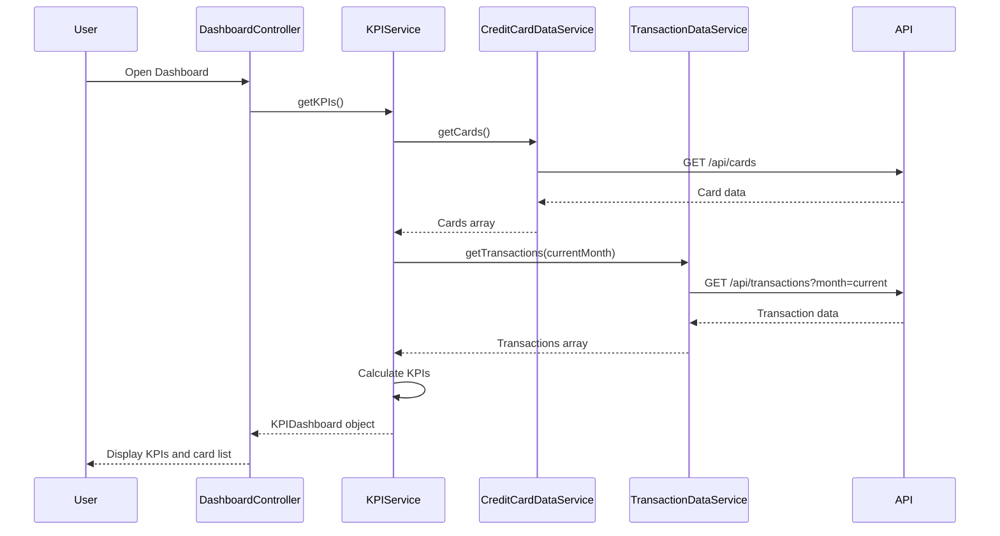

# Low-Level Design: QE-8551 - Dashboard KPIs and Credit Card Overview

## a. Architecture Mapping

- **DashboardModule** (AngularJS Module) - Root module for dashboard feature
- **DashboardController** (Controller) - Manages dashboard UI state and KPI display
- **KPIService** (Service) - Calculates KPIs (monthly spend, credit limit, available credit, outstanding)
- **CreditCardDataService** (Service) - Retrieves credit card details and balances from REST API
- **TransactionDataService** (Service) - Fetches transaction data for spend calculations
- **KPICardDirective** (Directive) - Renders individual KPI cards with responsive layout

**Folder Structure:**
```
/app
  /modules
    /dashboard
      dashboard.module.js
      dashboard.controller.js
      dashboard.html
  /services
    kpi.service.js
    credit-card-data.service.js
    transaction-data.service.js
  /directives
    kpi-card.directive.js
```

## b. Component Specifications

| Name | Artifact Type | Responsibility | Key Dependencies |
|------|---------------|----------------|------------------|
| DashboardModule | Module | Registers dashboard components and routes | angular, angular-route, bootstrap |
| DashboardController | Controller | Manages dashboard state, fetches KPIs, handles refresh | KPIService, $scope |
| KPIService | Service | Calculates monthly spend, total credit limit, available credit, outstanding amount | CreditCardDataService, TransactionDataService |
| CreditCardDataService | Service | Fetches credit card details (limits, balances) from REST API endpoint /api/cards | $http, $q |
| TransactionDataService | Service | Retrieves current month transactions from REST API endpoint /api/transactions | $http, $q |
| KPICardDirective | Directive | Renders KPI card with title, value, icon, and responsive styling | None |

## c. Data Model

**KPIDashboard (JS Object):**
- `monthlySpend`: Number
- `totalCreditLimit`: Number
- `availableCredit`: Number
- `outstandingAmount`: Number
- `cards`: Array of CreditCard

**CreditCard (JS Object):**
- `id`: String
- `name`: String
- `lastFourDigits`: String
- `creditLimit`: Number
- `currentBalance`: Number
- `availableCredit`: Number

## d. Data Flow

User opens dashboard → DashboardController initializes → Calls KPIService.getKPIs() → Service invokes CreditCardDataService.getCards() (GET /api/cards) to fetch card details → Invokes TransactionDataService.getTransactions() with current month filter (GET /api/transactions?month=current) → Calculates totalCreditLimit (sum of all card limits), availableCredit (sum of available credit per card), outstandingAmount (sum of current balances), monthlySpend (sum of current month transaction amounts) → Returns KPIDashboard object to controller → Controller binds to $scope → KPICardDirective renders each KPI in responsive grid layout → UI displays KPIs and card list.

## e. Primary Sequence Diagram



## f. Implementation Notes

- Use AngularJS DI to inject services; implement ES6 classes for controllers and services
- REST API calls via $http with promise-based chaining; implement $q.all for parallel API calls to optimize load time
- Bootstrap grid system for responsive KPI card layout (col-xs-12, col-sm-6, col-md-3)
- Cache card data in service for 5 minutes to reduce API calls; invalidate on user-triggered refresh
- Use Angular's currency filter for formatting monetary values in KPI cards

## g. Error Handling

HTTP interceptor captures API errors; display user-friendly error messages via toast notification; retry mechanism for failed requests.

## h. Security Notes

Requires token-based auth via existing SSO; standard input validation and secure API calls assumed.