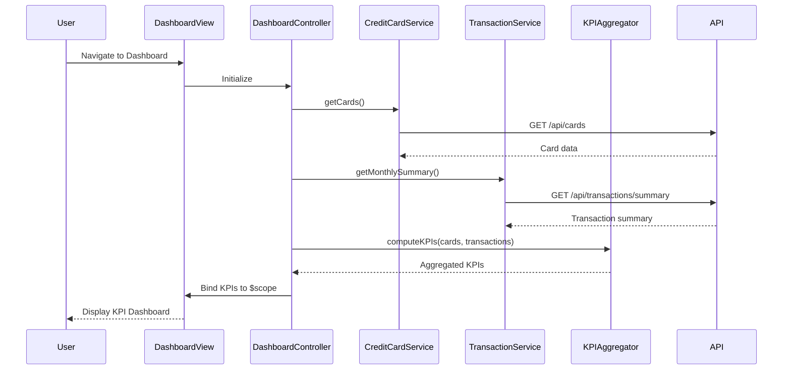

# Low-Level Design: QE-8552 - Dashboard and KPI Management

## a. Architecture Mapping

- **Dashboard Controller** → AngularJS Controller (`dashboardController.js`) - Orchestrates KPI data flow and view updates
- **Credit Card Data Service** → AngularJS Service (`creditCardService.js`) - Fetches card balances, limits, and available credit via REST API
- **Transaction Service** → AngularJS Service (`transactionService.js`) - Retrieves monthly spend and outstanding amounts via REST API
- **KPI Aggregation Engine** → AngularJS Factory (`kpiAggregator.js`) - Computes portfolio-level metrics from raw card and transaction data
- **Dashboard View** → HTML5 Template (`dashboard.html`) with Bootstrap grid and CSS3 styling

**Recommended Folder Structure:**
```
app/
├── modules/
│   └── dashboard/
│       ├── controllers/
│       │   └── dashboardController.js
│       ├── services/
│       │   ├── creditCardService.js
│       │   └── transactionService.js
│       ├── factories/
│       │   └── kpiAggregator.js
│       └── views/
│           └── dashboard.html
├── shared/
│   └── styles/
│       └── dashboard.css
└── app.js
```

## b. Component Specifications

| Component Name | Artifact Type | Responsibility | Key Dependencies |
|---|---|---|---|
| dashboardController | Controller | Manages dashboard state, triggers KPI refresh, binds data to view | creditCardService, transactionService, kpiAggregator, $scope, $interval |
| creditCardService | Service | Fetches card balances, limits, available credit from REST API `/api/cards` | $http, $q |
| transactionService | Service | Retrieves monthly spend and outstanding amounts from REST API `/api/transactions/summary` | $http, $q |
| kpiAggregator | Factory | Aggregates multi-card data into portfolio KPIs (total limit, available credit, monthly spend, outstanding) | None (pure computation) |
| dashboard.html | View | Renders KPI cards using Bootstrap grid, displays real-time metrics | dashboardController, Bootstrap CSS |

## c. Data Model

**KPI Model (JavaScript Object):**
```javascript
{
  monthlySpend: Number,        // Total spend for current month across all cards
  totalCreditLimit: Number,    // Sum of credit limits across all cards
  availableCredit: Number,     // Sum of available credit across all cards
  outstandingAmount: Number,   // Total outstanding balance across all cards
  lastUpdated: Date            // Timestamp of last data refresh
}
```

**Card Summary Model (JavaScript Object):**
```javascript
{
  cardId: String,
  cardName: String,
  creditLimit: Number,
  availableCredit: Number,
  outstandingBalance: Number
}
```

## d. Data Flow

User accesses the dashboard view → `dashboardController` initializes and calls `creditCardService.getCards()` and `transactionService.getMonthlySummary()` → Both services make parallel REST API calls → Responses are passed to `kpiAggregator.computeKPIs()` → Aggregated KPI object is bound to `$scope.kpis` → View automatically updates via AngularJS two-way binding, rendering KPI cards in Bootstrap grid → `$interval` triggers periodic refresh every 30 seconds to update KPIs in real-time.

## e. Primary Sequence Diagram



## f. Implementation Notes

- Use AngularJS Dependency Injection to inject `creditCardService`, `transactionService`, and `kpiAggregator` into `dashboardController`
- Leverage `$http` service with Promises (`$q`) for asynchronous REST API calls; handle responses with `.then()` and errors with `.catch()`
- Implement `$interval` service in controller to auto-refresh KPIs every 30 seconds; cancel interval on `$scope.$on('$destroy')` to prevent memory leaks
- Use Bootstrap responsive grid (`col-xs-12 col-md-6 col-lg-3`) for KPI card layout to ensure mobile and desktop compatibility
- Apply ES6 arrow functions and `const`/`let` for cleaner service and factory code; use template literals for dynamic API endpoint construction

## g. Error Handling

HTTP interceptor-based error handling with user-friendly toast notifications for API failures; retry logic for transient errors in services.

## h. Security Notes

Requires token-based authentication via existing SSO; API calls include Authorization header with JWT token.