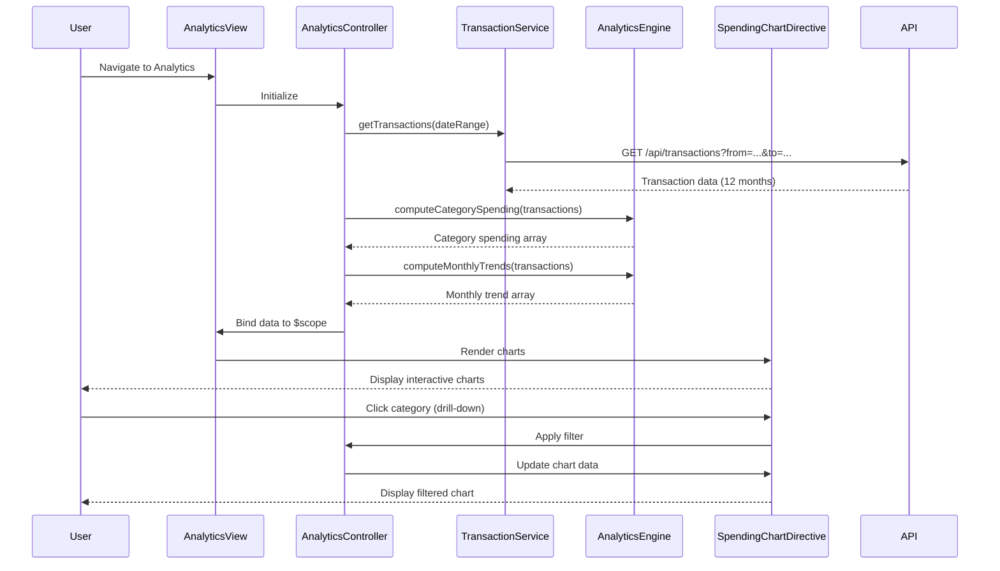

# Low-Level Design: QE-8553 - Analytics and Spending Insights

## a. Architecture Mapping

- **Analytics Controller** → AngularJS Controller (`analyticsController.js`) - Manages analytics view state, filters, and chart interactions
- **Transaction Service** → AngularJS Service (`transactionService.js`) - Fetches raw transaction data from REST API `/api/transactions`
- **Category Classification Service** → AngularJS Service (`categoryService.js`) - Retrieves categorized transaction data from REST API `/api/transactions/categorized`
- **Analytics Engine** → AngularJS Factory (`analyticsEngine.js`) - Computes trends, aggregations, and category-wise spending summaries
- **Visualization Component** → AngularJS Directive (`spendingChart`) - Renders interactive charts using Chart.js library
- **Analytics View** → HTML5 Template (`analytics.html`) with Bootstrap layout and CSS3 styling

**Recommended Folder Structure:**
```
app/
├── modules/
│   └── analytics/
│       ├── controllers/
│       │   └── analyticsController.js
│       ├── services/
│       │   ├── transactionService.js
│       │   └── categoryService.js
│       ├── factories/
│       │   └── analyticsEngine.js
│       ├── directives/
│       │   └── spendingChart.js
│       └── views/
│           └── analytics.html
├── shared/
│   └── styles/
│       └── analytics.css
└── app.js
```

## b. Component Specifications

| Component Name | Artifact Type | Responsibility | Key Dependencies |
|---|---|---|---|
| analyticsController | Controller | Manages analytics state, applies filters, triggers chart updates | transactionService, categoryService, analyticsEngine, $scope, $filter |
| transactionService | Service | Fetches raw transaction data from REST API `/api/transactions` with date range parameters | $http, $q |
| categoryService | Service | Retrieves categorized transactions from REST API `/api/transactions/categorized` | $http, $q |
| analyticsEngine | Factory | Computes monthly trends, category-wise spending totals, and spending patterns from transaction data | None (pure computation) |
| spendingChart | Directive | Renders interactive bar/pie charts using Chart.js; supports drill-down and filtering | Chart.js library, $timeout |
| analytics.html | View | Displays category filters, monthly trend chart, and category-wise spending breakdown using Bootstrap grid | analyticsController, Bootstrap CSS, Chart.js |

## c. Data Model

**Transaction Model (JavaScript Object):**
```javascript
{
  transactionId: String,
  cardId: String,
  amount: Number,
  category: String,           // One of 9 predefined categories
  transactionDate: Date,
  description: String
}
```

**Category Spending Model (JavaScript Object):**
```javascript
{
  category: String,           // Food & Dining, Fuel, Shopping, Travel, Entertainment, Utilities, Healthcare, Education, Miscellaneous
  totalSpend: Number,
  transactionCount: Number,
  percentageOfTotal: Number
}
```

**Monthly Trend Model (JavaScript Array):**
```javascript
[
  {
    month: String,            // 'YYYY-MM' format
    totalSpend: Number
  }
]
```

## d. Data Flow

User navigates to analytics view → `analyticsController` initializes and calls `transactionService.getTransactions()` with 12-month date range → Service fetches raw transaction data via REST API → Controller passes data to `analyticsEngine.computeCategorySpending()` and `analyticsEngine.computeMonthlyTrends()` → Computed results are bound to `$scope.categoryData` and `$scope.trendData` → `spendingChart` directive watches scope changes and renders interactive Chart.js visualizations → User applies category filter → Controller updates scope, directive re-renders chart with filtered data.

## e. Primary Sequence Diagram



## f. Implementation Notes

- Use AngularJS Dependency Injection to inject `transactionService`, `categoryService`, and `analyticsEngine` into `analyticsController`
- Leverage `$http` with Promises for REST API calls; use query parameters for date range filtering (`?from=2023-01-01&to=2023-12-31`)
- Implement `spendingChart` directive with isolated scope and two-way data binding; use Chart.js `new Chart()` API to render bar and pie charts
- Apply AngularJS `$filter` service for client-side category filtering and date formatting
- Use ES6 array methods (`map`, `reduce`, `filter`) in `analyticsEngine` for efficient data aggregation and trend calculation

## g. Error Handling

HTTP interceptor captures API errors; controller displays user-friendly error messages via Bootstrap alerts; empty state handling for no transaction data.

## h. Security Notes

Standard input validation and secure API calls assumed; token-based auth via existing SSO for API access.