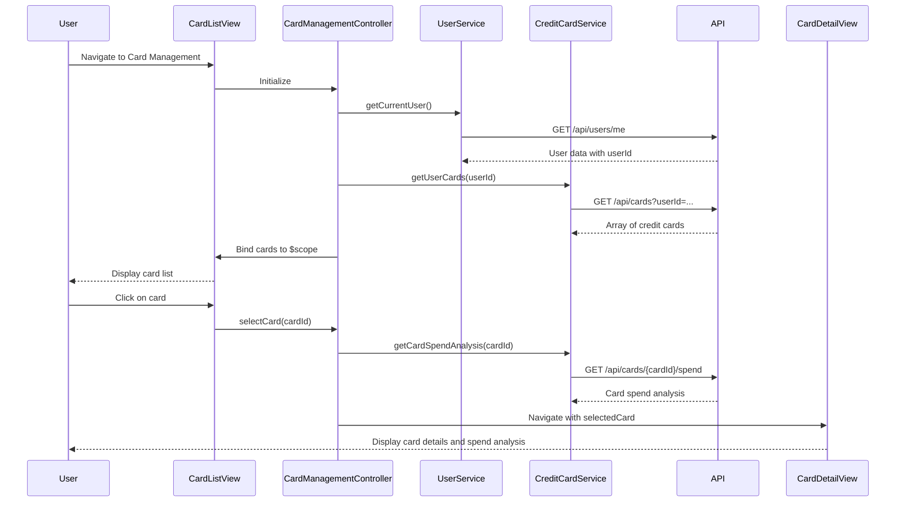

# Low-Level Design: QE-8554 - Multiple Credit Card Management

## a. Architecture Mapping

- **Card Management Controller** → AngularJS Controller (`cardManagementController.js`) - Manages card list, selection, and card-specific view state
- **Credit Card Service** → AngularJS Service (`creditCardService.js`) - Fetches card details, metadata, balances, and limits from REST API `/api/cards`
- **User Service** → AngularJS Service (`userService.js`) - Retrieves user account information and card associations from REST API `/api/users/me`
- **Card Data Repository** → Backend REST API endpoints (not implemented in frontend)
- **Card List View** → HTML5 Template (`card-list.html`) with Bootstrap cards and CSS3 styling
- **Card Detail View** → HTML5 Template (`card-detail.html`) displaying individual card metrics

**Recommended Folder Structure:**
```
app/
├── modules/
│   └── cards/
│       ├── controllers/
│       │   └── cardManagementController.js
│       ├── services/
│       │   ├── creditCardService.js
│       │   └── userService.js
│       └── views/
│           ├── card-list.html
│           └── card-detail.html
├── shared/
│   └── styles/
│       └── cards.css
└── app.js
```

## b. Component Specifications

| Component Name | Artifact Type | Responsibility | Key Dependencies |
|---|---|---|---|
| cardManagementController | Controller | Manages card list state, handles card selection, switches between card views | creditCardService, userService, $scope, $state |
| creditCardService | Service | Fetches all user cards, individual card details, balances, limits, and spend analysis from REST API `/api/cards` | $http, $q |
| userService | Service | Retrieves user account info and card associations from REST API `/api/users/me` | $http, $q |
| card-list.html | View | Displays all user cards in Bootstrap card grid with summary info (name, limit, balance) | cardManagementController, Bootstrap CSS |
| card-detail.html | View | Renders detailed view of selected card including credit limit, available credit, outstanding balance, and spend analysis | cardManagementController, Bootstrap CSS |

## c. Data Model

**Credit Card Model (JavaScript Object):**
```javascript
{
  cardId: String,
  cardName: String,
  cardType: String,              // Visa, Mastercard, Amex, etc.
  cardNumber: String,            // Masked (e.g., '**** **** **** 1234')
  creditLimit: Number,
  availableCredit: Number,
  outstandingBalance: Number,
  billingCycle: String,          // 'YYYY-MM-DD' format
  isActive: Boolean
}
```

**Card Spend Analysis Model (JavaScript Object):**
```javascript
{
  cardId: String,
  currentMonthSpend: Number,
  lastMonthSpend: Number,
  yearToDateSpend: Number
}
```

## d. Data Flow

User navigates to card management view → `cardManagementController` initializes and calls `userService.getCurrentUser()` to retrieve user ID → Controller then calls `creditCardService.getUserCards(userId)` → Service makes REST API call to `/api/cards?userId=...` → Card list is returned and bound to `$scope.cards` → View renders card list using Bootstrap grid with ng-repeat → User clicks on a card → Controller sets `$scope.selectedCard` and navigates to card detail view using `$state.go('card-detail')` → Detail view displays card-specific metrics and spend analysis fetched via `creditCardService.getCardSpendAnalysis(cardId)`.

## e. Primary Sequence Diagram



## f. Implementation Notes

- Use AngularJS Dependency Injection to inject `creditCardService` and `userService` into `cardManagementController`
- Leverage `$http` service with Promises for REST API calls; cache user card list in service using `$cacheFactory` to reduce API calls on view re-entry
- Implement card selection using `ng-click` directive bound to controller method `selectCard(card)`; use `$state` service (UI-Router) for navigation between list and detail views
- Use Bootstrap card component (`card`, `card-body`, `card-title`) for responsive card layout; apply CSS3 transitions for smooth card selection animations
- Apply ES6 template literals for dynamic API endpoint construction; use `const` and arrow functions in services for cleaner code

## g. Error Handling

HTTP interceptor-based error handling with toast notifications for API failures; display empty state message if user has no cards associated.

## h. Security Notes

Requires token-based auth via existing SSO; ensure data isolation by validating userId in API requests; mask sensitive card numbers in UI.