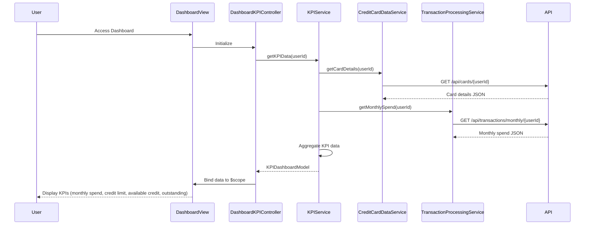

# Low-Level Design: Dashboard KPIs and Credit Card Overview
**Epic ID:** QE-8555  
**Feature:** Consolidated dashboard displaying key performance indicators for credit card portfolio

---

## a. Architecture Mapping

**AngularJS Artifacts:**
- **Module:** `creditCardDashboardModule` - Main module encapsulating dashboard functionality
- **Controller:** `DashboardKPIController` - Manages KPI data binding and user interactions
- **Service:** `KPIService` - Handles KPI data aggregation and API calls
- **Service:** `CreditCardDataService` - Retrieves card details and balances via REST API
- **Service:** `TransactionProcessingService` - Calculates monthly spend and outstanding amounts
- **Directive:** `kpiCardDirective` - Reusable component for displaying individual KPI metrics
- **Factory:** `RealTimeRefreshFactory` - Manages periodic polling for real-time data updates

**Folder Structure:**
```
app/
├── modules/
│   └── dashboard/
│       ├── controllers/
│       │   └── DashboardKPIController.js
│       ├── services/
│       │   ├── KPIService.js
│       │   ├── CreditCardDataService.js
│       │   └── TransactionProcessingService.js
│       ├── directives/
│       │   └── kpiCardDirective.js
│       ├── factories/
│       │   └── RealTimeRefreshFactory.js
│       ├── views/
│       │   └── dashboard.html
│       └── dashboard.module.js
```

---

## b. Component Specifications

| Component Name | Artifact Type | Responsibility | Key Dependencies |
|----------------|---------------|----------------|------------------|
| DashboardKPIController | Controller | Binds KPI data to view, handles user interactions, triggers data refresh | KPIService, $scope, $interval |
| KPIService | Service | Aggregates multi-card KPI data, orchestrates calls to data services | CreditCardDataService, TransactionProcessingService, $http, $q |
| CreditCardDataService | Service | Fetches card details, balances, and credit limits from REST API | $http, $q |
| TransactionProcessingService | Service | Retrieves and calculates monthly spend and outstanding amounts | $http, $q |
| kpiCardDirective | Directive | Renders individual KPI metric with responsive layout | None |
| RealTimeRefreshFactory | Factory | Implements polling mechanism for real-time data updates (30s interval) | $interval, $rootScope |

---

## c. Data Model

**KPIDashboardModel (JavaScript Object):**
```javascript
{
  userId: String,
  monthlySpend: Number,
  totalCreditLimit: Number,
  availableCredit: Number,
  outstandingAmount: Number,
  cards: Array<CreditCard>,
  lastUpdated: Date
}
```

**CreditCard (JavaScript Object):**
```javascript
{
  cardId: String,
  cardNumber: String (masked),
  cardType: String,
  creditLimit: Number,
  availableCredit: Number,
  outstandingBalance: Number,
  monthlySpend: Number
}
```

---

## d. Data Flow

User accesses dashboard → DashboardKPIController initializes and calls KPIService.getKPIData() → KPIService makes parallel API calls via CreditCardDataService (for card details/balances) and TransactionProcessingService (for monthly spend/outstanding) → Services return promises resolved with JSON data → KPIService aggregates data across all cards into KPIDashboardModel → Controller binds aggregated data to $scope → View renders KPI cards using kpiCardDirective with responsive Bootstrap grid → RealTimeRefreshFactory polls every 30 seconds, triggering data refresh and UI update.

---

## e. Primary Sequence Diagram



---

## f. Implementation Notes

- Use AngularJS dependency injection for all services and controllers; register via `angular.module('creditCardDashboardModule', []).controller/service/directive`
- Implement KPIService using `$q.all()` for parallel API calls to improve performance; cache results for 30 seconds
- Use `$interval` in RealTimeRefreshFactory for polling; cancel interval on scope destruction to prevent memory leaks
- Apply Bootstrap responsive grid classes (col-xs-12, col-sm-6, col-md-3) in kpiCardDirective template for cross-device layout
- Use ES6 arrow functions and const/let in service implementations; transpile with Babel if needed

---

## g. Error Handling

HTTP interceptor-based error handling with user-friendly notifications via toastr or similar; retry failed API calls once before displaying error.

---

## h. Security Notes

Requires token-based authentication via existing SSO; include JWT token in Authorization header for all API calls.