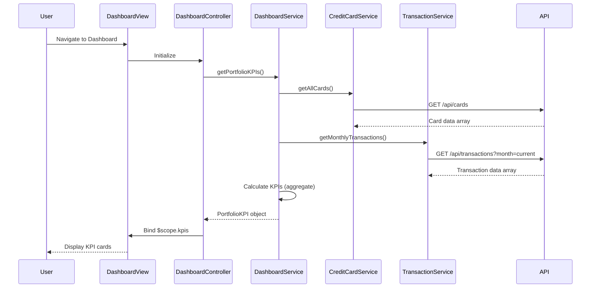

# Low-Level Design: QE-8555 - Dashboard KPIs and Credit Card Overview

## a. Architecture Mapping

- **App Module**: `creditCardApp` - Root AngularJS module with routing and dependency injection configuration
- **Dashboard Controller**: `DashboardController` - Orchestrates KPI display, handles user interactions, binds data to view
- **Dashboard Service**: `DashboardService` (Factory) - Aggregates data from multiple services, calculates portfolio-level KPIs
- **Credit Card Service**: `CreditCardService` (Factory) - REST API wrapper for fetching card details, balances, and limits
- **Transaction Service**: `TransactionService` (Factory) - REST API wrapper for fetching transaction data and calculating monthly spend
- **KPI Directive**: `kpiCard` - Reusable directive for rendering individual KPI cards with real-time updates

**Recommended Folder Structure:**
```
app/
├── modules/
│   └── dashboard/
│       ├── controllers/
│       │   └── dashboard.controller.js
│       ├── services/
│       │   ├── dashboard.service.js
│       │   ├── creditCard.service.js
│       │   └── transaction.service.js
│       ├── directives/
│       │   └── kpi-card.directive.js
│       └── views/
│           └── dashboard.html
├── shared/
│   ├── interceptors/
│   └── constants/
└── app.module.js
```

## b. Component Specifications

| Component Name | Artifact Type | Responsibility | Key Dependencies |
|----------------|---------------|----------------|------------------|
| creditCardApp | Module | Root module, routing, DI setup | ngRoute, ngResource |
| DashboardController | Controller | Bind KPI data to view, handle refresh | DashboardService, $scope |
| DashboardService | Factory | Aggregate multi-card data, calculate portfolio KPIs | CreditCardService, TransactionService, $q |
| CreditCardService | Factory | Fetch card details, balances, limits via REST | $http, API_ENDPOINTS |
| TransactionService | Factory | Fetch transactions, calculate monthly spend | $http, API_ENDPOINTS |
| kpiCard | Directive | Render individual KPI with icon, value, label | None |

## c. Data Model

**CreditCard Model:**
```javascript
{
  cardId: String,
  cardNumber: String (masked),
  cardType: String,
  creditLimit: Number,
  availableCredit: Number,
  outstandingAmount: Number,
  lastUpdated: Date
}
```

**PortfolioKPI Model:**
```javascript
{
  totalCreditLimit: Number,
  totalAvailableCredit: Number,
  totalOutstanding: Number,
  monthlySpend: Number,
  cardCount: Number
}
```

## d. Data Flow

User navigates to dashboard route → DashboardController initializes → calls DashboardService.getPortfolioKPIs() → DashboardService concurrently fetches all user cards via CreditCardService.getAllCards() and current month transactions via TransactionService.getMonthlyTransactions() using $q.all() → aggregates results to calculate total credit limit (sum of all card limits), total available credit (sum of available per card), total outstanding (sum of balances), and monthly spend (sum of current month transaction amounts) → returns PortfolioKPI object to controller → controller binds to $scope → view renders KPI cards using kpiCard directive → real-time refresh triggered via $interval or manual refresh button re-invokes the flow.

## e. Primary Sequence Diagram



## f. Implementation Notes

- Use AngularJS Factory pattern for services to enable singleton behavior and testability via DI
- Leverage $q.all() for concurrent API calls to minimize latency when fetching cards and transactions
- Implement $http interceptor for token injection and error handling across all REST calls
- Use Bootstrap grid system (col-md-3, col-sm-6, col-xs-12) for responsive KPI card layout
- Apply $interval service for auto-refresh every 30 seconds with cleanup on $scope.$on('$destroy')

## g. Error Handling

HTTP interceptor captures all API errors, displays user-friendly toast notifications via a shared NotificationService, and logs errors to console; service methods return rejected promises with error context.

## h. Security Notes

Requires token-based auth via existing SSO; all API calls include Authorization header with JWT token injected by HTTP interceptor.