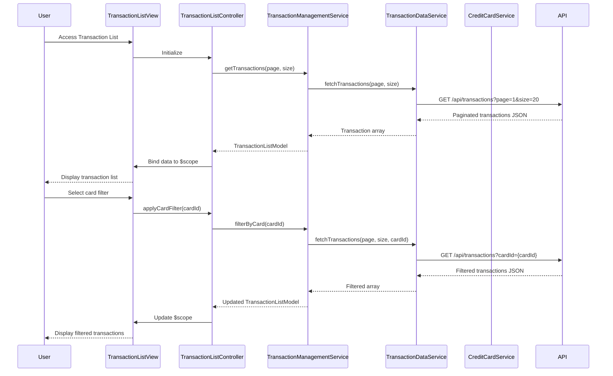

# Low-Level Design: Transaction Management and Monitoring
**Epic ID:** QE-8556  
**Feature:** Comprehensive transaction tracking with filtering and detailed view capabilities

---

## a. Architecture Mapping

**AngularJS Artifacts:**
- **Module:** `transactionManagementModule` - Main module for transaction tracking functionality
- **Controller:** `TransactionListController` - Manages transaction list display and filtering
- **Controller:** `TransactionDetailController` - Handles individual transaction detail view
- **Service:** `TransactionManagementService` - Orchestrates transaction retrieval and filtering logic
- **Service:** `TransactionDataService` - Fetches transaction records via REST API with pagination
- **Service:** `CreditCardService` - Provides card-specific filtering capabilities
- **Directive:** `transactionListItemDirective` - Renders individual transaction row
- **Filter:** `cardFilterPipe` - Client-side filter for card-wise transaction filtering

**Folder Structure:**
```
app/
├── modules/
│   └── transactions/
│       ├── controllers/
│       │   ├── TransactionListController.js
│       │   └── TransactionDetailController.js
│       ├── services/
│       │   ├── TransactionManagementService.js
│       │   ├── TransactionDataService.js
│       │   └── CreditCardService.js
│       ├── directives/
│       │   └── transactionListItemDirective.js
│       ├── filters/
│       │   └── cardFilterPipe.js
│       ├── views/
│       │   ├── transaction-list.html
│       │   └── transaction-detail.html
│       └── transactions.module.js
```

---

## b. Component Specifications

| Component Name | Artifact Type | Responsibility | Key Dependencies |
|----------------|---------------|----------------|------------------|
| TransactionListController | Controller | Manages transaction list display, pagination, and filter application | TransactionManagementService, CreditCardService, $scope |
| TransactionDetailController | Controller | Displays detailed view of selected transaction | TransactionDataService, $routeParams, $scope |
| TransactionManagementService | Service | Orchestrates transaction retrieval, applies filters, manages pagination state | TransactionDataService, CreditCardService, $q |
| TransactionDataService | Service | Fetches paginated transaction records from REST API | $http, $q |
| CreditCardService | Service | Provides card list for filtering and validates card-specific queries | $http, $q |
| transactionListItemDirective | Directive | Renders individual transaction row with click handler for detail view | None |
| cardFilterPipe | Filter | Filters transactions by selected card ID | None |

---

## c. Data Model

**Transaction (JavaScript Object):**
```javascript
{
  transactionId: String,
  cardId: String,
  cardNumber: String (masked),
  merchantName: String,
  category: String,
  amount: Number,
  currency: String,
  transactionDate: Date,
  status: String,
  description: String
}
```

**TransactionListModel (JavaScript Object):**
```javascript
{
  transactions: Array<Transaction>,
  totalCount: Number,
  currentPage: Number,
  pageSize: Number,
  selectedCardId: String (nullable)
}
```

---

## d. Data Flow

User accesses transaction interface → TransactionListController initializes and calls TransactionManagementService.getTransactions() → Service calls TransactionDataService with pagination params (page, size) → TransactionDataService makes GET request to /api/transactions with query params → API returns paginated JSON response → Service binds data to TransactionListModel → User selects card filter from dropdown → Controller updates selectedCardId and calls TransactionManagementService.filterByCard(cardId) → Service applies server-side filter via TransactionDataService → Filtered list displayed → User clicks transaction row → TransactionDetailController fetches full details via TransactionDataService.getTransactionById() → Detail view rendered.

---

## e. Primary Sequence Diagram



---

## f. Implementation Notes

- Use AngularJS `$http` service with interceptors for all API calls; implement pagination using query parameters (page, size, cardId)
- Implement server-side filtering for performance; apply filters via query params rather than client-side filtering for large datasets
- Use `ng-repeat` with `track by transactionId` in transaction list view for optimal rendering performance
- Implement lazy loading with infinite scroll or pagination controls using Bootstrap pagination component
- Use ES6 template literals for constructing API URLs; handle date formatting with Angular date filter or moment.js

---

## g. Error Handling

HTTP interceptor captures API errors; display user-friendly messages via modal or toastr; implement retry logic for network failures.

---

## h. Security Notes

Requires token-based auth via existing SSO; validate user access to transactions server-side; mask sensitive card data in API responses.