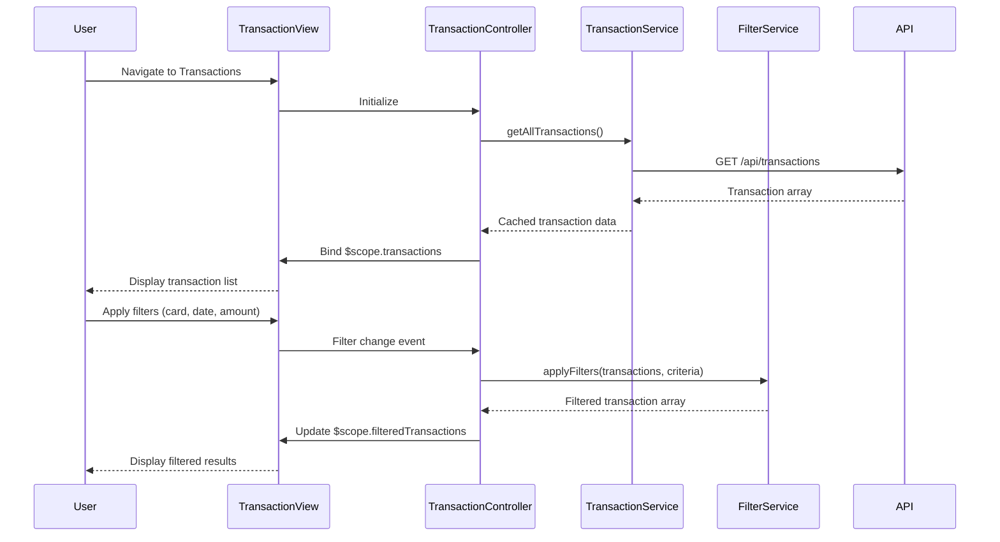

# Low-Level Design: QE-8556 - Transaction Management and Monitoring

## a. Architecture Mapping

- **App Module**: `creditCardApp` - Root module with transaction management routing
- **Transaction Controller**: `TransactionController` - Manages transaction list display, filtering, and detail view
- **Transaction Service**: `TransactionService` (Factory) - REST API wrapper for transaction data retrieval
- **Credit Card Service**: `CreditCardService` (Factory) - Fetches user's card list for filter dropdown
- **Filter Service**: `FilterService` (Factory) - Applies client-side filtering logic on transaction arrays
- **Transaction List Directive**: `transactionList` - Renders paginated transaction table with sorting

**Recommended Folder Structure:**
```
app/
├── modules/
│   └── transactions/
│       ├── controllers/
│       │   └── transaction.controller.js
│       ├── services/
│       │   ├── transaction.service.js
│       │   ├── creditCard.service.js
│       │   └── filter.service.js
│       ├── directives/
│       │   └── transaction-list.directive.js
│       └── views/
│           ├── transaction-list.html
│           └── transaction-detail.html
├── shared/
└── app.module.js
```

## b. Component Specifications

| Component Name | Artifact Type | Responsibility | Key Dependencies |
|----------------|---------------|----------------|------------------|
| TransactionController | Controller | Bind transaction data, handle filter changes, pagination | TransactionService, FilterService, $scope |
| TransactionService | Factory | Fetch transactions via REST, cache results | $http, $cacheFactory, API_ENDPOINTS |
| CreditCardService | Factory | Fetch user's card list for filter options | $http, API_ENDPOINTS |
| FilterService | Factory | Apply date, card, amount, merchant filters to transaction array | None |
| transactionList | Directive | Render transaction table with sorting and pagination | None |

## c. Data Model

**Transaction Model:**
```javascript
{
  transactionId: String,
  cardId: String,
  cardNumber: String (masked),
  date: Date,
  merchant: String,
  amount: Number,
  category: String,
  status: String,
  description: String
}
```

**FilterCriteria Model:**
```javascript
{
  cardId: String (optional),
  dateFrom: Date (optional),
  dateTo: Date (optional),
  minAmount: Number (optional),
  maxAmount: Number (optional),
  merchant: String (optional)
}
```

## d. Data Flow

User navigates to transaction list → TransactionController initializes → fetches user's cards via CreditCardService.getAllCards() to populate filter dropdown → fetches all transactions via TransactionService.getAllTransactions() → binds raw transaction array to $scope → user applies filters (card, date range, amount, merchant) → FilterService.applyFilters() processes the array client-side and returns filtered subset → controller updates $scope.filteredTransactions → transactionList directive renders paginated table → user clicks transaction row → controller navigates to detail view with transactionId parameter → detail view fetches single transaction via TransactionService.getTransactionById().

## e. Primary Sequence Diagram



## f. Implementation Notes

- Use $cacheFactory in TransactionService to cache transaction data and reduce redundant API calls
- Implement client-side filtering with FilterService for instant response; use Array.filter() with ES6 arrow functions
- Apply ng-repeat with track by transactionId for efficient DOM updates in transaction list
- Use Bootstrap table-responsive class for mobile-friendly transaction table rendering
- Implement pagination using AngularJS dirPagination or custom directive with configurable page size

## g. Error Handling

HTTP interceptor handles API failures; TransactionService methods catch errors and return rejected promises; controller displays error message via NotificationService toast.

## h. Security Notes

Standard input validation and secure API calls assumed; JWT token authentication enforced via HTTP interceptor.