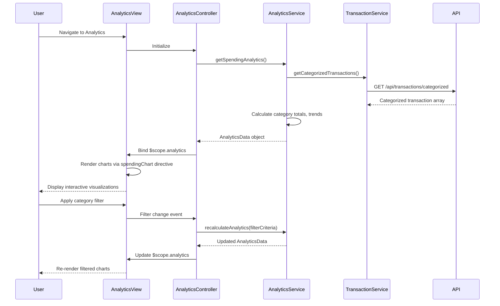

# Low-Level Design: QE-8557 - Spending Analytics and Insights

## a. Architecture Mapping

- **App Module**: `creditCardApp` - Root module with analytics routing
- **Analytics Controller**: `AnalyticsController` - Manages analytics view, chart rendering, filter interactions
- **Analytics Service**: `AnalyticsService` (Factory) - Aggregates transaction data, calculates category-wise and trend analytics
- **Transaction Service**: `TransactionService` (Factory) - Fetches categorized transaction data via REST
- **Chart Directive**: `spendingChart` - Wraps Chart.js or D3.js for rendering interactive visualizations
- **Category Filter Directive**: `categoryFilter` - Multi-select filter for spending categories

**Recommended Folder Structure:**
```
app/
├── modules/
│   └── analytics/
│       ├── controllers/
│       │   └── analytics.controller.js
│       ├── services/
│       │   ├── analytics.service.js
│       │   └── transaction.service.js
│       ├── directives/
│       │   ├── spending-chart.directive.js
│       │   └── category-filter.directive.js
│       └── views/
│           └── analytics.html
├── shared/
└── app.module.js
```

## b. Component Specifications

| Component Name | Artifact Type | Responsibility | Key Dependencies |
|----------------|---------------|----------------|------------------|
| AnalyticsController | Controller | Bind analytics data, handle filter/drill-down events | AnalyticsService, $scope |
| AnalyticsService | Factory | Calculate category totals, monthly trends, card-wise breakdowns | TransactionService, $q |
| TransactionService | Factory | Fetch categorized transactions via REST | $http, API_ENDPOINTS |
| spendingChart | Directive | Render interactive charts (bar, pie, line) using Chart.js | Chart.js library |
| categoryFilter | Directive | Multi-select dropdown for 9 predefined categories | None |

## c. Data Model

**CategorySpend Model:**
```javascript
{
  category: String,
  amount: Number,
  transactionCount: Number,
  percentage: Number
}
```

**MonthlyTrend Model:**
```javascript
{
  month: String,
  totalSpend: Number,
  categoryBreakdown: Array<CategorySpend>
}
```

**AnalyticsData Model:**
```javascript
{
  categorySpends: Array<CategorySpend>,
  monthlyTrends: Array<MonthlyTrend>,
  cardWiseSpends: Array<{cardId: String, amount: Number}>
}
```

## d. Data Flow

User navigates to analytics view → AnalyticsController initializes → calls AnalyticsService.getSpendingAnalytics() → AnalyticsService fetches categorized transactions via TransactionService.getCategorizedTransactions() → processes data to calculate category-wise totals (group by category, sum amounts), monthly trends (group by month and category), and card-wise breakdowns (group by cardId) → returns AnalyticsData object → controller binds to $scope → spendingChart directive renders bar chart for categories, line chart for monthly trends, and pie chart for card-wise distribution → user applies category filter or drills down into specific month → controller updates filter criteria → AnalyticsService recalculates filtered analytics → charts re-render with updated data.

## e. Primary Sequence Diagram



## f. Implementation Notes

- Use Chart.js library wrapped in AngularJS directive for declarative chart rendering with two-way data binding
- Leverage ES6 Array.reduce() and Map for efficient category aggregation and trend calculation
- Implement chart drill-down by binding click events in spendingChart directive to controller methods
- Use ng-options with track by for category filter dropdown to optimize rendering
- Apply debounce (300ms) on filter changes to prevent excessive recalculation during user interaction

## g. Error Handling

HTTP interceptor captures API errors; AnalyticsService returns rejected promises with error context; controller displays error notification and renders empty state in charts.

## h. Security Notes

Standard input validation and secure API calls assumed; JWT token authentication via HTTP interceptor.