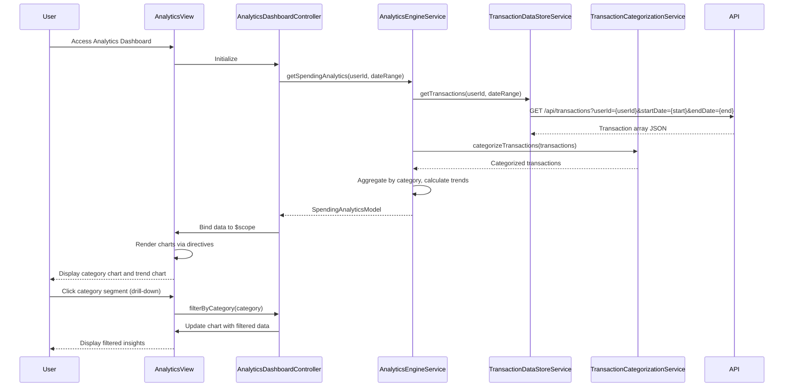

# Low-Level Design: Spending Analytics and Insights
**Epic ID:** QE-8557  
**Feature:** Interactive visualizations for spending pattern analysis across 9 predefined categories

---

## a. Architecture Mapping

**AngularJS Artifacts:**
- **Module:** `spendingAnalyticsModule` - Main module for analytics functionality
- **Controller:** `AnalyticsDashboardController` - Manages analytics view and user interactions with charts
- **Service:** `AnalyticsEngineService` - Calculates trends, aggregations, and category-wise spending
- **Service:** `TransactionCategorizationService` - Maps transactions to predefined spending categories
- **Service:** `TransactionDataStoreService` - Retrieves transaction data for analytics processing
- **Directive:** `categoryChartDirective` - Renders category-wise spending chart using Chart.js
- **Directive:** `trendChartDirective` - Renders monthly spend trend line chart
- **Factory:** `DataVisualizationFactory` - Configures and initializes Chart.js instances

**Folder Structure:**
```
app/
├── modules/
│   └── analytics/
│       ├── controllers/
│       │   └── AnalyticsDashboardController.js
│       ├── services/
│       │   ├── AnalyticsEngineService.js
│       │   ├── TransactionCategorizationService.js
│       │   └── TransactionDataStoreService.js
│       ├── directives/
│       │   ├── categoryChartDirective.js
│       │   └── trendChartDirective.js
│       ├── factories/
│       │   └── DataVisualizationFactory.js
│       ├── views/
│       │   └── analytics-dashboard.html
│       └── analytics.module.js
```

---

## b. Component Specifications

| Component Name | Artifact Type | Responsibility | Key Dependencies |
|----------------|---------------|----------------|------------------|
| AnalyticsDashboardController | Controller | Manages analytics view, handles drill-down interactions, applies filters | AnalyticsEngineService, $scope, $filter |
| AnalyticsEngineService | Service | Calculates category-wise spending, monthly trends, card-wise breakdowns | TransactionDataStoreService, TransactionCategorizationService, $q |
| TransactionCategorizationService | Service | Maps transactions to 9 predefined categories using rule-based logic | None |
| TransactionDataStoreService | Service | Fetches transaction data from REST API with date range filtering | $http, $q |
| categoryChartDirective | Directive | Renders interactive pie/bar chart for category-wise spending using Chart.js | DataVisualizationFactory |
| trendChartDirective | Directive | Renders line chart for monthly spend trends over time | DataVisualizationFactory |
| DataVisualizationFactory | Factory | Provides Chart.js configuration and initialization utilities | Chart.js library |

---

## c. Data Model

**SpendingAnalyticsModel (JavaScript Object):**
```javascript
{
  userId: String,
  dateRange: { startDate: Date, endDate: Date },
  categorySpending: Array<CategorySpend>,
  monthlyTrends: Array<MonthlySpend>,
  cardWiseSpending: Array<CardSpend>
}
```

**CategorySpend (JavaScript Object):**
```javascript
{
  category: String, // One of: Food & Dining, Fuel, Shopping, Travel, Entertainment, Utilities, Healthcare, Education, Miscellaneous
  totalAmount: Number,
  transactionCount: Number,
  percentage: Number
}
```

**MonthlySpend (JavaScript Object):**
```javascript
{
  month: String, // Format: YYYY-MM
  totalSpend: Number
}
```

**CardSpend (JavaScript Object):**
```javascript
{
  cardId: String,
  cardNumber: String (masked),
  totalSpend: Number,
  categoryBreakdown: Array<CategorySpend>
}
```

---

## d. Data Flow

User accesses analytics dashboard → AnalyticsDashboardController initializes and calls AnalyticsEngineService.getSpendingAnalytics(userId, dateRange) → AnalyticsEngineService calls TransactionDataStoreService.getTransactions(userId, dateRange) → API returns transaction array → TransactionCategorizationService.categorizeTransactions() maps each transaction to one of 9 categories → AnalyticsEngineService aggregates spending by category, calculates monthly trends, and computes card-wise breakdowns → Service returns SpendingAnalyticsModel → Controller binds data to $scope → categoryChartDirective and trendChartDirective render interactive Chart.js visualizations → User clicks chart segment for drill-down → Controller filters data and updates charts.

---

## e. Primary Sequence Diagram



---

## f. Implementation Notes

- Use Chart.js library for rendering interactive charts; wrap in AngularJS directives for reusability and data binding
- Implement TransactionCategorizationService with rule-based mapping (e.g., merchant name patterns, MCC codes) to assign categories
- Pre-aggregate monthly trends server-side for performance; fetch aggregated data via dedicated analytics API endpoint if available
- Use AngularJS `$filter` for client-side date range filtering when drilling down; apply Bootstrap responsive classes for chart containers
- Handle chart interactions (click, hover) using Chart.js event handlers; update $scope and trigger digest cycle with `$scope.$apply()`

---

## g. Error Handling

HTTP interceptor-based error handling; display user-friendly error messages if analytics data fails to load; gracefully degrade to empty charts with informative messages.

---

## h. Security Notes

Requires token-based auth via existing SSO; validate user access to transaction data server-side; ensure category mappings do not expose sensitive merchant data.