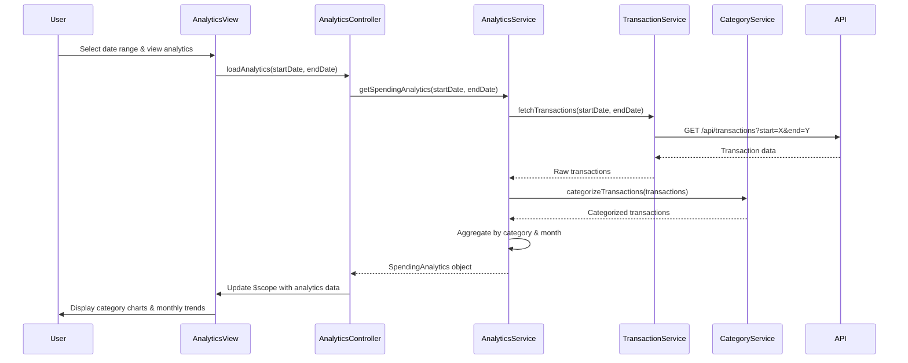

# Low-Level Design: QE-8558 - Spending Analytics and Insights

## a. Architecture Mapping

- **AngularJS Module**: `spendingAnalytics` - Main module for analytics feature
- **Controller**: `AnalyticsController` - Manages analytics UI state and user interactions
- **Service**: `AnalyticsService` - Handles data retrieval and aggregation logic
- **Service**: `CategoryService` - Manages category definitions and mappings
- **Service**: `TransactionService` - Fetches raw transaction data
- **Directive**: `spendingChart` - Renders interactive charts for category and trend visualization
- **Factory**: `VisualizationFactory` - Configures chart libraries (e.g., Chart.js/D3.js)

**Folder Structure:**
```
/app
  /modules
    /spending-analytics
      /controllers
        analytics.controller.js
      /services
        analytics.service.js
        category.service.js
        transaction.service.js
      /directives
        spending-chart.directive.js
      /factories
        visualization.factory.js
      /views
        analytics.html
      spending-analytics.module.js
```

## b. Component Specifications

| Name | Artifact Type | Responsibility | Key Dependencies |
|------|---------------|----------------|------------------|
| spendingAnalytics | Module | Root module for analytics feature | ngRoute, ngResource |
| AnalyticsController | Controller | Manages view state, handles user interactions, coordinates data flow | AnalyticsService, CategoryService, $scope |
| AnalyticsService | Service | Aggregates transaction data by category and time period | TransactionService, CategoryService, $http, $q |
| CategoryService | Service | Provides nine predefined categories and categorization logic | $http |
| TransactionService | Service | Fetches raw transaction data from REST API | $http, $q |
| spendingChart | Directive | Renders interactive charts with drill-down capability | VisualizationFactory, $timeout |
| VisualizationFactory | Factory | Wraps Chart.js/D3.js for consistent chart configuration | Chart.js or D3.js library |

## c. Data Model

**Category Model:**
```javascript
{
  id: Number,
  name: String, // e.g., "Food & Dining", "Fuel", "Shopping", etc.
  icon: String,
  color: String
}
```

**Transaction Model:**
```javascript
{
  id: Number,
  cardId: Number,
  amount: Number,
  date: Date,
  categoryId: Number,
  description: String,
  merchant: String
}
```

**SpendingAnalytics Model:**
```javascript
{
  categoryBreakdown: Array<{categoryId: Number, categoryName: String, totalAmount: Number, percentage: Number}>,
  monthlyTrend: Array<{month: String, totalAmount: Number, categoryBreakdown: Object}>,
  timeRange: {startDate: Date, endDate: Date}
}
```

## d. Data Flow

User selects date range and requests analytics view → AnalyticsController invokes AnalyticsService.getSpendingAnalytics() → AnalyticsService calls TransactionService to fetch raw transactions for the period → CategoryService categorizes transactions into nine predefined categories → AnalyticsService aggregates spending by category and month, calculates percentages → Aggregated data returned to controller → Controller binds data to $scope → spendingChart directive watches scope changes and invokes VisualizationFactory to render interactive charts → User interacts with charts (hover, click) to drill down into specific categories or time periods, triggering controller methods that update the view.

## e. Primary Sequence Diagram



## f. Implementation Notes

- Use AngularJS dependency injection for all services and controllers; register components via module.controller() and module.service()
- Implement promise-based API calls using $http service with $q for chaining and error handling
- Use directive isolated scope with two-way binding for chart data; watch for data changes to trigger re-rendering
- Leverage ES6 classes for service definitions; use arrow functions for callbacks to maintain context
- Implement client-side caching in AnalyticsService using $cacheFactory for 12-month historical data to reduce API calls

## g. Error Handling

HTTP interceptor captures API errors; service layer wraps calls in try/catch; user notified via toast/modal with retry option.

## h. Security Notes

Standard input validation and secure API calls assumed; token-based auth via existing SSO for API access.