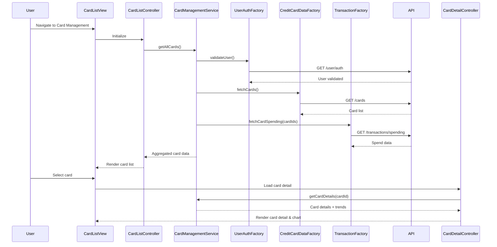

# Low-Level Design: Multiple Credit Card Management
**Epic ID:** QE-8559  
**Feature:** CreditCardNew20261109190012-Multiple Credit Card Management

---

## a. Architecture Mapping

- **Card Management UI Component** → AngularJS Module (`creditCard.management`) + Controller (`CardListController`, `CardDetailController`) + View Templates
- **Card Management Service** → AngularJS Service (`CardManagementService`) for orchestration and state management
- **Credit Card Data Service Integration** → AngularJS Factory (`CreditCardDataFactory`) for REST API calls
- **User Service Integration** → AngularJS Factory (`UserAuthFactory`) for authentication and ownership validation
- **Transaction Service Integration** → AngularJS Factory (`TransactionFactory`) for card-wise spending data

**Recommended Folder Structure:**
```
/app
  /modules
    /credit-card-management
      /controllers (CardListController.js, CardDetailController.js)
      /services (CardManagementService.js)
      /factories (CreditCardDataFactory.js, TransactionFactory.js, UserAuthFactory.js)
      /directives (cardTile.directive.js, spendTrendChart.directive.js)
      /views (card-list.html, card-detail.html)
      credit-card-management.module.js
```

---

## b. Component Specifications

| Component Name | Artifact Type | Responsibility | Key Dependencies |
|---|---|---|---|
| `creditCard.management` | Module | Root module for multi-card management feature | `ngRoute`, `chart.js` |
| `CardListController` | Controller | Manages list of cards, filtering, selection state | `CardManagementService`, `$scope` |
| `CardDetailController` | Controller | Displays individual card details and monthly trends | `CardManagementService`, `$routeParams`, `$scope` |
| `CardManagementService` | Service | Orchestrates data retrieval, caching, and state for cards | `CreditCardDataFactory`, `TransactionFactory`, `UserAuthFactory` |
| `CreditCardDataFactory` | Factory | REST API calls to Credit Card Data Service | `$http`, `API_CONFIG` |
| `TransactionFactory` | Factory | REST API calls to Transaction Service for spend data | `$http`, `API_CONFIG` |
| `UserAuthFactory` | Factory | REST API calls to User Service for authentication and ownership | `$http`, `API_CONFIG` |
| `cardTile` | Directive | Reusable card display tile with spend summary | None |
| `spendTrendChart` | Directive | Renders monthly spend trend chart for a card | `chart.js` |

---

## c. Data Model

**CreditCard Model:**
```javascript
{
  cardId: String,
  cardNumber: String (masked),
  cardType: String, // 'Visa', 'MasterCard', etc.
  cardHolderName: String,
  expiryDate: String, // 'MM/YY'
  creditLimit: Number,
  availableCredit: Number,
  outstandingAmount: Number,
  lastSyncTime: Date
}
```

**CardSpendSummary Model:**
```javascript
{
  cardId: String,
  monthlySpend: Number,
  monthlyTrends: Array<{month: String, amount: Number}> // Last 12 months
}
```

---

## d. Data Flow

User navigates to the card management view; `CardListController` invokes `CardManagementService.getAllCards()`, which calls `UserAuthFactory.validateUser()` for ownership, then `CreditCardDataFactory.fetchCards()` and `TransactionFactory.fetchCardSpending()` to retrieve card details and spending data via REST APIs. Aggregated card list with spend summaries is returned to the controller and rendered in the view using `cardTile` directives. User selects a card; `CardDetailController` loads detailed card info and monthly trends via `CardManagementService.getCardDetails(cardId)`, rendering the spend trend chart using `spendTrendChart` directive. Filtering and selection updates occur client-side without page reload.

---

## e. Primary Sequence Diagram



---

## f. Implementation Notes

- Use AngularJS Dependency Injection for all services, factories, and controllers; configure via module's `.config()` block.
- Implement client-side caching in `CardManagementService` with 5-second TTL to meet sync NFR; use `$interval` for periodic refresh.
- Use `$http` interceptors for global error handling and token injection for authenticated API calls.
- Leverage Bootstrap grid system and AngularJS `ng-repeat` with `track by cardId` for responsive card list rendering.
- Integrate Chart.js via `spendTrendChart` directive with isolated scope for reusable monthly trend visualization.

---

## g. Error Handling

HTTP interceptor-based error handling with user notification via Bootstrap modals for API failures; try/catch in controllers for client-side exceptions.

---

## h. Security Notes

Requires token-based auth via existing SSO; card ownership validated server-side by User Service before data retrieval.

---