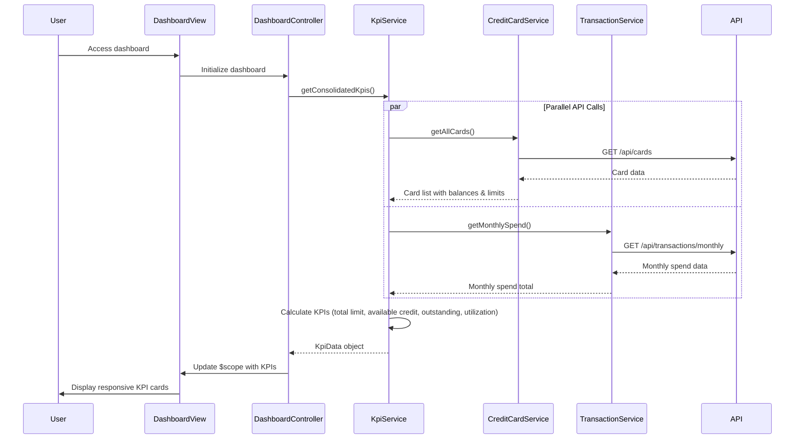

# Low-Level Design: QE-8560 - Dashboard and KPI Management

## a. Architecture Mapping

- **AngularJS Module**: `dashboardKpi` - Main module for dashboard feature
- **Controller**: `DashboardController` - Manages dashboard state and KPI display logic
- **Service**: `KpiService` - Aggregates and calculates KPIs from backend services
- **Service**: `CreditCardService` - Fetches card balances and credit limits
- **Service**: `TransactionService` - Retrieves monthly spend aggregates
- **Directive**: `kpiCard` - Reusable component for displaying individual KPI metrics
- **Factory**: `DataRefreshFactory` - Manages real-time/near-real-time data refresh logic

**Folder Structure:**
```
/app
  /modules
    /dashboard
      /controllers
        dashboard.controller.js
      /services
        kpi.service.js
        credit-card.service.js
        transaction.service.js
      /directives
        kpi-card.directive.js
      /factories
        data-refresh.factory.js
      /views
        dashboard.html
      dashboard.module.js
```

## b. Component Specifications

| Name | Artifact Type | Responsibility | Key Dependencies |
|------|---------------|----------------|------------------|
| dashboardKpi | Module | Root module for dashboard and KPI management | ngRoute, ngResource |
| DashboardController | Controller | Orchestrates KPI data loading and manages dashboard view state | KpiService, DataRefreshFactory, $scope, $interval |
| KpiService | Service | Aggregates data from multiple services to calculate consolidated KPIs | CreditCardService, TransactionService, $http, $q |
| CreditCardService | Service | Fetches card balances, limits, and outstanding amounts via REST API | $http, $q |
| TransactionService | Service | Retrieves monthly spend totals from backend | $http, $q |
| kpiCard | Directive | Renders individual KPI with responsive layout and styling | $filter |
| DataRefreshFactory | Factory | Implements polling or event-driven refresh mechanism for near-real-time updates | $interval, $timeout |

## c. Data Model

**KpiData Model:**
```javascript
{
  monthlySpend: Number,
  totalCreditLimit: Number,
  availableCredit: Number,
  outstandingAmount: Number,
  utilizationPercentage: Number,
  lastUpdated: Date
}
```

**CreditCard Model:**
```javascript
{
  cardId: Number,
  cardNumber: String,
  creditLimit: Number,
  currentBalance: Number,
  availableCredit: Number
}
```

**MonthlySpend Model:**
```javascript
{
  month: String,
  totalSpend: Number,
  cardBreakdown: Array<{cardId: Number, amount: Number}>
}
```

## d. Data Flow

User accesses dashboard → DashboardController initializes and calls KpiService.getConsolidatedKpis() → KpiService concurrently invokes CreditCardService.getAllCards() and TransactionService.getMonthlySpend() using $q.all() → CreditCardService fetches card data from GET /api/cards endpoint → TransactionService fetches spend data from GET /api/transactions/monthly endpoint → KpiService aggregates responses to calculate total credit limit, available credit, outstanding amount, and monthly spend → Calculated KPIs returned to controller → Controller updates $scope with KPI data → kpiCard directives render responsive KPI widgets → DataRefreshFactory polls backend every 30 seconds to refresh KPIs and updates view automatically.

## e. Primary Sequence Diagram



## f. Implementation Notes

- Use AngularJS $q.all() for parallel API calls to minimize page load time; aggregate results in KpiService
- Implement DataRefreshFactory with $interval for 30-second polling; cancel interval on $scope.$destroy to prevent memory leaks
- Use Bootstrap grid system for responsive layout; kpiCard directive adapts to xs/sm/md/lg breakpoints
- Apply ES6 template literals for dynamic API endpoint construction; use const/let for variable declarations
- Cache KPI data in service layer using simple object storage; invalidate cache on refresh

## g. Error Handling

HTTP interceptor-based error handling with fallback to cached data; user notified via inline alert on dashboard with retry button.

## h. Security Notes

Requires token-based auth via existing SSO; all API calls include Authorization header with JWT token.