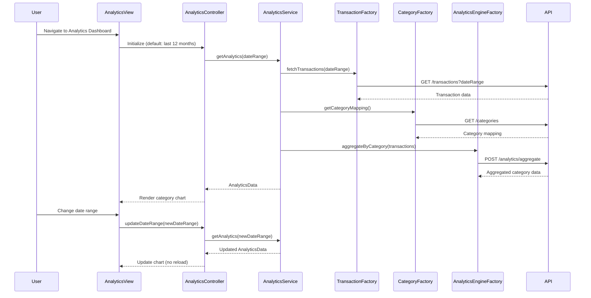

# Low-Level Design: Spending Analytics and Insights
**Epic ID:** QE-8561  
**Feature:** CreditCardNew20261109190012-Spending Analytics and Insights

---

## a. Architecture Mapping

- **Analytics UI Component** → AngularJS Module (`creditCard.analytics`) + Controller (`AnalyticsController`) + View Templates
- **Analytics Service** → AngularJS Service (`AnalyticsService`) for data aggregation and filtering logic
- **Transaction Service Integration** → AngularJS Factory (`TransactionFactory`) for transaction data retrieval
- **Category Classification Service Integration** → AngularJS Factory (`CategoryFactory`) for category data
- **Analytics Engine Integration** → AngularJS Factory (`AnalyticsEngineFactory`) for aggregated insights

**Recommended Folder Structure:**
```
/app
  /modules
    /analytics
      /controllers (AnalyticsController.js)
      /services (AnalyticsService.js)
      /factories (TransactionFactory.js, CategoryFactory.js, AnalyticsEngineFactory.js)
      /directives (categoryChart.directive.js, dateRangeFilter.directive.js)
      /views (analytics-dashboard.html)
      analytics.module.js
```

---

## b. Component Specifications

| Component Name | Artifact Type | Responsibility | Key Dependencies |
|---|---|---|---|
| `creditCard.analytics` | Module | Root module for analytics and insights feature | `ngRoute`, `chart.js` |
| `AnalyticsController` | Controller | Manages analytics view state, date filtering, chart data | `AnalyticsService`, `$scope` |
| `AnalyticsService` | Service | Orchestrates data retrieval, aggregation, and filtering | `TransactionFactory`, `CategoryFactory`, `AnalyticsEngineFactory` |
| `TransactionFactory` | Factory | REST API calls to Transaction Service | `$http`, `API_CONFIG` |
| `CategoryFactory` | Factory | REST API calls to Category Classification Service | `$http`, `API_CONFIG` |
| `AnalyticsEngineFactory` | Factory | REST API calls to Analytics Engine for aggregated data | `$http`, `API_CONFIG` |
| `categoryChart` | Directive | Renders interactive category-wise spending chart | `chart.js` |
| `dateRangeFilter` | Directive | Date range picker for filtering analytics | `angular-daterangepicker` |

---

## c. Data Model

**CategorySpending Model:**
```javascript
{
  category: String, // 'Food & Dining', 'Fuel', 'Shopping', etc.
  totalAmount: Number,
  transactionCount: Number,
  percentageOfTotal: Number
}
```

**AnalyticsData Model:**
```javascript
{
  dateRange: {startDate: Date, endDate: Date},
  categoryBreakdown: Array<CategorySpending>,
  totalSpending: Number,
  topCategory: String
}
```

---

## d. Data Flow

User accesses analytics dashboard; `AnalyticsController` invokes `AnalyticsService.getAnalytics(dateRange)`, which calls `TransactionFactory.fetchTransactions(dateRange)` to retrieve transaction data, `CategoryFactory.getCategoryMapping()` for category classification, and `AnalyticsEngineFactory.aggregateByCategory(transactions)` to compute category-wise spending via REST APIs. Aggregated `AnalyticsData` is returned to the controller and rendered using `categoryChart` directive. User adjusts date range via `dateRangeFilter` directive; controller re-invokes `AnalyticsService.getAnalytics(newDateRange)` without page reload, updating chart interactively.

---

## e. Primary Sequence Diagram



---

## f. Implementation Notes

- Use AngularJS DI for all services, factories, and controllers; configure API endpoints in module's `.constant()` block.
- Implement client-side filtering in `AnalyticsService` to avoid redundant API calls when toggling between cached date ranges.
- Use `$http` interceptors for error handling and loading indicators during data fetch.
- Integrate Chart.js via `categoryChart` directive with two-way binding for interactive filtering without page reload.
- Default date range to last 12 months; store user's last selected range in `$sessionStorage` for persistence across navigation.

---

## g. Error Handling

HTTP interceptor-based error handling with user notification via Bootstrap alerts; try/catch in service layer for data aggregation exceptions.

---

## h. Security Notes

Standard input validation and secure API calls assumed; date range inputs sanitized to prevent injection attacks.

---