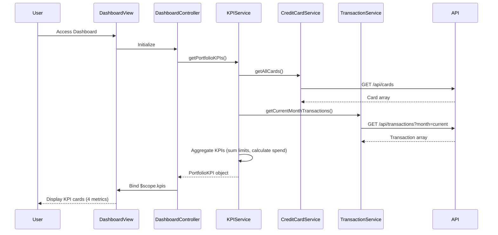

# Low-Level Design: QE-8562 - Dashboard KPIs and Credit Card Overview

## a. Architecture Mapping

- **App Module**: `creditCardApp` - Root AngularJS module with routing configuration
- **Dashboard Controller**: `DashboardController` - Orchestrates dashboard view, binds KPI data, handles refresh
- **KPI Service**: `KPIService` (Factory) - Aggregates card and transaction data, calculates portfolio KPIs
- **Credit Card Service**: `CreditCardService` (Factory) - REST API wrapper for card details, balances, limits
- **Transaction Service**: `TransactionService` (Factory) - REST API wrapper for transaction data
- **KPI Card Directive**: `kpiCard` - Reusable component for rendering individual KPI metrics

**Recommended Folder Structure:**
```
app/
├── modules/
│   └── dashboard/
│       ├── controllers/
│       │   └── dashboard.controller.js
│       ├── services/
│       │   ├── kpi.service.js
│       │   ├── creditCard.service.js
│       │   └── transaction.service.js
│       ├── directives/
│       │   └── kpi-card.directive.js
│       └── views/
│           └── dashboard.html
├── shared/
└── app.module.js
```

## b. Component Specifications

| Component Name | Artifact Type | Responsibility | Key Dependencies |
|----------------|---------------|----------------|------------------|
| DashboardController | Controller | Initialize dashboard, bind KPI data to view, trigger refresh | KPIService, $scope, $interval |
| KPIService | Factory | Fetch and aggregate multi-card data, calculate portfolio-level KPIs | CreditCardService, TransactionService, $q |
| CreditCardService | Factory | Fetch card details, balances, credit limits via REST API | $http, API_ENDPOINTS |
| TransactionService | Factory | Fetch transaction data, calculate monthly spend | $http, API_ENDPOINTS |
| kpiCard | Directive | Render KPI metric with icon, label, value, trend indicator | None |

## c. Data Model

**CreditCard Model:**
```javascript
{
  cardId: String,
  cardNumber: String (masked),
  cardType: String,
  creditLimit: Number,
  availableCredit: Number,
  outstandingAmount: Number,
  status: String
}
```

**PortfolioKPI Model:**
```javascript
{
  monthlySpend: Number,
  totalCreditLimit: Number,
  totalAvailableCredit: Number,
  totalOutstanding: Number,
  cardCount: Number,
  lastUpdated: Date
}
```

## d. Data Flow

User navigates to dashboard → DashboardController initializes → calls KPIService.getPortfolioKPIs() → KPIService uses $q.all() to concurrently fetch user's cards via CreditCardService.getAllCards() and current month transactions via TransactionService.getCurrentMonthTransactions() → aggregates results: sums credit limits, available credit, outstanding amounts across all cards; calculates monthly spend from transaction totals → returns PortfolioKPI object → controller binds to $scope.kpis → view renders four KPI cards using kpiCard directive (monthly spend, total credit limit, available credit, outstanding amount) → $interval triggers auto-refresh every 30 seconds by re-invoking KPIService.getPortfolioKPIs().

## e. Primary Sequence Diagram



## f. Implementation Notes

- Use AngularJS Factory pattern for services to ensure singleton instances and testability
- Leverage $q.all() for parallel API calls to minimize dashboard load time
- Implement $http interceptor for automatic JWT token injection and centralized error handling
- Use Bootstrap grid (col-lg-3, col-md-6, col-sm-12) for responsive KPI card layout across devices
- Apply $interval with $scope.$on('$destroy') cleanup to prevent memory leaks from auto-refresh

## g. Error Handling

HTTP interceptor captures all API errors, displays user-friendly notifications via toast service, and logs errors; service methods return rejected promises with error details.

## h. Security Notes

Requires token-based auth via existing SSO; all API requests include Authorization header with JWT token managed by HTTP interceptor.